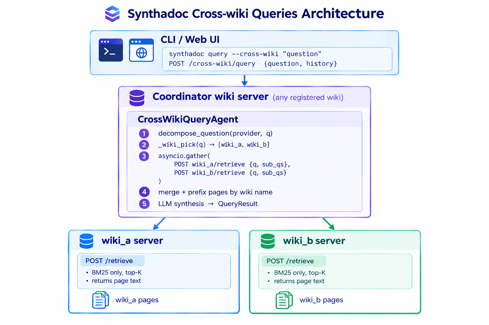

# Synthadoc — Design Document

**Version:** 1.5.0
**Audience:** Product users who want to understand how the system works; developers adding features, skills, and plugins.

**Document owners:** Paul Chen, William Johnason

---

## Table of Contents

1. [Overview](#1-overview)
2. [Core Concepts](#2-core-concepts)
3. [System Architecture](#3-system-architecture)
4. [Agents](#4-agents)
5. [Skills System](#5-skills-system)
6. [Storage](#6-storage)
7. [HTTP API](#7-http-api)
8. [Obsidian Plugin](#8-obsidian-plugin)
9. [CLI](#9-cli)
10. [Configuration](#10-configuration)
11. [Hook System](#11-hook-system)
12. [Cache System](#12-cache-system)
13. [Cost Guard](#13-cost-guard)
14. [Job Queue](#14-job-queue)
15. [Observability and Logging](#15-observability-and-logging)
16. [Security](#16-security)
17. [Plugin Development Guide](#17-plugin-development-guide)
18. [Routing](#18-routing)
19. [Candidates Staging](#19-candidates-staging)
20. [Context Packs](#20-context-packs)
21. [Adversarial Review](#21-adversarial-review)
22. [Claim-Level Provenance](#22-claim-level-provenance)
23. [Lifecycle Machine](#23-lifecycle-machine)
24. [Export Formats](#24-export-formats)
25. [Streaming Query and Query Cache](#25-streaming-query-and-query-cache)
26. [Web Chat UI and Session Management](#26-web-chat-ui-and-session-management)
27. [MCP Server](#27-mcp-server)
28. [Backup & Restore](#28-backup--restore)
29. [Pre-LLM Source Sanitizer](#29-pre-llm-source-sanitizer)
30. [Per-Source Truncation Flag](#30-per-source-truncation-flag)
31. [Proportional Context Budget](#31-proportional-context-budget)
32. [Knowledge Graph](#32-knowledge-graph)
33. [Multi-Platform Agent Skill Files](#33-multi-platform-agent-skill-files)
34. [Synthadoc Scaffold Marker](#34-synthadoc-scaffold-marker)
35. [Contradiction Resolver Workflow](#35-contradiction-resolver-workflow)
36. [Orphan Resolver Workflow](#36-orphan-resolver-workflow)
37. [Citation Faithfulness Audit](#37-citation-faithfulness-audit)
38. [Sensitive Data Retract](#38-sensitive-data-retract)
39. [Broken Citation Resolver Workflow](#39-broken-citation-resolver-workflow)
40. [Content Health Resolver Workflow (v1.4.2)](#40-content-health-resolver-workflow)
41. [Cross-Wiki Queries (v1.4.0)](#41-cross-wiki-queries-v140)
42. [Docker Deployment (v1.4.2)](#42-docker-deployment)
43. [Scoped Edit Confirm](#43-scoped-edit-confirm)

**Appendices**

- [Appendix A — Release Feature Index](#appendix-a--release-feature-index)

---

## 1. Overview

Synthadoc is a **domain-agnostic LLM knowledge compilation engine**. It reads raw source documents and uses an LLM to synthesize them into a persistent structured wiki. Knowledge is compiled at **ingest time** — not at query time. The compiled wiki lives as plain Markdown files that are readable and editable without any tool running.

**Key design principles:**

- **Ingest-time compilation** — synthesis, cross-referencing, and contradiction detection happen once per source, not on every query.
- **Local-first** — all data stays on disk; the server binds only to `127.0.0.1`.
- **Obsidian-native** — wiki pages are valid Obsidian notes with `[[wikilinks]]`, YAML frontmatter, and Dataview compatibility.
- **Layered access** — CLI, HTTP REST API, and MCP server expose the same operations; the agent and storage logic is shared. The MCP layer positions Synthadoc as persistent domain memory: an AI client (Claude Desktop, Claude Code) acts as the reasoning brain while Synthadoc handles BM25 search, lifecycle, and the immutable audit trail.
- **Extensible by design** — skills (file formats) and providers (LLM backends) are loaded as plugins; no core changes needed to add either.

---

## 2. Core Concepts

### Wiki

A self-contained knowledge base rooted at a filesystem directory. Contains:

```
my-wiki/
  wiki/               ← compiled Markdown pages
  raw_sources/        ← original source documents
  hooks/              ← wiki-specific hook scripts
  AGENTS.md           ← LLM instructions for Codex CLI, OpenCode, and generic OpenAI agents
  CLAUDE.md           ← same content as AGENTS.md; loaded automatically by Claude Code
  GEMINI.md           ← same content as AGENTS.md; loaded automatically by Gemini CLI
  log.md              ← human-readable activity log
  .synthadoc/
    config.toml       ← per-project configuration
    audit.db          ← immutable audit trail
    jobs.db           ← job queue
    cache.db          ← LLM response cache
    embeddings.db     ← BM25 + vector search index
    extracted/        ← plain-text sidecars for ingested local sources (v0.5.0)
      report.txt      ← extracted text for report.pdf (or .docx, .xlsx, etc.)
      report.pdf.pagemap.json  ← PDF page-boundary map (PDF sources only)
    logs/
      synthadoc.log   ← rotating JSON-lines operational log
      traces.jsonl    ← OpenTelemetry traces
```

### Wiki Page

A Markdown file in `wiki/` with YAML frontmatter:

```yaml
---
title: Alan Turing
tags: [computer-science, cryptography, turing-test]
type: person            # OKF knowledge type — set by IngestAgent during compilation
status: active          # active | contradicted | archived
confidence: high        # high | medium | low
created: '2026-04-10'
resource: https://example.com/turing-bio  # OKF primary source URL (URL sources only)
sources:
  - file: turing-biography.pdf
    hash: sha256:abc123…
    size: 204800
    ingested: '2026-04-10'
---

# Alan Turing

Content with [[wikilinks]] to related pages…
```

**`type` values** _(added in v0.9.0, OKF-required field)_: `concept` (default), `person`, `organization`, `technology`, `event`, `location`, `product`. Set automatically by IngestAgent during the analysis pass; absent on pages ingested before v0.9.0.

**`resource`** _(added in v0.9.0, OKF-optional field)_: the primary source URL for pages ingested from a URL source. Absent for local file sources and pre-v0.9.0 pages.

`resource` and `sources` are complementary, not duplicates:


|                    | `resource`                                                                | `sources`                                                                |
| ------------------ | ------------------------------------------------------------------------- | ------------------------------------------------------------------------ |
| Purpose            | OKF external citation — one clean URL for agents and humans to follow    | Synthadoc internal provenance — full audit record per contributing file |
| Cardinality        | Single string (or absent)                                                 | Array — grows as more files are ingested into the same page             |
| Contents           | URL only                                                                  | File path, SHA-256 hash, byte size, ingestion timestamp                  |
| Used for           | OKF compatibility; agent consumption without Synthadoc-specific knowledge | Dedup, stale detection, cost audit trail                                 |
| Local file sources | Absent                                                                    | Present (file path + hash)                                               |
| URL sources        | Set to the source URL                                                     | Also present (URL + hash of URL string)                                  |

**`status` values:**


| Value          | Meaning                                                 |
| -------------- | ------------------------------------------------------- |
| `draft`        | Newly compiled — not yet lint-reviewed                 |
| `active`       | Lint-reviewed, current, trusted                         |
| `contradicted` | A new source conflicts with this page; needs resolution |
| `stale`        | Source file changed since last ingest                   |
| `archived`     | Source removed or manually retired                      |

New pages are created with `status: draft`. Lint promotes them to `active` automatically when all checks pass. See [§23 Lifecycle Machine](#23-lifecycle-machine) for full transition rules.

**`lint_warnings`** _(added in v0.5.0)_ — list of adversarial review findings written to frontmatter after each lint run:

```yaml
lint_warnings:
  - claim: "Saved over fourteen million lives."
    concern: "This specific figure lacks scholarly consensus…"
```

Cleared automatically when `--no-adversarial` is passed to `lint run`.

### Job

Every ingest, lint, and scheduled operation runs as a job:

```
pending → in_progress → completed
                      → failed
                      → dead
                      → skipped
pending → cancelled
```

Jobs persist across server restarts. See [§14 Job Queue](#14-job-queue) for full state transition rules, retry backoff, and status descriptions.

### Slug

The filename without extension, derived from the page title. ASCII-safe and CJK-aware:

- Lowercase, hyphens for separators
- Unicode accents decomposed (NFKD)
- CJK characters (Chinese, Japanese, Korean) preserved as-is
- Slug blacklist blocks reserved words (`wiki`, `obsidian`, `index`, `dashboard`, `wikilinks`)
- Collisions resolved by appending `-2`, `-3`, etc.

---

## 3. System Architecture

### Component Map


### Request lifecycle (ingest via CLI)

1. `synthadoc ingest report.pdf -w my-wiki`
2. CLI posts `POST /jobs/ingest {source: "report.pdf"}` to `localhost:7070`
3. HTTP server validates path, writes job to `jobs.db` with status `pending`, returns `{job_id}`
4. Background worker picks up job within 2 seconds
5. Orchestrator instantiates IngestAgent
6. SkillAgent detects `.pdf`, lazy-loads `PdfSkill`, extracts text
7. IngestAgent Step 1 — Analysis: `_analyse()` extracts entities, tags, and a 3-sentence summary (cached under key `analyse-v1`)
8. IngestAgent Step 2 — Decision: LLM reads the full source text (bounded by `max_source_chars`) + BM25-retrieved candidate pages + `purpose.md` scope, decides per-page action (`create` / `update` / `flag` / `skip`). Pages with `status='active'` are protected — sources that conflict with them trigger `flag` rather than `update` (RULE 1b).
9. IngestAgent Step 3 — Write: applies actions; updates frontmatter; writes `[[wikilinks]]`; fires hooks
10. IngestAgent Step 4 — Overview: if any pages were created or updated, regenerates `wiki/overview.md`
11. Orchestrator calls `_guard_ingest_cost()` on the returned cost: soft warn → `logger.warning` only; hard gate → `cost_gate_exceeded` audit event + `fail_permanent` (job → DEAD). On success, job transitions to `completed`; `log.md` updated; `audit.db` record written

---

## 4. Agents

All agents are async Python classes. They receive a job context, write results to storage, and return a summary. Agents never call each other directly — they are dispatched by the Orchestrator.

### IngestAgent

Five-pass pipeline:


| Pass                                               | Model        | Purpose                                                                                                                                                                                                                                                                                                                                                                                                                                                                                                                                                                                                                                                                                                   |
| -------------------------------------------------- | ------------ | --------------------------------------------------------------------------------------------------------------------------------------------------------------------------------------------------------------------------------------------------------------------------------------------------------------------------------------------------------------------------------------------------------------------------------------------------------------------------------------------------------------------------------------------------------------------------------------------------------------------------------------------------------------------------------------------------------- |
| 0 — Vision (optional)                             | Default      | Extract text from image sources (`is_image=True`); requires a vision-capable provider                                                                                                                                                                                                                                                                                                                                                                                                                                                                                                                                                                                                                     |
| 0b — Key Data Extraction                          | None (regex) | Deterministic pre-processor: extracts numbers, percentages, currency amounts, ratios, formulas, underscore identifiers, and date ranges from source text via regex; appends them as a`[Key Data — extracted by pre-processor]` section before any LLM sees the text. Zero token cost; cannot hallucinate. Anchors the synthesis LLM to all quantitative candidates.                                                                                                                                                                                                                                                                                                                                      |
| 1 — Analysis (`_analyse()`)                       | Default      | Extract entities, tags, and a 3-sentence summary from raw text. Result cached under key`analyse-v1` keyed by SHA-256 of the text.                                                                                                                                                                                                                                                                                                                                                                                                                                                                                                                                                                         |
| 2 — Candidate search                              | None (BM25)  | Find existing wiki pages related to extracted entities                                                                                                                                                                                                                                                                                                                                                                                                                                                                                                                                                                                                                                                    |
| 3 — Decision                                      | Default      | LLM reads the full source text (bounded by`max_source_chars`) + BM25 candidates (with each candidate's `##` headings, so an `update` reuses an existing heading instead of inventing a variant) + `purpose.md` scope + status of each candidate page. Outputs per-page action: `create`, `update`, `flag`, `skip`. **RULE 1b:** a page with `status='active'` is human-reviewed and authoritative — when the source provides a conflicting value, date, formula, or conclusion, the action must be `flag`, not `update`. The only exception is a source that adds a topic the page does not yet mention at all. Decision cache version: `v2`.                                                                                                                                                                            |
| 4 — Citation annotation (`_annotate_citations()`) | Default      | For each page section being written, the LLM reads the section alongside the numbered source text and inserts`^[filename:L-L]` inline citation markers at the end of substantive paragraphs. Results cached by section SHA-256. Falls back gracefully (returns original section) on any LLM or parse failure — ingest always completes. Citations are recorded in `audit.db` `claim_citations` table. If no citation markers are present in the returned body, a `citation_pass4_no_markers` WARNING audit event is written — the page is still saved but the condition is flagged for re-ingest with a more capable model. Zero-citation results are not cached so a subsequent re-ingest can succeed. |
| 5 — Write                                         | None         | Apply actions; update frontmatter; write`[[wikilinks]]`; fire hooks. For local sources, writes a `.txt` sidecar to `.synthadoc/extracted/` (all file types) and a pagemap JSON sidecar when PDF page boundaries are available.                                                                                                                                                                                                                                                                                                                                                                                                                                                                            |
| 6 — Overview                                      | Default      | Regenerate`wiki/overview.md` if any pages were created or updated                                                                                                                                                                                                                                                                                                                                                                                                                                                                                                                                                                                                                                         |

**Analysis caching:** The analysis step is expensive (full text read + LLM call). Results are cached in `cache.db` by text SHA-256. Subsequent ingests of the same source (e.g. after a `--force` that hits the decision cache miss) re-use the analysis result without a new LLM call.

**purpose.md scope filtering:** IngestAgent reads `wiki/purpose.md` at init. Its content is prepended to the decision prompt. The LLM can respond with `action="skip"` when the source is clearly outside the wiki's stated scope. If `purpose.md` is absent, all sources are accepted.

**overview.md auto-maintenance:** After any ingest that creates or updates pages, IngestAgent calls `_update_overview()`, which reads the 10 most-recently-modified wiki pages and asks the LLM to write a 2-paragraph overview of the entire wiki. The result is saved to `wiki/overview.md` with `status: auto` frontmatter. This page is excluded from contradiction detection and orphan checks.

**Web search fan-out:** When a source is routed to the `web_search` skill, `ExtractedContent.metadata["child_sources"]` contains the top result URLs. IngestAgent detects this and returns early with the URL list; the Orchestrator enqueues each URL as a separate ingest job. This keeps the web search skill stateless and the queue the single source of work.

**Deduplication:** Every source tracked by SHA-256 in `audit.db`. Hash match → skip. Use `--force` to bypass.

**Slug derivation:**

```python
def _slugify(title: str) -> str:
    normalized = unicodedata.normalize("NFKD", title)
    slug = re.sub(
        r"[^a-z0-9\u4e00-\u9fff\u3040-\u309f\u30a0-\u30ff\uac00-\ud7af]+",
        "-", normalized.lower(),
    ).strip("-")
    return slug or "page-" + hashlib.md5(title.encode()).hexdigest()[:8]
```

**Contradiction flagging:** When Pass 3 returns `flag_contradiction`, the page's frontmatter is updated to `status: contradicted`, both the old claim and new conflicting claim are preserved with `⚠` markers and citations.

**CJK support:** Entity extraction falls back to CJK 2–6 char sequence regex when SpaCy is unavailable. `_slugify` preserves CJK characters. BM25 tokenizer handles CJK unigrams.

### QueryAgent

#### Query Decomposition

**Pipeline:**

```
Question
 → Call 1: decompose() — LLM splits question into 1–N sub-questions (cap=4)
   └─ on any LLM error: fall back to [question]          graceful degradation
 → parallel BM25 search per sub-question                 asyncio.gather()
 → merge candidates — best score wins per slug           deduplication
 → Call 2: LLM synthesises answer from merged context    unchanged from v0.1
 → record_query() in audit.db                            cost + history tracking
 → log_query() in activity log                           operator visibility
```

**Decomposition behaviour:**

- Simple questions decompose to a single sub-question — identical behaviour to v0.1
- Compound questions (e.g. "Who invented FORTRAN and what was the Bombe machine?") decompose into one sub-question per part — each part retrieved independently, pages merged before synthesis
- Comparative questions (e.g. "Compare Turing's contributions with Von Neumann's") retrieve both subjects in parallel
- The LLM returns a JSON array of strings. Markdown code fences (` ```json ``` `) are stripped before parsing — required for cross-model robustness (some providers wrap JSON in fences despite instructions)
- On any failure during decomposition (network error, invalid JSON, empty list, non-array response), the agent falls back silently to `[question]` — the query always completes

**BM25 corpus cache:** `HybridSearch` builds the BM25 corpus once per server session and caches it in memory (`_cached_corpus`). The cache is invalidated by `invalidate_index()` after every `write_page()` call in IngestAgent, so queries always see current wiki content without redundant disk reads.

**Lifecycle-aware corpus filter _(v1.3.0)_:** Only pages with `status: active` or `status: stale` enter the BM25 index. Pages with `status: contradicted`, `status: archived`, or `status: draft` are excluded at corpus build time. This ensures that pages flagged as conflicted or not yet reviewed do not contribute candidates to query answers. The constant `_QUERY_STATES = frozenset({"active", "stale"})` in `storage/search.py` is the single source of truth for which states participate in retrieval.

#### Knowledge Gap Workflow

After the BM25 merge step, a knowledge gap is detected when ANY of three independent signals fire (gap is skipped when `gap_score_threshold = 0`):

1. `len(candidates) < 3` — wiki has almost nothing on the topic. **Suppressed when TF fallback was used** (a small corpus with broad coverage may legitimately return fewer than 3 candidates — that is expected, not a gap).
2. `max_score < gap_score_threshold` (default: `2.0`, configurable via `[query] gap_score_threshold` in `config.toml`) — low keyword overlap
3. Fewer than 2 candidates contain any key noun from the question with sufficient frequency — corpus-relative BM25 scores can be inflated by shared vocabulary; this content-overlap check catches off-topic matches

Signals 4–7 check each key term of the (decomposed) question against the candidate pages. A page is *on topic* when it contains a specific term at least twice, matched as the exact word. Signal 5 asks whether every specific term is covered in depth by at least one page; there a term also matches its word family — common endings (`-ing`, `-er(s)`, `-ion(s)`, `-ation(s)`, `-ed`) are stripped when at least 5 letters remain — so a page that says "codebreaking" covers "codebreakers". The family match is kept out of the on-topic count, where "container" → "contain" would make every page that says "contains" look on topic. On the top 3 candidates, one mention covers a term when that page contains every specific term of the question: exact names and numbers ("OARnet", "1656") usually appear once, on exactly the right page, while a passing mention on a page about something else ("quantum" on a page without "error correction") still leaves a gap. On the retrieval benchmark this cut false gap alarms on exact-name questions whose page was found from 36% to 3.5%, at the cost of 4 of 499 simulated real gaps (labelled page removed). When the check fires, the signals that fired are logged at debug level (`gap signals fired: [...]`). With semantic search on, only candidates with a BM25 score above 0 are considered: a page found only by the embedding search is not keyword evidence.

When a gap fires:

1. `SearchDecomposeAgent.decompose(question)` is called to generate 1–4 focused keyword search strings
2. `QueryResult.knowledge_gap = True` and `QueryResult.suggested_searches = [...]` are set
3. The CLI appends a `[!tip] Knowledge Gap Detected` Obsidian callout with:
   - Obsidian Command Palette path (primary)
   - `synthadoc ingest "search for: ..."` terminal commands (with `-w`)
4. The API response includes `knowledge_gap` and `suggested_searches` fields
5. The Obsidian `QueryModal` renders the same callout using `MarkdownRenderer.render()`

When no gap is detected, `suggested_searches` is `[]` and no callout is shown.

**After the answer is written,** the LLM's own verdict is checked. In gap mode the prompt tells the LLM to use the wiki pages *and* general knowledge, and to start its reply with `[GAP]` on its own line only if the pages do not answer the question. When the reply starts with `[GAP]`, the gap stands (outside gap mode this is Guard B, which turns a missed gap on). Otherwise Guard C cancels a pre-synthesis gap when the answer is substantial and cited: over 300 characters with two or more `[[...]]` citations, or over 800 characters with one. Guard C used to run even when the LLM had declared `[GAP]`, so a long general-knowledge answer with one passing citation ("quantum error correction", citing the quantum computing page once) hid a real gap. `[GAP]` is never shown: a leading `[GAP]` line is not streamed, and it is stripped from the final text.

---

### Web Search Decomposition (v0.2.0)

> **Note:** Implementation is in `docs/plans/web-search-decomposition-v0.2.md`. This section describes the delivered behavior.

**Motivation:** The v0.1 web search feature (`synthadoc ingest "search for: <topic>"`) fired a single Tavily API call for the entire input phrase. Decomposing the search intent into multiple focused keyword queries before fetching produces richer, more targeted pages — each sub-query targets a different aspect of the topic.

**Pipeline:**

```
User input: "search for: yard gardening in Canadian climate zones"
 → IngestAgent detects web_search skill
 → strip intent prefix → "yard gardening in Canadian climate zones"
 → SearchDecomposeAgent.decompose() — LLM returns terse keyword strings
   e.g. ["Canada hardiness zones map",
         "planting guide by province Canada",
         "frost dates Canadian cities"]
 → asyncio.gather() — N parallel Tavily API calls
 → deduplicate URLs across results (first-seen wins, order preserved)
 → merged child_sources → existing fan-out unchanged
```

**Key design decisions:**

- Uses a **separate prompt** from `QueryAgent.decompose()` — query decomposition asks "what distinct *questions* does this ask?" (natural-language sub-questions) while search decomposition asks "what distinct *search strings* would find the best authoritative sources?" (terse keyword phrases). The outputs are fundamentally different — they must not share a prompt.
- Implemented as `SearchDecomposeAgent` in `synthadoc/agents/search_decompose_agent.py` — kept separate to avoid coupling the two decomposition strategies.
- Cap: 4 search strings maximum — prevents runaway Tavily API spend.
- Fallback: if LLM call fails, JSON is invalid, or all entries are whitespace, use the original phrase as a single search query — the ingest always completes.

### Semantic Search

> **On by default for new wikis when installed.** New wikis are created with `vector = "auto"`: semantic search runs whenever fastembed is installed (the Docker image includes it), and BM25 alone otherwise. BM25 needs no extra dependencies.

**Installation:**

```bash
pip install "synthadoc[vectors]"     # adds fastembed
```

**Config:**

```toml
[search]
vector = "auto"              # template default: on when fastembed is installed; true = always; false = BM25 only
vector_top_candidates = 20   # candidates taken from each of BM25 and the embedding search
```

`true` logs a warning when fastembed is missing; `"auto"` treats a missing
fastembed as the normal BM25 setup and logs it at info level. With `vector = false`
and fastembed installed (as in the Docker image), startup logs one info line saying
how to turn semantic search on; nothing switches on by itself.

**Default:** the `synthadoc init` template writes `vector = "auto"`. Wikis created
before that have `vector = false` written in their config (every template since
v0.2.0 wrote it) and keep it: existing configs are never rewritten. The built-in
default for a config with no `vector` line is still `false`. The switch followed
two independent English corpora with human-written queries (SciFact, NFCorpus:
fusion better on every measure) and a Chinese corpus (DuRetrieval: the English
model hurt, which the CJK handling below removes); see
[benchmarks/retrieval](../benchmarks/retrieval/README.md).

**Chinese, Japanese and Korean:** `vector = "auto"` detects language and selects the right strategy automatically — no configuration needed for a mixed-language wiki. The embedding model is English-only, so the system routes each page and query accordingly: during sync, a page whose embedded text is mostly CJK (CJK characters ≥ 30% of its letters, `is_mostly_cjk()`) is not embedded and stays searchable by BM25 only; a page that becomes mostly CJK loses its stored embedding. A query containing any CJK character is answered by BM25 alone, and the query agent also translates it to English and searches both — the translation finds English pages (with embeddings), the original finds CJK pages (with BM25), and the results are merged. A mixed wiki therefore gets semantic search over its English pages and BM25 over all pages. An English question cannot retrieve a page written entirely in Chinese — no keyword overlap and no embedding bridge. Add an English summary or English tags to the page if cross-lingual retrieval in that direction matters.

**Embedding model:** `BAAI/bge-small-en-v1.5` (~65 MB), run locally by `fastembed` — it works with every LLM provider, including the CLI providers. Downloaded once on the first server start with vectors on, as five plain files in `~/.synthadoc/models/bge-small-en-v1.5/` (override the parent folder with `FASTEMBED_CACHE_PATH`; the Docker image ships with it built in). It is fetched with `huggingface_hub.snapshot_download(local_dir=…)` and loaded with fastembed's `specific_model_path`, not fastembed's own download: that keeps the Hugging Face cache layout, which needs symlinks, and Windows refuses those without Developer Mode or admin rights (WinError 1314). A copy already in that layout (from earlier versions) is reused.

**What is embedded:** each page's title, tags and the first 512 characters of its text — one embedding per page. Section-level embeddings (one per heading) were benchmarked and rejected: on their own they rank better, but fused with BM25 they did worse — they mostly find the pages BM25 already finds — and took ~20x longer to compute.

**Search flow (`HybridSearch.hybrid_search`, when vectors are on):**

1. BM25 takes its top `vector_top_candidates` pages (default 20).
2. The query is embedded and compared with every page embedding in memory; the top `vector_top_candidates` pages by similarity are taken, over the same scope (routing scope, query lifecycle states).
3. The two rankings are merged with **reciprocal rank fusion** — each page scores `1 / (60 + rank)` in each list it appears in — so a page either method finds can surface, and a page high in both wins.
4. **Keyword pin:** when BM25's best score is at least 1.05× its second, BM25's top hit stays on top. A dominant keyword match is almost always an exact name or term, and re-ordering it by meaning would lose it. Only the top hit is pinned: at 1.05× the pin fires on 53% of paraphrased questions, and BM25's second and third results were the labelled page for at most 6% of the questions it fired on. Pinning the top 3 (the first release) cost paraphrase recall@5 (0.699 → 0.676) for 3 of 499 exact-name lookups, and was no better on any held-out corpus.

Each `SearchResult` keeps `score` as the BM25 score (0 for a page only the embedding search found), so the knowledge-gap signals and the routing-scope fallback keep their BM25 meaning; `rank_score` is the fused ordering key and `similarity` the embedding similarity. Callers merge sub-question searches with `merge_results()`, which orders by `rank_score`. Ingest's page matching stays on BM25.

**Sync:** embeddings live in `embeddings.db` (`page_embeddings` table: one vector per page plus a hash of the text it was embedded from) and in memory as one matrix. A background sync embeds new and changed pages and drops pages that left the query corpus: at server start, after every ingest, and on the next search after any page write (`invalidate_index()`). Until the first sync finishes, search is BM25 only — no downtime. A failed sync (e.g. the model cannot be downloaded) is logged and search stays on BM25.

**Measured:** see [benchmarks/retrieval](../benchmarks/retrieval/README.md). On a 1,985-page Wikipedia-derived wiki, fusion with the keyword pin raises paraphrased-question recall@5 from 0.48 to 0.70 and all questions from 0.84 to 0.90; own-words questions are unchanged and exact-name lookups are 1.6 points under BM25 (0.978 vs 0.994).

**Performance notes:**

- The first sync embeds every page — a few minutes of CPU for a couple of thousand pages. Later syncs only embed pages whose text changed.
- A query adds one embedding of the query text (about 20 ms on CPU) and an in-memory matrix product (under 2 ms at 5,000 pages). The query embedding is started in a worker thread before BM25 runs, so the two overlap, and the last 256 query embeddings are kept (LRU, keyed by query text; an embedding depends only on the text and the model, so entries never go stale). P95 search latency on the 1,985-page benchmark wiki: 15 ms BM25, 62 ms fused (166 ms before the overlap).
- Set `vector = false` to revert to BM25-only at any time. Existing embeddings are not deleted.

---

### LintAgent

Runs against the entire wiki or a scoped subset:


| Check                                     | What it finds                                                                                                                                                                                                                                                                                             |
| ----------------------------------------- | --------------------------------------------------------------------------------------------------------------------------------------------------------------------------------------------------------------------------------------------------------------------------------------------------------- |
| Contradiction                             | Pages with`status: contradicted`                                                                                                                                                                                                                                                                          |
| Orphan                                    | Pages with zero inbound`[[wikilinks]]`                                                                                                                                                                                                                                                                    |
| Stale                                     | Pages whose`sources[]` entries no longer exist on disk                                                                                                                                                                                                                                                    |
| Missing link                              | Entity mentioned in page body but no wikilink created                                                                                                                                                                                                                                                     |
| Adversarial review_(v0.5.0)_              | Independent LLM pass that flags overstated claims, unsupported assertions, and high-confidence statements the source material does not support                                                                                                                                                            |
| Lifecycle — archived detection_(v0.6.0)_ | Source file no longer on disk → transition page to`archived`                                                                                                                                                                                                                                             |
| Lifecycle — stale detection_(v0.6.0)_    | SHA-256 hash of source on disk ≠ recorded ingest hash → transition page to`stale`                                                                                                                                                                                                                       |
| Lifecycle — draft promotion_(v0.6.0)_    | `draft` page with no active issues → transition to `active`                                                                                                                                                                                                                                              |
| Lifecycle — manual-edit sync_(v0.6.0)_   | Frontmatter`status` differs from `page_states` DB record → reconcile DB to match                                                                                                                                                                                                                         |
| Citation presence (Check 5b)              | Page body has ≥ 50 words and zero`^[filename:L-L]` citation markers → WARNING. Diagnostic only — does not block promotion to `active`. Indicates the annotation pass failed to produce markers, usually a model-compatibility issue (use Gemini 2.5 Flash or higher for reliable citation annotation). |

**Auto-resolution:** For contradictions, LintAgent asks the LLM to propose a resolution with a confidence score. If score ≥ `auto_resolve_confidence_threshold` (default 0.85), applies automatically. Below threshold, queues for human review.

**Index suggestion:** For orphan pages, LintAgent reads the page frontmatter and generates a ready-to-paste `wiki/index.md` entry: `- [[slug]] — tag1, tag2, tag3`.

**Orphan frontmatter sync:** After computing orphans, both `LintAgent.run()` (server-side, via `POST /jobs/lint`) and `synthadoc lint report` (CLI, offline) write `orphan: true` or `orphan: false` to each eligible page's YAML frontmatter. This keeps the Obsidian Dataview query (`WHERE orphan = true`) in sync with the computed orphan state without requiring the server to be running after `lint report`.

**Auto-generated page exclusions:** The pages `index`, `dashboard`, `overview`, `log`, and `purpose` are excluded from both orphan detection and contradiction checking. Links from these pages do not count as real inbound references — a page linked only from `overview.md` is still reported as an orphan. These pages are also never flagged as contradicted by the ingest pipeline.

**Adversarial review _(v0.5.0)_:** After structural checks complete, `LintAgent` runs an independent LLM review of every non-excluded page concurrently via `asyncio.gather()` — a 100-page wiki completes in wall-clock time equal to one call. The adversarial provider is configured via `[agents].adversarial` (falls back to `[agents].default` if absent); using a different model family from the ingest model reduces self-serving bias. Results are stored as `lint_warnings: [{claim, concern}]` in each page's YAML frontmatter. The cap is `adversarial_max_per_page` (default 2). Rate-limit failures are caught per-page and stored as non-fatal entries. Skipped entirely when `--no-adversarial` is passed to `lint run`; in that case, existing `lint_warnings` are cleared from all pages.

**Adversarial gate _(v1.3.0)_:** When `adversarial_gate_threshold` is set in `[lint]` of `config.toml`, any `active` or `stale` page that accumulates that many or more adversarial warnings during a lint run is automatically transitioned to `contradicted` at the end of the adversarial pass. The transition is recorded in the lifecycle audit trail with the reason `"auto-demoted: adversarial gate — N warning(s) ≥ threshold T"`. Pages already in `contradicted`, `archived`, or `draft` states are never affected by the gate. Setting the value to `0` or omitting the key entirely disables the gate. New wikis created with `synthadoc init` have the gate enabled at `2` by default. Existing wikis upgrading to v1.3.0 have the gate disabled until `adversarial_gate_threshold` is explicitly added to `config.toml`. The count of auto-demotions in each lint run is reported in `LintReport.adversarial_demotions` and shown in `synthadoc lint report`. Recommended values: `2` for general wikis (reliable across model families — gives a one-warning margin rather than requiring the LLM to hit its absolute cap), `1` for compliance-sensitive corpora.

### SkillAgent

Dispatches to the correct skill based on file extension, URL prefix, or intent keyword match. Manages 3-tier lazy loading. Returns `ExtractedContent` to IngestAgent.

When a source is a URL or an intent phrase (e.g. `search for: Dennis Ritchie`), IngestAgent skips the local file checks — there is no file to verify or hash. File-existence validation and SHA-256 dedup only apply to local file paths.

### ActionAgent

Dispatches action-intent queries from the chat UI (e.g. "activate a draft page", "show lint report", "archive a stale page", "run scaffold"). Parses the user's free-text intent into a structured action via an LLM extraction prompt, then executes the action against the wiki and returns a human-readable result. When the intent is ambiguous (e.g. "activate a page" without specifying which), sets `needs_clarification=True` and returns a prompt and candidate list for the web UI to render as chip buttons.

### ScaffoldAgent

Generates and updates the wiki's structural pages. Reads all current wiki pages and asks the LLM to organise them into 5–8 domain-appropriate categories, then writes `wiki/index.md` (category index with wikilinks), `wiki/purpose.md` (scope statement), and `AGENTS.md` (ingest and query guidelines). Also stamps a `categories:` field on each page's YAML frontmatter. When `ROUTING.md` already exists, regenerates it to stay in sync with the updated index structure.

### RewriteAgent

Rewrites follow-up questions in multi-turn conversations into self-contained, standalone form before BM25 retrieval. Converts context-dependent phrases ("What came after that?", "Tell me more about his early life") into explicit questions ("What came after Alan Turing's work at Bletchley Park?") so keyword retrieval targets the correct pages without relying on conversation context. Only invoked when conversation history is non-empty. See also: [Multi-turn Conversation](#multi-turn-conversation).

### SummarizeAgent

Compresses the oldest conversation turns into a single `[Session summary: …]` assistant turn when a session exceeds `conversation_history_turns`. Prevents unbounded context growth across long sessions. Emits a `notice` SSE event the first time compression occurs so the user can see that earlier context was condensed. See also: [Multi-turn Conversation](#multi-turn-conversation).

### ContextAgent

Builds token-budgeted context packs for MCP tool consumers. See [Section 20 — Context Packs](#20-context-packs) for full detail.

### SearchDecomposeAgent

Decomposes a web search intent into 1–4 terse keyword search strings optimised for authoritative source retrieval. Uses a separate prompt from `QueryAgent`'s question decomposition — search decomposition asks "what distinct search strings would find the best sources?" (terse keyword phrases) rather than "what distinct questions does this ask?" (natural-language sub-questions). See [Web search fan-out](#web-search-fan-out) in the IngestAgent section.

### CitationFaithfulnessAgent

On-demand audit agent that verifies each claim's faithfulness to its cited source lines. Unlike the structural citation lint (which validates citation *reference integrity*) and the adversarial reviewer (which checks claims against general world knowledge), this agent checks whether the specific source lines actually support the specific claim text preceding each `^[filename:L-L]` marker.

**Invocation:** Opt-in only — called via `synthadoc audit citations --faithfulness` or `POST /audit/citations/faithfulness`. Never runs as part of default lint. Runs against active pages by default; scoped to a single slug with `--page`.

**Execution model (job engine):** The non-dry-run API path enqueues a background job and returns `{job_id, message}` immediately. The orchestrator's `_run_faithfulness` coroutine dispatches per the job payload (`page_slug`, `stale_only`), emits per-page progress updates via `update_progress(job_id, {phase, current_slug, pages_checked, pages_total})`, and writes the merged cache on completion via `complete(job_id, result={pages_checked, citations_checked})`. Clients poll `GET /jobs/{job_id}` every 3 seconds; the Obsidian plugin renders live progress (current slug + checked/total count) while the job is in `in_progress` state. Both Run Audit and Re-run Audit buttons are disabled for the duration of the job. If the plugin is closed and reopened while a job is still running, the tab auto-resumes polling by querying `GET /jobs?status=in_progress` and `GET /jobs?status=pending` for any `faithfulness` operation on tab open, restoring the progress display seamlessly.

**CLI delegation:** The CLI delegates all LLM work to the running server — no API key or LLM provider is needed in the terminal process. Cost checks still run locally from the wiki files (reading page frontmatter and citation counts), but the actual audit is dispatched via `POST /audit/citations/faithfulness` and polled on `GET /jobs/{job_id}` with per-page progress printed to the terminal. This mirrors the same delegation pattern as `synthadoc lint run`.

**Cache-aware CLI:** Before posting, the CLI reads the local cache to determine scope automatically:
- **No cache** → full run across all active pages.
- **Cache with stale pages** → `stale_only=True` to re-audit only the changed pages; unchanged pages are served from cache at no cost.
- **Cache fully fresh** → results are printed from cache immediately without any server round-trip or LLM calls.
- **`--force` flag** → always enqueues a full run regardless of cache state.

| Step | What happens |
|---|---|
| 1 — Scope | Iterate active pages (or the filtered slug). Pages with zero citations are skipped. |
| 2 — Extraction | For each `^[file:L1-L2]` in the page body: extract claim text (backward scan to sentence boundary, ≤400 chars) + read lines L1–L2 from `.synthadoc/extracted/<file>.txt`. Missing sidecar → emit `skipped` result immediately. |
| 3 — Cost estimate | Compute `Σ(200 per page + 150 per citation)` tokens. Call `CostGuard.check()` before any LLM calls (CLI path only). |
| 4 — LLM evaluation | One call per page: numbered citation list (claim + source lines) → structured JSON response with `verdict` per citation. |
| 5 — Result emission | One result per citation: `supported \| drift \| hallucination \| skipped`. |

**Batch per page:** All citations for a page are sent in one prompt — same pattern as the adversarial reviewer. Wall-clock time equals one LLM call per page, not one per citation.

**Source line resolution:** Follows the same two-step lookup as the structural citation lint — exact filename match first, then `stem + ".txt"` fallback. Supports both local-file and URL-ingested sources.

**Verdict definitions:** `supported` — source clearly backs claim; `drift` — claim overstates or misrepresents; `hallucination` — source contradicts or is unrelated; `skipped` — sidecar missing or LLM returned unparseable output.

**Robustness:** JSON response validated with `json.loads()` before any verdict is trusted. Malformed LLM response marks all citations for that page `skipped` with `reason="LLM parse error"`.

**Dry-run mode:** `dry_run=True` returns token/cost estimate only — no LLM calls. The Obsidian tab auto-triggers dry-run on open (all-pages scope) and on each slug change (specific-page scope) to keep the cost bar current without any user action.

**Result cache:** After every live run, results are written to `.synthadoc/faithfulness-cache.json`, keyed per page by the maximum `ingested` timestamp across its sources. The cache schema is `{version:1, entries:{<slug>:{page_key:str|null, checked_at:ISO_UTC, results:[{citation_marker, verdict, reason}]}}}`. `GET /audit/citations/faithfulness/cache` flattens entries into a single results array, each row carrying `slug`, `citation_marker`, `verdict`, `reason`, and `checked_at`; the response also includes `stale_slugs`, `total_slugs_cached`, and `last_checked_at` (the most recent `checked_at` across all cached entries). On the next Obsidian tab open, cached results load immediately without LLM calls. Pages whose `ingested` timestamp has changed since the last audit are flagged as stale and listed in the yellow stale banner. The **Re-run stale** button re-runs only those pages and merges results back into the cache; unchanged pages are served from cache at no cost.

**YAML date normalisation:** PyYAML parses unquoted YAML date values (e.g. `ingested: 2026-04-08`) as Python `date` objects. `_page_key()` normalises these via `.isoformat()` so the cache key is always a JSON-serialisable string and compares correctly against stored string keys. YAML writes quotes dates in ISO-8601 form so newly ingested pages are unaffected; only pre-existing pages written without quotes need this guard.

---

## 5. Skills System

Skills extract text from source documents. They are Python classes that subclass `BaseSkill` (`synthadoc/skills/base.py`, Apache-2.0).

### Folder-based skill structure

Each skill is a self-contained directory:

```
pdf/
  SKILL.md          ← YAML frontmatter (parsed by engine) + Markdown body (for humans/LLMs)
  scripts/
    main.py         ← BaseSkill subclass; entry point declared in SKILL.md
  assets/           ← data files bundled with the skill (optional)
  references/       ← reference documents loaded via get_resource() (optional)
```

**`SKILL.md` frontmatter schema:**

```yaml
name: pdf
version: "1.0"
description: Extract text from PDF documents
entry:
  script: scripts/main.py
  class: PdfSkill
triggers:
  extensions: [".pdf"]
  intents: ["pdf", "research paper", "document"]
requires: [pypdf, pdfminer.six]
```

The Markdown body is for human readers and LLMs — never engine-parsed. Use it to document usage, edge cases, and references.

### 3-Tier Lazy Loading


| Tier           | What loads                                                | When                                  |
| -------------- | --------------------------------------------------------- | ------------------------------------- |
| 1 — Metadata  | `SkillMeta` parsed from `SKILL.md` frontmatter            | Always; startup                       |
| 2 — Body      | Full skill class via`importlib.util`                      | When a matching source is encountered |
| 3 — Resources | Files from`assets/` or `references/` via `get_resource()` | On first access within the skill      |

This means importing 20 skills costs essentially zero memory until they are needed.

### Registry cache

`SkillAgent` writes `skill_registry.json` to `<wiki-root>/.synthadoc/` on init. Each entry stores the `SKILL.md` mtime; on subsequent startups, unchanged entries are deserialised without re-parsing YAML (warm start). New, changed, or deleted skill folders are detected automatically.

### Intent-based dispatch

`detect_skill(source)` matches against `triggers.extensions` (file suffix or URL prefix) **and** `triggers.intents` (substring match on lowercased source string). This enables purely intent-driven skills with no file extension — e.g., `web_search` triggers on `"search for"`, `"look up"`, `"find on the web"`, etc.

For URL sources, **longest prefix wins**: the matched extension string length determines priority. A skill with prefix `https://www.youtube.com/` (28 chars) takes priority over the generic URL skill prefix `https://` (8 chars). This makes Tavily web search results that happen to be YouTube links automatically routed to the YouTube skill without any special-case logic.

### Built-in Skills


| Skill        | Extensions                                        | Intent phrases                                                                       | Notes                                                                                                                                                                                                                                                                                  |
| ------------ | ------------------------------------------------- | ------------------------------------------------------------------------------------ | -------------------------------------------------------------------------------------------------------------------------------------------------------------------------------------------------------------------------------------------------------------------------------------- |
| `pdf`        | `.pdf`                                            | `pdf`, `research paper`, `document`                                                  | pypdf primary; pdfminer.six fallback if yield < 50 chars/page                                                                                                                                                                                                                          |
| `url`        | `http://`, `https://`                             | `fetch url`, `web page`, `website`                                                   | httpx fetch + BeautifulSoup clean                                                                                                                                                                                                                                                      |
| `markdown`   | `.md`, `.txt`                                     | `markdown`, `text file`, `notes`                                                     | Direct read                                                                                                                                                                                                                                                                            |
| `docx`       | `.docx`                                           | `word document`, `docx`                                                              | python-docx                                                                                                                                                                                                                                                                            |
| `pptx`       | `.pptx`                                           | `powerpoint`, `presentation`, `pptx`                                                 | python-pptx; each slide rendered as a titled section; speaker notes appended when present                                                                                                                                                                                              |
| `xlsx`       | `.xlsx`, `.csv`                                   | `spreadsheet`, `excel`, `csv`                                                        | openpyxl                                                                                                                                                                                                                                                                               |
| `image`      | `.png`, `.jpg`, `.jpeg`, `.webp`, `.gif`, `.tiff` | `image`, `screenshot`, `diagram`, `photo`                                            | Base64 + vision LLM                                                                                                                                                                                                                                                                    |
| `web_search` | _(none)_                                          | `search for`, `find on the web`, `look up`, `web search`, `browse`                   | Calls Tavily API; returns top result URLs as child sources enqueued individually. Requires`TAVILY_API_KEY`.                                                                                                                                                                            |
| `youtube`    | `https://www.youtube.com/`, `https://youtu.be/`   | `youtube video`, `youtube lecture`, `youtube talk`                                   | Extracts captions via YouTube caption system; no API key or audio download needed. Generates an executive summary (what the video covers, main topics, key takeaway) followed by the full timestamped transcript. Skips gracefully when no captions are available.                     |
| `session`    | `.jsonl`                                          | `claude session`, `codex session`, `cursor session`, `ai session`, `session history` | Extracts human-readable turns from AI coding session transcripts. Supports Claude Code JSONL format and Codex/Cursor format. Filters tool calls, thinking blocks, and sub-agent scaffolding. Short turns (< 20 assistant words, < 3 user words) are skipped. No external dependencies. |

### Session Skill — AI Session History Ingestion

The `session` skill turns AI coding session history files (`.jsonl`) into searchable wiki pages capturing the problem-solving knowledge exchanged during the session.

**Supported formats**


| Format         | File origin                                    | Detection                                                       |
| -------------- | ---------------------------------------------- | --------------------------------------------------------------- |
| Claude Code    | `~/.claude/projects/<hash>/<session-id>.jsonl` | `obj.type` ∈ `{"user", "assistant"}` with nested `obj.message` |
| Codex / Cursor | Export from OpenAI Codex or Cursor IDE         | `obj.role` at top level, no `message` wrapper                   |

Format is auto-detected from the first 30 parseable lines. Files that match neither format are parsed as Codex (fallback).

**Filtering rules**


| Content                                          | Kept? | Reason                                                    |
| ------------------------------------------------ | ----- | --------------------------------------------------------- |
| User text ≥ 3 words                             | ✓    | Substantive question or instruction                       |
| Assistant text ≥ 20 words                       | ✓    | Substantive answer                                        |
| User text < 3 words (`"ok"`, `"yes"`)            | ✗    | Too terse to be useful                                    |
| Assistant text < 20 words                        | ✗    | Acknowledgement or one-liner                              |
| `isSidechain: true` lines                        | ✗    | Sub-agent scaffolding (not the user's conversation)       |
| `tool_use` blocks                                | ✗    | Shell commands / file writes — not final output          |
| `tool_result` blocks                             | ✗    | Raw output — avoids leaking file contents or credentials |
| `thinking` blocks                                | ✗    | Internal reasoning — not the final answer                |
| `permission-mode`, `system`, `last-prompt` lines | ✗    | Session metadata, not conversation                        |

After extraction the text passes through Synthadoc's standard pre-LLM source sanitizer
(zero-width characters, bidi overrides, HTML comments, hidden CSS spans, base64 blobs ≥ 200 chars,
instruction-override phrases) — the same step applied to every PDF, DOCX, URL, and other source type.
See [§29 Pre-LLM Source Sanitizer](#29-pre-llm-source-sanitizer).

**Output format**

Each kept turn is labelled and separated by `---`:

```
[USER]
How do I implement a sliding window algorithm in Python?

---

[ASSISTANT]
A sliding window algorithm maintains a contiguous subarray by advancing two
pointers simultaneously…
```

**`suggested_slug`**

The skill sets `metadata["suggested_slug"]` to `session-YYYY-MM-DD-<topic>` where the date comes from the file's `mtime` and the topic from the first substantive user turn (first 6 words, slugified). Example: `session-2026-07-15-how-do-i-implement-sliding`.

**Limitations**

- No chunking in v1.1 — very long sessions are truncated at `max_source_chars` (default 400 000 chars). Split large archives into individual `.jsonl` files.
- Tool output is excluded by design — re-ingest the original source files if you need the file contents in the wiki.
- Re-ingesting the same `.jsonl` file uses Synthadoc's standard source-hash dedup — no duplicate pages are created.

### Custom Skill Locations

Skills are discovered from five locations in priority order:


| Source                      | Path                                     | Override priority |
| --------------------------- | ---------------------------------------- | ----------------- |
| `extra_dirs` (programmatic) | Passed at`SkillAgent()` init             | Highest           |
| Local wiki                  | `<wiki-root>/skills/`                    | High              |
| Global user                 | `~/.synthadoc/skills/`                   | Medium            |
| pip entry points            | `entry_points('synthadoc.skills')`       | Low               |
| Built-in                    | Ships with package (`synthadoc/skills/`) | Lowest            |

No server restart needed — registry cache detects changes automatically on next startup.

### BaseSkill Interface

```python
# synthadoc/skills/base.py  (Apache-2.0)
@dataclass
class Triggers:
    extensions: list[str]   # e.g. [".pdf"] or ["http://", "https://"]
    intents:    list[str]   # e.g. ["search for", "look up"]

@dataclass
class SkillMeta:
    name: str
    description: str
    version: str
    entry_script: str       # relative path within skill_dir
    entry_class: str        # class name in that script
    triggers: Triggers
    requires: list[str]     # pip distribution names
    skill_dir: Path = None  # set by SkillAgent after loading

@dataclass
class ExtractedContent:
    text: str
    source_path: str
    metadata: dict = field(default_factory=dict)

class BaseSkill(ABC):

    @abstractmethod
    async def extract(self, source: str) -> ExtractedContent: ...

    def get_resource(self, filename: str) -> str:
        """Load a file from assets/ or references/ within the skill folder."""
        ...
```

---

## 6. Storage

### wiki/ — Page files

Plain Markdown. One file per page. Filename = slug + `.md`. Frontmatter is YAML between `---` delimiters. Body uses standard Markdown with `[[wikilinks]]` for internal references.

Frontmatter is parsed with `synthadoc.utils.load_yaml()`, which uses PyYAML's libyaml-backed `CSafeLoader` when it is available (PyYAML's prebuilt wheels include it) and the pure-Python `SafeLoader` otherwise. Both refuse Python object tags and give identical results; the C loader is about 7× faster, which matters for whole-wiki scans (graph enrichment, status, lint) at thousands of pages.

`WikiStorage.write_page()` drops C0 control characters other than tab, newline and carriage return from the body before writing. A NUL in a page (one replaced `&` in a shipped demo page) makes `grep` and editors treat the file as binary; a test keeps them out of every shipped demo page.

### audit.db — Immutable audit trail

SQLite. Two key tables:

**`ingest_log`**


| Column          | Type       | Notes                |
| --------------- | ---------- | -------------------- |
| `id`            | INTEGER PK |                      |
| `source`        | TEXT       | Original path or URL |
| `hash`          | TEXT       | `sha256:<hex>`       |
| `size`          | INTEGER    | Bytes                |
| `cost_usd`      | REAL       |                      |
| `tokens`        | INTEGER    |                      |
| `pages_created` | TEXT       | JSON array of slugs  |
| `pages_updated` | TEXT       | JSON array of slugs  |
| `ingested_at`   | TEXT       | UTC ISO-8601         |

**`audit_events`**


| Column        | Type       | Notes                                                             |
| ------------- | ---------- | ----------------------------------------------------------------- |
| `id`          | INTEGER PK |                                                                   |
| `event`       | TEXT       | e.g.`contradiction_found`, `auto_resolved`, `cost_gate_triggered` |
| `details`     | TEXT       | JSON                                                              |
| `recorded_at` | TEXT       | UTC ISO-8601                                                      |

**`queries`** _(added in v0.2.0)_


| Column                | Type       | Notes                                                       |
| --------------------- | ---------- | ----------------------------------------------------------- |
| `id`                  | INTEGER PK |                                                             |
| `question`            | TEXT       | Original question text                                      |
| `sub_questions_count` | INTEGER    | Number of sub-questions decomposed (1 for simple questions) |
| `tokens`              | INTEGER    | Answer call token usage                                     |
| `cost_usd`            | REAL       | Approximate cost (answer tokens × rate)                    |
| `queried_at`          | TEXT       | UTC ISO-8601                                                |

**`claim_citations`** _(added in v0.5.0)_


| Column          | Type       | Notes                                                     |
| --------------- | ---------- | --------------------------------------------------------- |
| `id`            | INTEGER PK |                                                           |
| `page_slug`     | TEXT       | Wiki page the citation belongs to                         |
| `source_file`   | TEXT       | Filename of the raw source (basename only)                |
| `line_start`    | INTEGER    | First line of the supporting passage                      |
| `line_end`      | INTEGER    | Last line of the supporting passage                       |
| `claim_excerpt` | TEXT       | First ~100 chars of the annotated paragraph (for display) |
| `ingested_at`   | TEXT       | UTC ISO-8601                                              |

**`page_states`** _(added in v0.6.0)_

Fast slug-keyed current state index. One row per wiki page.


| Column         | Type    | Notes                                                         |
| -------------- | ------- | ------------------------------------------------------------- |
| `slug`         | TEXT PK | Wiki page slug                                                |
| `state`        | TEXT    | One of:`draft`, `active`, `contradicted`, `stale`, `archived` |
| `updated_at`   | TEXT    | UTC ISO-8601 — when this row was last modified               |
| `triggered_by` | TEXT    | Who caused the last transition:`ingest`, `lint`, `cli`, `api` |

**`lifecycle_events`** _(added in v0.6.0)_

Immutable append-only audit log of every lifecycle transition.


| Column             | Type       | Notes                                                                                                                                                                                                            |
| ------------------ | ---------- | ---------------------------------------------------------------------------------------------------------------------------------------------------------------------------------------------------------------- |
| `id`               | INTEGER PK |                                                                                                                                                                                                                  |
| `slug`             | TEXT       | Wiki page slug                                                                                                                                                                                                   |
| `from_state`       | TEXT       | Previous state (`null` on first creation)                                                                                                                                                                        |
| `to_state`         | TEXT       | New state                                                                                                                                                                                                        |
| `reason`           | TEXT       | Human-readable reason (empty string if none provided)                                                                                                                                                            |
| `triggered_by`     | TEXT       | `ingest`, `lint`, `cli`, `api`                                                                                                                                                                                   |
| `timestamp`        | TEXT       | UTC ISO-8601                                                                                                                                                                                                     |
| `content_snapshot` | TEXT       | Full page body at the moment of the event; NULL when the event carries no content change (e.g. ingest-agent transitions). See[§23 Page Content Snapshots](#page-content-snapshots) for the full capture policy. |

### jobs.db — Job queue

See [Section 14 — Job Queue](#14-job-queue).

### cache.db — LLM response cache

See [Section 12 — Cache System](#12-cache-system).

### embeddings.db — Search index

Optional page-embedding store for [semantic search](#semantic-search). The BM25 index is built in memory (and cached per search scope) and never written to disk. When vectors are on, this SQLite file holds the `page_embeddings` table: one `float32` vector per page plus a hash of the embedded text, used to re-embed only pages that changed.

**BM25 tokenizer** handles ASCII and CJK:

```python
@staticmethod
def _tokenize(text: str) -> list[str]:
    ascii_tokens = re.findall(r"[a-z0-9]+", text.lower())
    cjk_tokens   = re.findall(
        r"[\u4e00-\u9fff\u3040-\u309f\u30a0-\u30ff\uac00-\ud7af]", text
    )
    return ascii_tokens + cjk_tokens
```

Note: BM25 IDF requires a minimum of 3 documents in the corpus for non-zero scores when a term appears in exactly one document (formula: `log((N-df+0.5)/(df+0.5))`; N=2, df=1 → log(1) = 0).

**Compound identifier expansion:** When a token contains underscores, the tokenizer emits both the compound form and each component as separate tokens (`capex_growth` → `["capex_growth", "capex", "growth"]`). This expansion is applied at both index time and query time so that human-friendly queries match programmatic identifiers and vice versa. Leading/trailing underscores are stripped before splitting; no empty strings are emitted.

**TF fallback for small corpora:** When all BM25 scores in a result set are zero or negative (IDF collapse on a corpus of ≤ 2 documents, or a term present in every page), the search system falls back to normalised term frequency (TF) scoring: `TF(doc, query) = Σcount(term, doc) / len(doc_tokens)`. Results are returned in the same format as BM25 results with a `tf_fallback: True` flag on each `SearchResult`. This field is recorded in the audit trail and consumed by gap detection (see below).

---

## 7. HTTP API

**Base URL:** `http://127.0.0.1:<port>` (default port: 7070)

### Middleware

- **CORS:** Allows `app://obsidian.md`, `http://localhost:*`, `http://127.0.0.1:*`
- **ContentSizeLimitMiddleware:** Rejects bodies > 10 MB with HTTP 413
- **Asyncio semaphore:** Max 20 concurrent requests
- **Timeout:** 60 seconds per request

### Endpoints


| Method   | Path                                         | Request                                                                            | Response                                                                                                                                                          |
| -------- | -------------------------------------------- | ---------------------------------------------------------------------------------- | ----------------------------------------------------------------------------------------------------------------------------------------------------------------- |
| `POST`   | `/jobs/ingest`                               | `{source: str}`                                                                    | `{job_id: str}`                                                                                                                                                   |
| `POST`   | `/jobs/lint`                                 | `{scope?: str}`                                                                    | `{job_id: str}`                                                                                                                                                   |
| `GET`    | `/jobs`                                      | `?status=<filter>&sort=<col>&order=<dir>`                                          | `[Job]`                                                                                                                                                           |
| `GET`    | `/jobs/{id}`                                 | —                                                                                 | `Job`                                                                                                                                                             |
| `DELETE` | `/jobs/{id}`                                 | —                                                                                 | `{deleted: job_id}`                                                                                                                                               |
| `POST`   | `/jobs/{id}/retry`                           | —                                                                                 | `{retried: job_id}` — resets a `dead` or `failed` job to `pending`; returns an optional `warning` field if the job status is unusual                             |
| `GET`    | `/query`                                     | `?q=<question>`                                                                    | `{answer: str, citations: [str]}`                                                                                                                                 |
| `POST`   | `/query`                                     | `{question: str, save?: bool}`                                                     | `{answer: str, citations: [str], slug?: str}`                                                                                                                     |
| `GET`    | `/status`                                    | —                                                                                 | `WikiStatus`                                                                                                                                                      |
| `GET`    | `/lint/report`                               | —                                                                                 | `LintReport`                                                                                                                                                      |
| `GET`    | `/health`                                    | —                                                                                 | `{status: "ok"}`                                                                                                                                                  |
| `GET`    | `/provenance/citations` _(v0.5.0)_           | `?page=<slug>&source=<file>&broken=<bool>&limit=N&offset=N&sort=<col>&order=<dir>` | `{total: int, citations: [CitationRow]}`                                                                                                                          |
| `GET`    | `/lifecycle/status` _(v0.6.0)_               | —                                                                                 | `{draft: int, active: int, contradicted: int, stale: int, archived: int}`                                                                                         |
| `GET`    | `/lifecycle/events` _(v0.6.0)_               | `?slug=<slug>&to_state=<state>&limit=N&offset=N`                                   | `{total: int, events: [LifecycleEvent]}`                                                                                                                          |
| `POST`   | `/lifecycle/transition` _(v0.6.0)_           | `{slug: str, to_state: str, reason?: str}`                                         | `{slug, from_state, to_state, timestamp, cascade_links_removed_from: [str]}` _(cascade field added v1.0.2)_                                                       |
| `GET`    | `/query/stream` _(v0.7.0)_                   | `?q=<question>&no_cache=<bool>&timeout_seconds=N` _(timeout added v0.8.0)_         | SSE stream of`data: <token>\n\n` events, terminated by `data: [DONE]\n\n`                                                                                         |
| `GET`    | `/app` _(v0.7.0)_                            | —                                                                                 | Serves the React SPA (web chat UI)                                                                                                                                |
| `GET`    | `/sessions` _(v0.8.0)_                       | —                                                                                 | `[{session_id, first_q, last_active, turn_count, questions: [str]}]`                                                                                              |
| `GET`    | `/sessions/{session_id}/messages` _(v0.8.0)_ | —                                                                                 | `[{role, content, timestamp}]`                                                                                                                                    |
| `GET`    | `/graph` _(v1.0.0)_                          | —                                                                                 | `{status, node_count, edge_count, cluster_count, nodes: [...], edges: [...]}` or `{status: "computing"}` on first call                                            |
| `GET`    | `/pages/{slug}/history`                      | `?index=N&include_content=true`                                                    | List content snapshots; ?index=N&include_content=true for single                                                                                                  |
| `POST`   | `/pages/{slug}/rollback`                     | `{index: int, reason: str}`                                                        | Restore page body to snapshot N                                                                                                                                   |
| `POST`   | `/pages/{slug}/snapshot`                     | `{content: str, reason?: str}`                                                     | Record a content snapshot only when content differs from the last stored snapshot (`recorded: true/false`). Called by the Obsidian plugin on vault modify events. |
| `DELETE` | `/pages/{slug}/history`                      | —                                                                                 | Delete all lifecycle events (including snapshots) for a slug; intended for test teardown.                                                                         |
| `POST`   | `/audit/citations/faithfulness`              | `{page?: str, dry_run?: bool, stale_only?: bool}`                                | `{job_id: str, message: str}` — enqueues a background faithfulness audit job; poll `GET /jobs/{job_id}` for progress and completion. `dry_run=true` returns cost estimate synchronously (`{pages, citations, estimated_cost_usd}`) without enqueuing a job; `stale_only=true` restricts the enqueued run to stale pages |
| `GET`    | `/audit/citations/faithfulness/cache`        | —                                                                                | `{results:[{slug,citation_marker,verdict,reason,checked_at}], stale_slugs, total_slugs_cached, last_checked_at}` — cached results with per-row audit timestamp; no LLM calls |

**`GET /jobs` query parameters:**


| Parameter | Values                                                                                      | Default      | Description          |
| --------- | ------------------------------------------------------------------------------------------- | ------------ | -------------------- |
| `status`  | `pending` \| `in_progress` \| `completed` \| `failed` \| `skipped` \| `dead` \| `cancelled` | _(all)_      | Filter to one status |
| `sort`    | `created_at` \| `status` \| `operation`                                                     | `created_at` | Column to sort by    |
| `order`   | `asc` \| `desc`                                                                             | `asc`        | Sort direction       |

**Operation types:** `ingest` (file/URL/web-search ingest jobs), `lint` (lint pass jobs), and `faithfulness` (citation faithfulness audit jobs).

**Job object:**

```json
{
  "id": "abc123",
  "status": "completed",
  "operation": "ingest",
  "created_at": "2026-04-10T14:32:01Z",
  "payload": {"source": "report.pdf"},
  "result": {"pages_created": ["alan-turing"], "cost_usd": 0.0, "child_job_ids": []},
  "progress": {"phase": "found_urls", "total": 5},
  "error": null
}
```

The `progress` field is updated in real time during execution (e.g. `{"phase": "searching"}` before Tavily call, `{"phase": "found_urls", "total": N}` after URLs are returned). It is `null` for jobs that do not emit progress. Web search jobs additionally store `child_job_ids` in `result` so callers can track the fan-out URL ingest jobs.

**LintReport object:**

```json
{
  "contradictions": ["grace-hopper"],
  "orphans": ["quantum-computing"],
  "orphan_details": [
    {
      "slug": "quantum-computing",
      "index_suggestion": "- [[quantum-computing]] — physics, computing, qubits"
    }
  ],
  "adversarial_warnings": [
    {
      "slug": "alan-turing",
      "claim": "Saved over fourteen million lives.",
      "concern": "This figure lacks scholarly consensus…"
    }
  ]
}
```

`adversarial_warnings` is present in v0.5.0+; it is an empty list when no warnings were found or when the adversarial pass was skipped.

**CitationRow object** _(v0.5.0)_:

```json
{
  "page_slug": "alan-turing",
  "source_file": "turing-enigma-decryption.pdf",
  "line_start": 8,
  "line_end": 10,
  "claim_excerpt": "## Bletchley Park and the Bombé",
  "ingested_at": "2026-05-21T14:32:01"
}
```

**Note on timestamps:** All `created_at` values are stored and returned as UTC. The Obsidian plugin appends `+00:00` before passing to `new Date()` to ensure correct local-time display.

### Path resolution

`POST /jobs/ingest` accepts:

- Absolute path: `/home/user/docs/report.pdf`
- Vault-relative path: `raw_sources/report.pdf` (resolved against `wiki_root`)
- URL: `https://example.com/article`

**External file paths** (outside the wiki root) are supported when the request comes from
`127.0.0.1` or `::1` and the payload includes `"allow_external_paths": true`. The CLI sets
this flag automatically for all local file sources. Remote clients cannot set this flag
(the server ignores it for non-localhost connections) to prevent arbitrary file reads
in server-exposed deployments.

This is required for ingesting files that live outside the wiki directory by design —
for example, Claude Code session transcripts at `~/.claude/projects/<hash>/<id>.jsonl`.

**Client behaviour summary:**


| Client                          | Sends`allow_external_paths`                   | Can ingest outside wiki root?           |
| ------------------------------- | --------------------------------------------- | --------------------------------------- |
| CLI (`synthadoc ingest <path>`) | `true` (automatic, local file paths only)     | Yes — server is localhost              |
| Obsidian plugin                 | Never sent (field omitted → defaults`false`) | No — wiki-relative paths and URLs only |
| Web UI                          | Never sent (field omitted → defaults`false`) | No — wiki-relative paths and URLs only |
| Direct HTTP API (localhost)     | Set manually in request body                  | Yes — if request from 127.0.0.1/::1    |
| Direct HTTP API (remote)        | Ignored by server                             | No — server silently treats as`false`  |

### Background worker

The HTTP server runs a background task that polls `jobs.db` every 2 seconds and dispatches pending jobs. The worker processes one job at a time (sequential `await`). `queue.max_parallel_ingest` is reserved for a future parallel implementation but has no runtime effect today — see the config reference for details.

---

## 8. Obsidian Plugin

**Package:** `synthadoc-obsidian` (TypeScript)
**Location:** `obsidian-plugin/` in the repo
**Version:** 1.1.0

Each vault configures its server URL in plugin settings (default `http://127.0.0.1:7070`).

**Installation:** Build with `npm run build` in `obsidian-plugin/`, then copy `main.js` and
`manifest.json` to `<vault>/.obsidian/plugins/synthadoc/`. Enable in Settings → Community Plugins.
Reload the plugin (toggle off/on) after copying — a full Obsidian restart is not required.

**Reading View default:** `synthadoc plugin install` and `synthadoc plugin upgrade` write `"defaultViewMode": "preview"` to `.obsidian/app.json` after copying the plugin files. This causes Obsidian to open new notes in Reading View by default, which is required for `^[filename:L-L]` citation chips to render. Only `defaultViewMode` is written; all other keys in `app.json` are preserved. If `app.json` is malformed JSON the write is skipped and a warning is logged — the install still succeeds.

### Command palette


| Command                                            | Behaviour                                                                                                                                                                                                                                                                                                                                                                                                                                                                                                                                                                                                                                                                                                                                                                                                                                                                                                                                                                                                                                                                                                                                                                                                                              |
| -------------------------------------------------- | -------------------------------------------------------------------------------------------------------------------------------------------------------------------------------------------------------------------------------------------------------------------------------------------------------------------------------------------------------------------------------------------------------------------------------------------------------------------------------------------------------------------------------------------------------------------------------------------------------------------------------------------------------------------------------------------------------------------------------------------------------------------------------------------------------------------------------------------------------------------------------------------------------------------------------------------------------------------------------------------------------------------------------------------------------------------------------------------------------------------------------------------------------------------------------------------------------------------------------------- |
| `Synthadoc: Ingest...`                             | Tabbed modal with four ingest modes.**Web search** — type a topic, set max results (1–50, default 20) and poll interval (500–10 000 ms, default 2000 ms); polls live showing phase text, pages list, and per-URL errors until all fan-out jobs settle. `Ctrl/Cmd+Enter` to submit. **From URL** — paste any URL and queue it for ingest; polls job status live. **All sources in folder** — queues every supported file in the configured raw sources folder. **Pick files** — click **Browse…** to select a folder from the OS picker, then **Scan** to list supported files; wiki sub-folder contents and common system files are excluded automatically; select files and click **Ingest selected**.                                                                                                                                                                                                                                                                                                                                                                                                                                                                                                                         |
| `Synthadoc: Query: ask the wiki...`                | Responsive modal (min 520px, 60vw, max 860px); markdown-rendered answer with citation footer; stays open when clicking elsewhere — must be closed explicitly via ✕ or Escape                                                                                                                                                                                                                                                                                                                                                                                                                                                                                                                                                                                                                                                                                                                                                                                                                                                                                                                                                                                                                                                         |
| `Synthadoc: Lint: report`                          | 3-tab modal —**Contradictions**, **Orphans**, **Adversarial** _(v0.5.0)_. The Adversarial tab shows each flagged claim (orange) with its concern and suggested re-ingest commands.                                                                                                                                                                                                                                                                                                                                                                                                                                                                                                                                                                                                                                                                                                                                                                                                                                                                                                                                                                                                                                                    |
| `Synthadoc: Lint: run...`                          | Modal with**Auto-resolve** and **Skip adversarial review** _(v0.5.0)_ checkboxes. Queues a lint job; polls progress live; reports contradiction, orphan, and adversarial warning counts when complete. Tick **Skip adversarial review** to run structural-only lint (also clears existing `lint_warnings`).                                                                                                                                                                                                                                                                                                                                                                                                                                                                                                                                                                                                                                                                                                                                                                                                                                                                                                                            |
| `Synthadoc: View Page Provenance` _(v0.5.0)_       | Sortable, paginated table of every claim citation recorded across the wiki — page, claim excerpt, source file, line range, and ingest timestamp. Draggable; all cell content is selectable and copyable. Click any row to open the Source Viewer showing the exact source lines with ±5 lines of context. For PDF sources a page-jump button opens the native PDF viewer at the correct page.                                                                                                                                                                                                                                                                                                                                                                                                                                                                                                                                                                                                                                                                                                                                                                                                                                        |
| `Synthadoc: Manage Page Lifecycle` _(v0.6.0)_      | Three-tab modal.**Current States** — sortable, filterable, paginated table (dynamic row count based on modal height) of all wiki pages with their current lifecycle state and last transition timestamp; click column headers to sort; each row shows valid transition buttons with a reason dialog before committing; draft/stale badge links on the lint modal and jobs panel open the table pre-filtered to that state. **Audit Log** — full history of every state transition across all pages, searchable by slug, filterable by target state, sortable by any column, with pagination and a purge footer (keep latest N per slug, or purge events before a date). **Content Snapshots** _(v1.2.0)_ — flat list of all snapshots across all pages, grouped by slug and sorted by index when unfiltered; filter-by-slug input with a × clear button; each row shows slug, snapshot index, state transition, triggered-by, timestamp, and size; click a row to open the corresponding wiki page; **View** button shows the snapshot diff against the current file body (LCS diff, YAML frontmatter stripped); **Rollback** button restores the page body to that snapshot (saves current body first, making rollback undoable). |
| `Synthadoc: Jobs...`                               | Modal with status-filter checkboxes (pending, in_progress, completed, failed, skipped, dead, cancelled), sortable results table (click**Status**, **Operation**, or **Created** headers to sort ascending; click again to reverse; ▲/▼ indicates active sort, ⇅ indicates unsorted; default: newest first), error detail rows for failed/dead/cancelled jobs, pagination (25 per page), auto-refresh countdown, a **Retry selected** button (enabled when ≥ 1 selected job is failed/dead/cancelled) and a **Delete selected** button (enabled when ≥ 1 job is selected). A **Purge old jobs** footer row lets you set a day threshold and remove old completed/dead jobs in one click.                                                                                                                                                                                                                                                                                                                                                                                                                                                                                                                                           |
| `Synthadoc: Routing: manage ROUTING.md...`         | Modal panel with three buttons.**Init** creates ROUTING.md from the current index.md branch structure (enabled only when ROUTING.md does not exist). **Validate** reports two things: dangling slugs (pages listed in ROUTING.md that no longer exist in the wiki) and unassigned slugs (pages that exist in index.md but are not listed in any ROUTING.md branch). Enabled only when ROUTING.md exists. **Clean** removes dangling slugs from ROUTING.md (enabled only when ROUTING.md exists). After each action the result appears inline with per-entry `[Branch] [[slug]]` detail rows.                                                                                                                                                                                                                                                                                                                                                                                                                                                                                                                                                                                                                                           |
| `Synthadoc: Staging: manage staging policy...`     | Modal panel showing the current policy state. A segmented control switches between**Off**, **All**, and **Threshold**. When **Threshold** is selected, a second segmented control sets the minimum confidence (**High** / **Medium** / **Low**). A **Save** button persists the change via the HTTP API and updates the inline status. A footer link opens the Candidates modal directly.                                                                                                                                                                                                                                                                                                                                                                                                                                                                                                                                                                                                                                                                                                                                                                                                                                              |
| `Synthadoc: Candidates: review candidate pages...` | Paginated table (50 per page) of all staged candidate pages. Each row shows the slug, a colour-coded confidence badge, and a checkbox.**Promote All** and **Discard All** act on every candidate; **Promote Selected** and **Discard Selected** act on checked rows. The table reloads automatically after each action. A footer link opens the Staging policy modal.                                                                                                                                                                                                                                                                                                                                                                                                                                                                                                                                                                                                                                                                                                                                                                                                                                                                  |
| `Synthadoc: Context: build context pack...`        | Modal with a goal/question text area, a token budget field (default 4000), and a**Build Context Pack** button (`Ctrl/Cmd+Enter` also triggers). The server decomposes the goal, retrieves and ranks wiki pages via BM25, and packs them within the budget. The result is rendered as cited Markdown in a read-only text area. **Copy to Clipboard** copies the content to the OS clipboard. **Save as .md** downloads the Markdown file with a slug-derived filename.                                                                                                                                                                                                                                                                                                                                                                                                                                                                                                                                                                                                                                                                                                                                                                  |
| `Synthadoc: Audit...`                              | Tabbed modal with four audit views, each loading automatically on open.**Query history** — paginated (50 per page) query records with question, sub-question count, token use, cost, and timestamp; ← Prev / Page X of Y (Z total) / Next → / ↻ Reload controls. **Ingest history** — paginated (50 per page) ingest records with source filename, wiki page slug, tokens, cost, and ingested-at timestamp; same pager controls. **Events** — paginated (100 per page) raw audit events with timestamp, job ID, event type, and metadata; same pager controls. **Cost summary** — total tokens and cost over the last N days (default 30) plus per-day breakdown.                                                                                                                                                                                                                                                                                                                                                                                                                                                                                                                                                               |
| `Graph: show knowledge graph` _(v1.1.0)_           | Open the knowledge graph panel — draggable modal with Canvas force-directed graph, type filter dropdown, cluster legend, hover tooltip showing title/slug/type/state/cluster/connections, and click-to-open page in current pane. System pages (index, overview, dashboard, purpose, log) are excluded. Capped at 300 most-connected nodes for large wikis with an explanatory banner.                                                                                                                                                                                                                                                                                                                                                                                                                                                                                                                                                                                                                                                                                                                                                                                                                                                |

### Ribbon icon

The Synthadoc ribbon icon (a book icon — `synthadoc-ribbon-icon`) appears in the **left sidebar ribbon** of Obsidian, alongside other plugin icons. Click it to open the engine status at a glance.

Shows engine health and live page count: `✅ online · 12 pages` or `❌ offline — run 'synthadoc serve'`.
Calls `GET /health` and `GET /status` in parallel (`Promise.allSettled`).

If the icon is not visible, make sure the plugin is enabled under **Settings → Community plugins** and that you are looking at the left ribbon (not the right sidebar). You can also pin it via right-clicking the ribbon area.

### Settings


| Setting            | Default                 | Description                            |
| ------------------ | ----------------------- | -------------------------------------- |
| Server URL         | `http://127.0.0.1:7070` | HTTP server for this vault             |
| Raw sources folder | `raw_sources`           | Folder scanned by "Ingest all sources" |

### Background vault monitoring _(v1.2.0)_

In addition to the command palette commands, the plugin registers a passive vault event
listener for automatic content snapshot capture:

- **`vault.on("modify")`** — fires whenever Obsidian saves a file. The handler filters to
  `.md` files at the vault root only (wiki pages, not subdirectories or scaffold files).
- **2-second per-slug debounce** — rapid keystrokes during editing collapse into a single
  request. The timer resets on each save event and only fires after 2 seconds of quiet.
- **Deduplication on the server** — `POST /pages/{slug}/snapshot` calls
  `AuditLog.snapshot_if_changed()`, which compares the incoming content to the last
  stored snapshot. No new row is written when content is identical.
- **Silent failure** — if the server is offline or the slug is not in the wiki, the error
  is swallowed. The plugin never shows an error notification for background snapshot calls.

This gives rollback coverage for edits that do not trigger a lifecycle transition — for
example, manually fixing an orphan page, editing body copy, or correcting a citation —
without requiring any explicit user action.

### Supported ingest formats

`.md`, `.txt`, `.pdf`, `.docx`, `.pptx`, `.xlsx`, `.csv`, `.png`, `.jpg`, `.jpeg`, `.webp`, `.gif`, `.tiff`

---

## 9. CLI

The CLI is a thin HTTP client — it posts jobs to the running server and polls for results. No LLM agents run in the CLI process.

**File:** `synthadoc/cli/main.py` + subcommands in `synthadoc/cli/`

### Command tree

```
synthadoc
├── install <name> --target <dir> [--demo] [--domain <str>] [--port <N>]
├── uninstall <name>
├── scaffold [-w wiki]
├── demo list
├── templates
│   └── list                                     — browse all demos and domain templates
├── plugin
│   ├── install <wiki>                            — copy plugin files into <wiki>/.obsidian/plugins/synthadoc/
│   └── upgrade                                   — upgrade plugin in all registered wikis at once
├── serve [-w wiki] [--port N] [--host ADDR] [--background] [--mcp-only] [--http-only] [--verbose] [--all]
│                                                    — --host 0.0.0.0 binds all interfaces (Docker / remote access; v1.4.2)
├── stop [-w wiki] [--all]                           — stop a running wiki server (sends /shutdown; falls back to PID file)
├── ingest <source> [-w wiki] [--batch] [--file manifest] [--force] [--analyse-only] [--max-results N]
├── query "<question>" [-w wiki] [--save] [--timeout N] [--cross-wiki]
├── lint
│   ├── run [-w wiki] [--scope contradictions|orphans|all] [--auto-resolve] [--no-adversarial] [--no-lifecycle] [--check-urls] [--wait]
│   │                                                — --wait blocks and prints lint phase progress until the job finishes (v1.4.2)
│   └── report [-w wiki]
├── jobs
│   ├── list [-w wiki] [--status pending|in_progress|completed|failed|skipped|dead|cancelled] [--sort created_at|status|operation] [--order asc|desc]
│   ├── status <id> [-w wiki]
│   ├── retry <id> [-w wiki]
│   ├── delete <id> [-w wiki]
│   ├── cancel [-w wiki] [--yes]
│   └── purge --older-than <days> [-w wiki]
├── routing
│   ├── init [-w wiki]                            — generate ROUTING.md from index.md branch structure
│   ├── validate [-w wiki]                        — report dangling slugs and cross-branch duplicates
│   └── clean [-w wiki]                           — remove dangling slugs from ROUTING.md
├── staging
│   └── policy [off|all|threshold] [--min-confidence high|medium|low] [-w wiki]
├── candidates
│   ├── list [-w wiki]
│   ├── promote <slug>|--all [-w wiki]
│   └── discard <slug>|--all [-w wiki]
├── context
│   └── build "<goal>" [-w wiki] [--tokens N] [--output <file>]
├── export -f <fmt> [-o <path>] [-s <state>] [-w wiki]    — llms.txt, llms-full.txt, graphml, json, okf
├── status [-w wiki] [--all]                         — with --all: show running/stopped state for every registered wiki
├── lifecycle
│   ├── activate <slug> [-w wiki] [--reason "<str>"]
│   ├── archive  <slug> [-w wiki] [--reason "<str>"]
│   ├── restore  <slug> [-w wiki] [--reason "<str>"]
│   ├── log      [slug] [-w wiki] [--state <state>]
│   ├── history  <slug> [-w wiki] [--index N] [--show-content]    list content snapshots (newest first)
│   └── rollback <slug> [-w wiki] [--index N] [--reason "<str>"]  restore page body to a snapshot
├── audit
│   ├── history [-w wiki] [--limit N] [--offset N] [--json]
│   ├── cost [-w wiki] [--days N] [--json]
│   ├── queries [-w wiki] [--limit N] [--offset N] [--json]
│   ├── events [-w wiki] [--limit N] [--offset N] [--json]
│   ├── citations [-w wiki]
│   │   ├── --broken
│   │   ├── --source <file>
│   │   ├── --page <slug>
│   │   ├── --faithfulness     # LLM faithfulness audit (opt-in)
│   │   │   ├── --force        # re-run even if cache is fresh
│   │   │   └── --yes          # skip cost confirmation (e.g. in CI)
│   │   └── --json
│   └── lifecycle
│       └── purge -w wiki (--before <date> | --keep-latest <n>)
├── workflow
│   ├── list
│   └── run --name NAME [WORKFLOW_ARGS...] [-w wiki] [--timeout N]
│       # NAME is one of: lint-report | broken-wikilinks | scaffold
│       #                  contradiction-resolver | ingest-lint | orphan-resolver
│       #                  broken-citation-resolver | content-health
│       # Workflow-specific args (forwarded verbatim):
│       #   contradiction-resolver:      [--slug SLUG] [--type adversarial|source-conflict|gate|conflict]
│       #   orphan-resolver:             [--slug SLUG]
│       #   broken-citation-resolver:    [--slug SLUG]
│       #   content-health:              [--slug SLUG] | list | roll back SLUG   (v1.4.2)
├── retract
│   ├── scan [-w wiki] [--slug SLUG] [--apply] [--changed-only] [--yes]
│   └── status [-w wiki] [--json]
├── backup [-w wiki] [--output <dir>] [--no-sources] [--no-exports] [--no-cache]
├── restore <backup.zip> [--name <wiki>] [--target <dir>] [--port <N>]
├── cache clear [-w wiki]
├── cross-wiki
│   ├── query "<question>" [--timeout N]            — fan-out query across all relevant registered wikis
│   └── routing
│       ├── init                                    — scaffold ~/.synthadoc/CROSS_WIKI_ROUTING.md from registry
│       ├── show                                    — print current cross-wiki routing rules
│       └── edit                                    — open routing file in $EDITOR
└── schedule
    ├── add --op "<cmd>" --cron "<expr>" [-w wiki]
    ├── list [-w wiki]
    ├── remove <id> [-w wiki]
    ├── apply [-w wiki]
    ├── run --op "<cmd>" [-w wiki]
    └── history [-w wiki] [-n N]
```

`synthadoc status -w <wiki>` now shows a per-state page count breakdown alongside the existing page total and job counts.

### `schedule` sub-commands


| Command                                     | Description                                                                                                                           |
| ------------------------------------------- | ------------------------------------------------------------------------------------------------------------------------------------- |
| `schedule add --op "<cmd>" --cron "<expr>"` | Register a single recurring job with the scheduler                                                                                    |
| `schedule apply`                            | Bulk-register all jobs declared in`[[schedule.jobs]]` in `config.toml`; idempotent alternative to running `schedule add` once per job |
| `schedule list`                             | List all registered jobs with their cron expression, next run time, last run time, and last result                                    |
| `schedule remove <id>`                      | Remove a registered job by ID                                                                                                         |
| `schedule run --op "<cmd>"`                 | Execute an operation immediately and record the result in the audit trail                                                             |
| `schedule history`                          | Show recent scheduled run history from the audit trail                                                                                |

`schedule apply` is the recommended setup path when jobs are declared in `config.toml`. It reads the `[[schedule.jobs]]` array and registers every entry in one command, making schedule configuration reproducible and version-controllable:

```bash
# Declare jobs in .synthadoc/config.toml
# [[schedule.jobs]]
# op   = "ingest --batch raw_sources/"
# cron = "0 2 * * *"
#
# [[schedule.jobs]]
# op   = "lint run"
# cron = "0 3 * * 0"

# Register all declared jobs at once
synthadoc schedule apply -w my-wiki
```

### `query` options


| Flag          | Default | Description                                                                                                                                      |
| ------------- | ------- | ------------------------------------------------------------------------------------------------------------------------------------------------ |
| `--save`      | off     | Save the answer as a new wiki page                                                                                                               |
| `--no-stream` | off     | Disable token-by-token streaming; print the full answer when complete. Use in scripts, pipes, or terminals that do not handle ANSI escape codes. |
| `--no-cache`  | off     | Bypass the query result cache and always call the LLM.                                                                                           |
| `--timeout N` | `60`    | Seconds to wait for the LLM response. Increase for slower providers (e.g.`--timeout 120` for MiniMax reasoning models)                           |

### `ingest --analyse-only`

Runs the analysis step only (entity extraction + tagging + summary) and prints the JSON result without writing any wiki pages. Useful for previewing how a source will be interpreted before committing it to the wiki.

`--analyse-only` works with all three ingest modes — single source, `--batch`, and `--file` manifest. Each source is analysed in turn and its result printed as JSON:

```bash
# Single file
synthadoc ingest report.pdf --analyse-only -w my-wiki
# → {"entities": ["Alan Turing", "Enigma"], "tags": ["cryptography"], "summary": "…"}

# Whole folder — analyses every supported file, no pages written
synthadoc ingest --batch raw_sources/ --analyse-only -w my-wiki

# Manifest — analyses each line in the file
synthadoc ingest --file sources.txt --analyse-only -w my-wiki
```

### `audit` sub-commands

Query the append-only `audit.db` directly from the CLI:

```bash
# Last 50 ingest records (title shows "50 of N total"); page 2 with --offset
synthadoc audit history -w my-wiki
synthadoc audit history -n 50 --offset 50 -w my-wiki

# Last 50 query records; supports --limit and --offset for paging
synthadoc audit queries -w my-wiki
synthadoc audit queries -n 50 --offset 50 -w my-wiki

# Token spend + cost for the last 30 days (default) or custom window
synthadoc audit cost -w my-wiki
synthadoc audit cost --days 7 -w my-wiki

# Last 100 audit events; supports --limit and --offset for paging
synthadoc audit events -w my-wiki
synthadoc audit events -n 100 --offset 100 -w my-wiki
```

### Wiki targeting

The `-w` / `--wiki` option accepts either a **registry name** (registered via `install`) or a **filesystem path**. Without `-w`, defaults to the current working directory. `synthadoc serve` hard-fails with `ERR-WIKI-006` when a name-based wiki is not registered; path-based arguments (`-w /wiki`, `-w ./my-wiki`) bypass that check entirely.

Registry stored at `~/.synthadoc/wikis.json`:

```json
{
  "my-wiki": "/home/user/wikis/my-wiki",
  "research": "/home/user/wikis/research"
}
```

### Wiki context resolution

Every CLI command resolves the target wiki through a priority chain rather than
requiring `-w` on each invocation:

1. **Explicit `-w <name>`** — highest priority, always wins
2. **`SYNTHADOC_WIKI` environment variable** — shell-session scope
3. **`~/.synthadoc/default_wiki`** — persistent default, set by `synthadoc use <name>`
4. **Current directory fallback** — if `.synthadoc/config.toml` is present in CWD
   (backward compat for users who `cd` into a wiki directory)
5. **Error** — actionable message directing user to `synthadoc use`

All hint and notification messages are written to **stderr**. Stdout carries only
command results, keeping `synthadoc ... | jq` and other pipelines clean.

The `synthadoc use` command manages the saved default. `synthadoc use` (no args)
shows which wiki is active and from which source, equivalent to `kubectl config current-context`.

### Error codes

Every user-facing error carries a stable code in the format `[ERR-<CATEGORY>-<NNN>]`. Codes are printed to stderr and embedded in job `error` fields, making them greppable in logs.

**File:** `synthadoc/errors.py`


| Code             | Meaning                                                   |
| ---------------- | --------------------------------------------------------- |
| `ERR-SRV-001`    | No server listening for the requested wiki                |
| `ERR-SRV-002`    | Port already bound by another process                     |
| `ERR-SRV-003`    | Server returned a 4xx/5xx HTTP response                   |
| `ERR-SRV-004`    | Background server process exited immediately              |
| `ERR-WIKI-001`   | Wiki root directory does not exist                        |
| `ERR-WIKI-002`   | Directory exists but missing`wiki/` subfolder             |
| `ERR-WIKI-003`   | `wiki/` directory is not writable                         |
| `ERR-WIKI-004`   | Install target already exists on disk                     |
| `ERR-WIKI-005`   | Unknown demo template name                                |
| `ERR-WIKI-006`   | Name-based wiki not in `~/.synthadoc/wikis.json`; path-based wikis (`-w /wiki`, `-w .`) bypass this check |
| `ERR-WIKI-007`   | Backup requires a newer`db_schema_version` than installed |
| `ERR-CFG-001`    | Required API key environment variable not set             |
| `ERR-CFG-002`    | Provider name not recognised                               |
| `ERR-CFG-003`    | Duplicate TOML key (e.g. two active `default =` lines)     |
| `ERR-CFG-004`    | TOML syntax error in config file                           |
| `ERR-CFG-005`    | `[agents]` section present but every `default =` line is commented out |
| `ERR-SKILL-001`  | No skill matched the source string                        |
| `ERR-SKILL-002`  | Required pip package for skill not installed              |
| `ERR-SKILL-003`  | URL returned 403 (bot/paywall protection)                 |
| `ERR-SKILL-004`  | `TAVILY_API_KEY` not set for web search                   |
| `ERR-INGEST-001` | Source file or directory not found                        |
| `ERR-INGEST-002` | Source file exists but is empty                           |
| `ERR-INGEST-003` | `--batch` target is not a directory                       |
| `ERR-QUERY-001`  | LLM synthesis timed out; retry the query                  |
| `ERR-JOB-001`    | Job ID does not exist in`jobs.db`                         |
| `ERR-PROV-001`   | Daily API quota exhausted for today                       |
| `ERR-PROV-002`   | Coding tool CLI usage quota exhausted                     |
| `ERR-AGENT-001`  | LLM agent call failed (empty response, bad JSON, timeout) |

**CLI errors** go through the `cli_error(code, message, hint)` helper, which prints `[ERR-XXX-NNN] message` to stderr with an optional hint line and exits with code 1. **Agent and skill errors** embed the code directly in the exception message string so it surfaces in the job `error` field.

---

## Template Engine

Domain templates give a freshly installed wiki a head start with pre-configured
agent guidelines, a query routing table, domain-specific purpose and index pages,
and scaffold stubs. Templates are bundled with the package — no network required.

**Template library:** 30 templates across 9 categories (finance, technology,
healthcare, legal, research, operations, education, real-estate, business).

**Install flow:** `synthadoc install <name> --template <category/domain>` performs
a standard blank wiki install first, then applies the template delta on top:

1. Agent skill files are regenerated with the template's domain-specific guidelines
2. `ROUTING.md` is overwritten with the template's query routing table
3. `wiki/purpose.md` and `wiki/index.md` are overwritten with template versions
4. Template stub pages are copied into `wiki/` (additive — existing pages kept)
5. Staging is enabled: `[ingest] staging_policy = "all"` in config
6. Weekly lint and scaffold jobs are pre-registered in the scheduler

**Discovery:** `synthadoc templates list` shows all demos and templates together.
New template folders appear automatically — no hardcoded registry needed.

**Registry:** Template installs add `category` and `template` fields to the wiki
registry entry. All existing reads use `.get()` — backward compatible with wikis
installed before v1.3.3.

**Extending:** Add a new folder under `synthadoc/templates/<category>/<domain>/`
with the 7 required files. The built-in completeness test validates the new
template automatically — a passing test suite is the quality gate.

---

## 10. Configuration

### Resolution order

```
Per-agent override  →  [agents].default (project)  →  [agents].default (global)  →  error
```

Project config wins over global config. Unspecified keys inherit from global defaults.

### Global config — `~/.synthadoc/config.toml`

```toml
[agents]
default = { provider = "anthropic", model = "claude-opus-4-8" }
lint    = { model = "claude-haiku-4-5-20251001" }

[wikis]
research = "~/wikis/research"

[observability]
exporter      = "file"                    # or "otlp"
otlp_endpoint = "http://localhost:4317"   # used when exporter = "otlp"
```

### Provider switching

All nine supported providers (`anthropic`, `openai`, `gemini`, `groq`, `minimax`, `deepseek`, `kimi`, `qwen`, `ollama`) share the same config key. Gemini, Groq, MiniMax, DeepSeek, Kimi, and Qwen (DashScope) use OpenAI-compatible endpoints internally, so no custom provider class is needed — just set the provider name and supply the corresponding API key:

```toml
# Switch from Claude to Gemini Flash (free tier available)
[agents]
default = { provider = "gemini", model = "gemini-2.5-flash" }
```

Required environment variables per provider:


| Provider    | Env var             | Free tier                                                                                      | Vision                                |
| ----------- | ------------------- | ---------------------------------------------------------------------------------------------- | ------------------------------------- |
| `anthropic` | `ANTHROPIC_API_KEY` | No (pay-per-token)                                                                             | Yes                                   |
| `openai`    | `OPENAI_API_KEY`    | No (pay-per-token)                                                                             | Yes                                   |
| `gemini`    | `GEMINI_API_KEY`    | **Yes** — 15 RPM / 1M tokens/day on Flash                                                     | Yes                                   |
| `groq`      | `GROQ_API_KEY`      | **Yes** — generous free tier on Llama/Mixtral models                                          | No                                    |
| `minimax`   | `MINIMAX_API_KEY`   | No (pay-per-token)                                                                             | Yes                                          |
| `deepseek`  | `DEEPSEEK_API_KEY`  | No (pay-per-token, very cheap)                                                                 | No (text-only)                        |
| `kimi`      | `KIMI_API_KEY` (or `QWEN_API_KEY`) | No — `kimi-k3` ($3/$15/1M, 1M ctx), `kimi-k2.6` ($0.95/$4/1M, 256K ctx) | No (text-only)                       |
| `qwen`      | `QWEN_API_KEY` (or `DASHSCOPE_API_KEY`) | Yes — free tier on `qwen3.8-flash` ($0.15/$0.47/1M) and `qwen3.8-max` ($2/$6/1M); paid: `qwen-plus`, `qwen-max` | Model-dependent |
| `ollama`    | _(none)_            | **Yes** — fully local; **GPU required** — CPU-only inference is too slow for interactive use | Model-dependent                       |

### Coding tool CLI providers — no API key needed

If you have an active **Claude Code** subscription, or want to use the free **Opencode Zen** tier, you can use either as the LLM provider with no separate API key.

**Requirements:** the CLI tool must be installed and reachable on `PATH`:

- Claude Code: `claude` binary — install via `npm install -g @anthropic-ai/claude-code`
- Opencode: `opencode` binary — install via `npm install -g opencode`

**Configuration — set in `<wiki-root>/.synthadoc/config.toml`:**

```toml
[agents]
default = { provider = "claude-code", model = "claude-opus-4-8" }
lint    = { provider = "claude-code", model = "claude-haiku-4-5-20251001" }
```

For Opencode Zen (free, no API key — requires connecting first: run `opencode` → `/connect` → select Zen):

```toml
[agents]
default = { provider = "opencode", model = "opencode/big-pickle" }
```

**Runtime override** — bypasses config.toml for the current server session:

```bash
synthadoc serve -w <wiki-name> --provider claude-code
```

**Limitations:**

- Quota is shared with your coding tool usage. Heavy batch ingest consumes from the same daily budget. Quota exhaustion permanently fails the job (no retry) with a clear message.

### Per-project config — `<wiki-root>/.synthadoc/config.toml`

```toml
[server]
port = 7070

[agents]
default = { provider = "anthropic", model = "claude-opus-4-8" }
lint    = { model = "claude-haiku-4-5-20251001" }
skill   = { model = "claude-haiku-4-5-20251001" }
# llm_timeout_seconds = 90  # set for reasoning models to fail fast instead of silent empty response

[queue]
max_parallel_ingest  = 4    # reserved — no effect; jobs run sequentially today
max_retries          = 3
backoff_base_seconds = 30

[cost]
soft_warn_usd                     = 0.50
hard_gate_usd                     = 2.00
auto_resolve_confidence_threshold = 0.85

[ingest]
max_pages_per_ingest  = 15
chunk_size            = 1500
chunk_overlap         = 150
fetch_timeout_seconds = 30   # seconds to wait for a URL response before retrying
# Citation pass (Pass 4) tuning — these two settings work together:
#   citation_source_lines — how many lines of the source the LLM sees when placing ^[...] markers.
#                           Increase if lint reports out_of_range on long sources (transcripts, PDFs).
#   citation_max_tokens   — output token budget for the annotated section returned by the LLM.
#                           Increase if you raise citation_source_lines and have long wiki sections.
# citation_source_lines = 400
# citation_max_tokens = 8192

[logs]
level        = "INFO"
max_file_mb  = 5
backup_count = 5

[hooks]
on_ingest_complete = "python hooks/git-auto-commit.py"                    # non-blocking
on_lint_complete   = { cmd = "python hooks/notify.py", blocking = true }  # blocking

[web_search]
provider    = "tavily"   # only supported provider
max_results = 20         # URLs returned per query; each enqueued as an ingest job

[audit]
lifecycle_retention_days = 0   # 0 = keep forever (default); set to e.g. 365 to prune old events

# Cron format: minute hour day-of-month month day-of-week
#              0-59   0-23 1-31         1-12  0-6 (0=Sun)

[[schedule.jobs]]
op   = "ingest --batch raw_sources/"
cron = "0 2 * * *"   # every day at 02:00

[[schedule.jobs]]
op   = "lint run"
cron = "0 3 * * 0"   # every Sunday at 03:00
```

### Config keys reference


| Key                                      | Type  | Default              | Description                                                                                                                                                                                                                                                                |
| ---------------------------------------- | ----- | -------------------- | -------------------------------------------------------------------------------------------------------------------------------------------------------------------------------------------------------------------------------------------------------------------------- |
| `wiki.domain`                            | str   | `"General"`          | Topic scope of the wiki. Used in prompts to keep ingest focused. Example:`"Machine Learning"` or `"Quantum Computing"`.                                                                                                                                                    |
| `agents.default.provider`                | str   | `"gemini"`           | LLM provider:`anthropic`, `openai`, `gemini`, `groq`, `minimax`, `deepseek`, `qwen`, `ollama`                                                                                                                                                                              |
| `agents.default.model`                   | str   | `"gemini-2.5-flash"` | Model ID passed to the provider API                                                                                                                                                                                                                                        |
| `agents.default.base_url`                | str   | `""`                 | Override the provider's API endpoint. Use this to point any OpenAI-compatible provider at a custom URL (e.g. a local proxy or a private deployment).                                                                                                                       |
| `agents.default.thinking`                | str   | `""`                 | Reasoning mode:`"disabled"` turns off chain-of-thought. **Required for all Qwen DashScope models** — thinking is ON by default and causes timeouts on large wiki contexts; always set `thinking = "disabled"` for `qwen`. Also supported on MiniMax M3 (faster, cheaper) and DeepSeek (optional). `"enabled"` or `"adaptive"` turns it on. Empty string uses the provider's default. Applies to `minimax`, `qwen` (DashScope), and `deepseek` providers; ignored by others. |
| `agents.ingest.provider`                 | str   | (inherits default)   | Override provider/model for the ingest agent only. Useful to use a cheap fast model for ingest while keeping a high-quality model for queries.                                                                                                                             |
| `agents.ingest.model`                    | str   | (inherits default)   | Model ID for the ingest agent override.                                                                                                                                                                                                                                    |
| `agents.query.provider`                  | str   | (inherits default)   | Override provider/model for query answering only.                                                                                                                                                                                                                          |
| `agents.query.model`                     | str   | (inherits default)   | Model ID for the query agent override.                                                                                                                                                                                                                                     |
| `agents.lint.provider`                   | str   | (inherits default)   | Override provider/model for the lint agent only.                                                                                                                                                                                                                           |
| `agents.lint.model`                      | str   | (inherits default)   | Model ID for the lint agent override.                                                                                                                                                                                                                                      |
| `agents.adversarial.provider`            | str   | (inherits default)   | Dedicated LLM provider for adversarial lint review. Falls back to`agents.default` when not set. Cross-model adversarial reduces self-serving bias — a different model family evaluates claims independently.                                                              |
| `agents.adversarial.model`               | str   | (inherits default)   | Model ID for the adversarial reviewer. For maximum independence, choose a model from a different family than the ingest model.                                                                                                                                             |
| `agents.llm_timeout_seconds`             | int   | `0`                  | Per-call LLM timeout in seconds;`0` = no limit. Set to e.g. `90` when using reasoning models (MiniMax-M3 with thinking enabled, DeepSeek-R1) that can exceed their internal generation budget silently. Restart required.                                                   |
| `agents.scaffold_max_tokens`             | int   | `32768`              | Max output tokens for the scaffold (page generation) agent. Increase to`65536`+ when using reasoning models on large wikis where the default budget is exhausted.                                                                                                          |
| `agents.query_max_tokens`                | int   | `8192`               | Max output tokens for the query agent. Increase if reasoning models exhaust their budget before completing the answer.                                                                                                                                                     |
| `agents.workflow_max_tokens`             | int   | `16384`              | Max output tokens for agentic workflow tool calls (orphan resolver, contradiction resolver, broken-wikilinks resolver). Increase to `32768`+ if workflows exit early with a "response truncated" error — this happens when `tool_propose_and_apply` must output a full page's content and the budget is too small. |
| `lint.adversarial_max_per_page`          | int   | `3`                  | Maximum adversarial warnings flagged per page. Must be ≥`adversarial_gate_threshold` for the gate to fire. Raise to 4–5 for a thorough audit; lower to 1–2 to reduce noise on large wikis.                                                                              |
| `lint.check_url_availability`            | bool  | `false`              | When`true`, lint performs an HTTP HEAD check on every URL source and flags unreachable URLs. Adds network calls to each lint run; opt-in only.                                                                                                                             |
| `server.host`                            | str   | `"127.0.0.1"`        | Bind address. Change to`"0.0.0.0"` to expose the server on all interfaces (e.g. for LAN access). No built-in auth — restrict via firewall when exposing.                                                                                                                  |
| `server.port`                            | int   | `7070`               | HTTP listen port. Change when running multiple wikis simultaneously.                                                                                                                                                                                                       |
| `ingest.max_pages_per_ingest`            | int   | `15`                 | Max pages one ingest job may create or update.                                                                                                                                                                                                                             |
| `ingest.chunk_size`                      | int   | `1500`               | Text chunk size in characters for BM25 indexing.                                                                                                                                                                                                                           |
| `ingest.chunk_overlap`                   | int   | `150`                | Overlap between consecutive chunks.                                                                                                                                                                                                                                        |
| `ingest.fetch_timeout_seconds`           | int   | `30`                 | Seconds to wait for a URL response before failing the fetch.                                                                                                                                                                                                               |
| `ingest.staging_policy`                  | str   | `"off"`              | Candidate staging gate:`"off"` = commit pages immediately; `"all"` = stage all new pages for review; `"threshold"` = stage only pages below `staging_confidence_min`.                                                                                                      |
| `ingest.staging_confidence_min`          | str   | `"high"`             | Minimum confidence to auto-commit when`staging_policy = "threshold"`. Values: `"high"`, `"medium"`, `"low"`. Pages below this threshold are held as candidates.                                                                                                            |
| `query.gap_score_threshold`              | float | `2.0`                | BM25 score below which a knowledge gap is detected and`suggested_searches` are returned instead of (or alongside) an answer. Lower = more sensitive gap detection.                                                                                                         |
| `query.context_token_budget`             | int   | `4000`               | Token budget for context pack assembly. Increase for richer context on complex queries; decrease if hitting prompt size limits.                                                                                                                                            |
| `queue.max_parallel_ingest`              | int   | `4`                  | Reserved for future parallel execution. The worker currently processes jobs sequentially; this field has no runtime effect.                                                                                                                                                |
| `queue.max_retries`                      | int   | `3`                  | Retries before job → dead                                                                                                                                                                                                                                                 |
| `queue.backoff_base_seconds`             | int   | `30`                 | Exponential backoff base; delays are`min(base × 2^(attempt−1), 300)` seconds                                                                                                                                                                                             |
| `cache.version`                          | str   | `"4"`                | Bump to invalidate all cached LLM responses without touching source code                                                                                                                                                                                                   |
| `cost.soft_warn_usd`                     | float | `0.50`               | Emit`logger.warning` in server log when per-job ingest cost exceeds this threshold; job continues normally                                                                                                                                                                 |
| `cost.hard_gate_usd`                     | float | `2.00`               | Permanently fail the ingest job (DEAD) and record a`cost_gate_exceeded` audit event when per-job cost exceeds this threshold                                                                                                                                               |
| `cost.auto_resolve_confidence_threshold` | float | `0.85`               | Auto-apply lint resolutions above this score                                                                                                                                                                                                                               |
| `chat.conversation_history_turns`        | int   | `5`                  | Number of prior conversation turns injected into each query prompt for multi-turn context. Set to`0` to disable conversation history (each query answered independently).                                                                                                  |
| `chat.session_retention_days`            | int   | `30`                 | Days to retain chat session history in`audit.db`. Sessions older than this are pruned automatically.                                                                                                                                                                       |
| `audit.lifecycle_retention_days`         | int   | `0`                  | Days to retain lifecycle events in`audit.db`. `0` = keep forever. When set, events older than this threshold are pruned at the end of each lint run.                                                                                                                       |
| `audit.url_staleness_days`               | int   | `0`                  | Days after which URL-sourced pages are automatically marked`stale` if the source URL has not been re-ingested. `0` = disabled.                                                                                                                                             |
| `logs.level`                             | str   | `"INFO"`             | Console log level:`DEBUG`, `INFO`, `WARNING`, `ERROR`                                                                                                                                                                                                                      |
| `logs.max_file_mb`                       | int   | `5`                  | Rotate`synthadoc.log` at this size (MB)                                                                                                                                                                                                                                    |
| `logs.backup_count`                      | int   | `5`                  | Rotated log files to keep; total disk ≈`max_file_mb × (backup_count + 1)`                                                                                                                                                                                                |
| `web_search.provider`                    | str   | `"tavily"`           | Web search provider (currently only`tavily` supported)                                                                                                                                                                                                                     |
| `web_search.max_results`                 | int   | `20`                 | Maximum results fetched per web search query                                                                                                                                                                                                                               |
| `search.vector`                          | bool / `"auto"`| `false`              | Semantic search: fuse BM25 with embedding search.      `"auto"` = on when fastembed is installed; new wikis are created with `"auto"`, and `false` applies only when the line is missing. Downloads `BAAI/bge-small-en-v1.5` (~65 MB) once                                                                                                                     |
| `search.vector_top_candidates`           | int   | `20`                 | Candidates taken from each of BM25 and the embedding search before fusion                                                                                                                                                                                                  |
| `ingest.max_source_chars`                | int   | `32000`              | Character limit applied to each source before the LLM call. Sources exceeding this limit are truncated; the page's`sources:` frontmatter entry gets `truncated: true` and lint emits a warning. Override per-run with `--max-source-chars N`. _(v1.0.0)_                   |
| `ingest.citation_source_lines`           | int   | `400`                | Number of source lines the LLM sees during Pass 4 (citation annotation). Increase if lint reports`out_of_range` on long sources such as transcripts or PDFs. Raise `citation_max_tokens` in proportion when increasing this value.                                         |
| `ingest.citation_max_tokens`             | int   | `8192`               | Output token budget for the annotated section returned by Pass 4. Increase when`citation_source_lines` is raised or wiki sections are long, to avoid truncated annotations.                                                                                                |
| `query.context_wiki_pct`                 | float | `0.60`               | Fraction of the model context window reserved for wiki source pages._(v1.0.0)_                                                                                                                                                                                             |
| `query.context_history_pct`              | float | `0.20`               | Fraction reserved for conversation history._(v1.0.0)_                                                                                                                                                                                                                      |
| `query.context_system_pct`               | float | `0.15`               | Fraction reserved for system prompt and instructions. Parsed and validated but not yet enforced as a hard cap in v1.0.0._(v1.0.0)_                                                                                                                                         |
| `query.context_index_pct`                | float | `0.05`               | Fraction reserved for the wiki index preamble. Parsed and validated but not yet enforced as a hard cap in v1.0.0._(v1.0.0)_                                                                                                                                                |
| `query.context_window`                   | int   | _(auto)_             | Override the built-in context window lookup for the configured model. Use when running a local or custom model whose window size is not in the built-in table._(v1.0.0)_                                                                                                   |

---

## 11. Hook System

Hooks are shell commands executed when lifecycle events fire. They are configured in `.synthadoc/config.toml` under `[hooks]` and receive a JSON context object on stdin.

### Configuration

```toml
# .synthadoc/config.toml

[hooks]
on_ingest_complete = "python hooks/git-auto-commit.py"                     # non-blocking
on_lint_complete   = { cmd = "python hooks/notify.py", blocking = true }   # blocking
```

### Blocking vs. non-blocking

- **Non-blocking** (default): runs in a background thread; failures are logged but do not affect the operation.
- **Blocking**: must exit `0` for the operation to succeed; a non-zero exit code raises an error and surfaces it to the caller.

### Events

Two events are fired in v0.1:


| Event                | Fires when                        | Context fields                                                                                          |
| -------------------- | --------------------------------- | ------------------------------------------------------------------------------------------------------- |
| `on_ingest_complete` | A source is successfully ingested | `event`, `wiki`, `source`, `pages_created`, `pages_updated`, `pages_flagged`, `tokens_used`, `cost_usd` |
| `on_lint_complete`   | A lint run finishes               | `event`, `wiki`, `contradictions_found`, `orphans`                                                      |

### Context JSON examples

**on_ingest_complete**

```json
{
  "event": "on_ingest_complete",
  "wiki": "/home/user/wikis/my-wiki",
  "source": "report.pdf",
  "pages_created": ["alan-turing"],
  "pages_updated": ["computing-history"],
  "pages_flagged": [],
  "tokens_used": 4820,
  "cost_usd": 0.031
}
```

**on_lint_complete**

```json
{
  "event": "on_lint_complete",
  "wiki": "/home/user/wikis/my-wiki",
  "contradictions_found": 2,
  "orphans": ["stub-page", "draft-notes"]
}
```

### Hook library

The [`hooks/`](../hooks/) folder in the repository is a community-maintained
library of ready-to-use scripts. Copy a script to your wiki root and configure
it in `config.toml`.

**Writing a hook script:**

- Read context from `sys.stdin` (JSON) — never from files or env vars
- Write human-readable status to `sys.stderr` (not stdout)
- Exit `0` on success, non-zero on failure
- Include the standard header block (event, description, setup instructions)

See [`hooks/README.md`](../hooks/README.md) for contribution guidelines and
the full list of available scripts.

---

## 12. Cache System

Four independent cache layers:

### Layer 1 — Vector embedding cache (`embeddings.db`) — optional

Stores fastembed embeddings for each page, used by [semantic search](#semantic-search) to fuse embedding similarity with BM25. Only active when `[search] vector` is `true` or `"auto"` and the `fastembed` optional dependency is installed (`pip install synthadoc[vectors]`). BM25 search is always computed in-memory and is never persisted to disk.

### Layer 2 — LLM response cache (`cache.db`)

Stores deterministic LLM responses keyed by a hash of the operation type and full input text. Enables zero-token lint runs on unchanged pages.

**Cache key:**

```python
def make_cache_key(operation: str, inputs: dict, version: str = CACHE_VERSION) -> str:
    payload = {"v": version, "op": operation, "inputs": inputs}
    digest = hashlib.sha256(json.dumps(payload, sort_keys=True).encode()).hexdigest()
    return digest[:32]
```

The version is part of every cache key, so bumping it causes all existing entries to be bypassed (they remain in `cache.db` but no longer match any key).

To invalidate the cache without touching source code, set `version` in `.synthadoc/config.toml`:

```toml
[cache]
version = "5"   # bump to bypass all entries cached under previous versions
```

The default (`"4"`) is defined in `synthadoc/core/cache.py`. Custom skill authors and wiki operators can bump this freely without modifying core code.

**Invalidation triggers:**


| Trigger                            | Behavior                                              |
| ---------------------------------- | ----------------------------------------------------- |
| Source content changes             | New SHA-256 → cache miss → fresh LLM call           |
| `[cache] version` bumped in config | All old entries bypassed                              |
| `ingest --force`                   | `bust_cache=True` → skips `cache.get()`, repopulates |
| `cache clear`                      | Deletes all rows from`cache.db`                       |

### Layer 3 — Query result cache (`cache.db` — `query_cache` table)

Stores full query answers keyed by `question + wiki_epoch + model`. The `wiki_epoch` is a monotonic counter incremented on every ingest or lifecycle state change, so any wiki update automatically invalidates all cached answers.

**Cache key:**

```python
def make_query_cache_key(question: str, epoch: int, model: str = "") -> str:
    normalized = " ".join(question.lower().split())   # collapse whitespace, lowercase
    payload = f"{normalized}|{epoch}|{model}"
    return hashlib.sha256(payload.encode()).hexdigest()[:32]
```

**Invalidation triggers:**


| Trigger                         | Behavior                                                                     |
| ------------------------------- | ---------------------------------------------------------------------------- |
| Any`ingest` or lifecycle change | `wiki_epoch` incremented → all query cache entries for prior epoch bypassed |
| `--no-cache` flag on query      | Cache lookup skipped; fresh LLM call; result repopulated                     |
| `cache clear`                   | Deletes all rows from both`response_cache` and `query_cache` tables          |

### Layer 4 — Provider prompt cache

Anthropic, OpenAI, and compatible providers cache stable prompt segments server-side. Long system prompts and `AGENTS.md` content hit this cache on repeated calls, giving 50–90% token savings.

**Target cache hit rate:** > 80% on repeated lint runs across unchanged pages.

---

## 13. Cost Guard

**Files:** `synthadoc/core/cost_guard.py`, `synthadoc/providers/pricing.py`

Cost tracking is live: `estimate_cost()` is called after each ingest and query operation and the result is written to `audit.db`. The `CostGuard` threshold enforcement is wired into the ingest pipeline: `Orchestrator._guard_ingest_cost()` is called after each ingest LLM call with the returned cost, before the job is marked complete.

### Thresholds


| Threshold       | Default | Behaviour                                                                                                                             |
| --------------- | ------- | ------------------------------------------------------------------------------------------------------------------------------------- |
| `soft_warn_usd` | $0.50   | `logger.warning` in server log; job continues normally                                                                                |
| `hard_gate_usd` | $2.00   | Server/ingest path: records`cost_gate_exceeded` audit event + permanently fails job (DEAD). Interactive CLI: prompts `Proceed? [y/N]` |

### Cost Tracking and Pricing

**How cost is computed (v0.2.0+):**

```
LLM call → CompletionResponse(input_tokens, output_tokens)
             ↓
         estimate_cost(model, input_tokens, output_tokens, is_local)
             ↓
         pricing table lookup in synthadoc/providers/pricing.py
             ↓
         IngestResult.cost_usd  or  audit.db queries.cost_usd
```

**Pricing table (`synthadoc/providers/pricing.py`):**

A static Python dict maps model name → `(input_usd_per_token, output_usd_per_token)`.
Separate input and output rates reflect real-world API pricing (output tokens cost 3–5× more than input tokens for most models).


| Provider  | Example model             | Input (per token) | Output (per token) |
| --------- | ------------------------- | ----------------- | ------------------ |
| Anthropic | claude-haiku-5-5          | $0.0000001        | $0.0000005         |
| Anthropic | claude-sonnet-5-5         | $0.000002         | $0.00001           |
| Anthropic | claude-opus-5-5           | $0.000004         | $0.00002           |
| OpenAI    | gpt-4o-mini               | $0.00000015       | $0.0000006         |
| Gemini    | gemini-2.5-flash          | $0.0000003        | $0.0000025         |
| Groq      | openai/gpt-oss-20b        | $0.000000075      | $0.0000003         |
| MiniMax   | MiniMax-M3                | $0.0000003        | $0.0000012         |
| DeepSeek  | deepseek-flash            | $0.0000003        | $0.0000012         |

Rates are refreshed each release (last: 2026-10-16). Tiered and date-scheduled prices (e.g. Claude Haiku 5.5 above 100K prompt tokens, Gemini promotional rates) record the current base rate, with the tier or change date noted in a comment.

**Special cases:**

- **Ollama (local inference):** Always `$0.00` regardless of token count — `is_local=True` short-circuits the calculation.
- **Unknown models:** Use a conservative fallback rate (`$0.000003` per token for both input and output) rather than crashing or silently reporting `$0.00`.

**Token propagation:**

- `CompletionResponse` (already in v0.1) carries `input_tokens` and `output_tokens` from every provider.
- `QueryResult` gains `input_tokens` and `output_tokens` fields (v0.2.0); `Orchestrator.query()` calls `estimate_cost()` to compute `cost_usd` before writing to `audit.db`.
- `IngestResult` gains `input_tokens` and `output_tokens` fields (v0.2.0); `Orchestrator._run_ingest()` calls `estimate_cost()` after ingest completes.
- The vision call and analysis call in `IngestAgent` also accumulate tokens; the analysis call only has a total (split not available due to internal caching).

**Refresh cadence:** The pricing table is refreshed at each major release. `_LAST_UPDATED` in `pricing.py` records the date of last review. See `CONTRIBUTING.md` for the release checklist.

### API

```python
class CostEstimate:
    tokens: int
    cost_usd: float
    operation: str

class CostGuard:
    def check(
        self,
        estimate: CostEstimate,
        auto_confirm: bool = False,   # HTTP server / batch: always proceed
        interactive: bool = True,     # CLI: prompt; HTTP server: False
    ) -> None: ...
```

The HTTP server always passes `auto_confirm=True` (no interactive terminal available). The CLI passes `interactive=True`.

---

## 14. Job Queue

**File:** `synthadoc/core/queue.py`
**Storage:** `<wiki-root>/.synthadoc/jobs.db` (SQLite)

### State transitions

```
pending     → in_progress  (worker picks up job)
pending     → cancelled    (user-initiated; `synthadoc jobs cancel`)

in_progress → completed
in_progress → failed       (non-retryable error; permanent, no retry)
in_progress → pending      (retryable error; retries < max_retries, after backoff)
in_progress → dead         (retryable error; retries == max_retries)
in_progress → skipped      (system-initiated skip; e.g. auto-blocked domain)
```


| Status      | Meaning                                                                        | Action                                                         |
| ----------- | ------------------------------------------------------------------------------ | -------------------------------------------------------------- |
| `failed`    | Non-retryable error (e.g. stub skill, bad source)                              | Inspect error; fix source; enqueue again                       |
| `dead`      | Retryable error exhausted max retries                                          | `synthadoc jobs retry <id>` to reset to pending                |
| `skipped`   | System-initiated permanent skip (e.g. domain auto-blocked after repeated 403s) | No action needed; remove domain from blocked list to re-enable |
| `cancelled` | Pending job cancelled by user via`synthadoc jobs cancel`                       | Re-enqueue manually if cancelled in error                      |

**Backoff formula:** `min(backoff_base_seconds × 2^(attempt − 1), 300)`
With the default base of 30 s: attempt 1 waits 30 s, attempt 2 waits 60 s, attempt 3 waits 120 s (all capped at 300 s). The `retry_after` timestamp is stored in the jobs table; `dequeue()` skips any job whose `retry_after` is still in the future. Applied only to transient errors (network timeouts, connection failures, 5xx responses).

**Persistence:** Jobs survive server restarts. `in_progress` jobs at shutdown are reset to `pending` on startup.

---

## 15. Observability and Logging

**Files:** `synthadoc/core/logging_config.py`, `synthadoc/observability/telemetry.py`

### Handler stack

```
Root logger (level: DEBUG)
├── Console handler
│   Level  : cfg.logs.level (default INFO); overridden to DEBUG if --verbose
│   Format : "HH:MM:SS LEVEL  logger — message"
│   Target : stderr
│   Note   : suppressed when --background spawns the detached child process
│
└── File handler (RotatingFileHandler)
    Level  : DEBUG always
    Format : JSON lines
    Target : <wiki-root>/.synthadoc/logs/synthadoc.log
    Rotate : cfg.logs.max_file_mb MB; cfg.logs.backup_count old files kept
```

Suppressed to WARNING: `httpx`, `httpcore`, `uvicorn.access`, `anthropic`, `openai`.

**Background mode (`--background` / `-b`):** the parent process prints the startup banner, spawns a detached child process (`pythonw.exe` on Windows, `start_new_session=True` on Unix), and exits — returning the shell to the user. The child runs without a console handler; all output goes to the file handler only. PID is written to `<wiki-root>/.synthadoc/server.pid`.

### Log record fields


| Field       | Always present   | Source                |
| ----------- | ---------------- | --------------------- |
| `ts`        | Yes              | `record.created`      |
| `level`     | Yes              | `record.levelname`    |
| `logger`    | Yes              | `record.name`         |
| `msg`       | Yes              | `record.getMessage()` |
| `job_id`    | Job context only | `LoggerAdapter.extra` |
| `operation` | Job context only | `LoggerAdapter.extra` |
| `wiki`      | Job context only | `LoggerAdapter.extra` |
| `trace_id`  | When OTel active | OTel span context     |

### Job-scoped logging

```python
from synthadoc.core.logging_config import get_job_logger

log = get_job_logger(__name__, job_id="abc123", operation="ingest", wiki="my-wiki")
log.info("Page created: %s", slug)
# → {"ts": "…", "level": "INFO", "logger": "…", "msg": "Page created: alan-turing",
#    "job_id": "abc123", "operation": "ingest", "wiki": "my-wiki"}
```

### Setup (called once at server start)

```python
from synthadoc.core.logging_config import setup_logging
setup_logging(wiki_root=Path("/path/to/wiki"), cfg=config.logs, verbose=False)
```

Idempotent — safe to call multiple times (subsequent calls are no-ops).

### OpenTelemetry

Default: file exporter writing to `traces.jsonl`. Switch to any OTLP backend:

```toml
[observability]
exporter      = "otlp"
otlp_endpoint = "http://localhost:4317"
```

Spans cover: full operation tree (orchestrator → agent → LLM calls → storage writes), with token counts, cost, and cache hit/miss as span attributes.

### Log level guidance


| Level      | When to use                                                                  |
| ---------- | ---------------------------------------------------------------------------- |
| `DEBUG`    | LLM prompt bodies, cache key details, BM25 scores, entity extraction details |
| `INFO`     | Job lifecycle, page created/updated, server started, lint summary            |
| `WARNING`  | Soft failures (network unreachable), suspicious patterns                     |
| `ERROR`    | Job failed, API error, file write failed                                     |
| `CRITICAL` | Server cannot start                                                          |

---

## 16. Security

### Path traversal

`WikiStorage` normalizes all paths with `Path.resolve()` and asserts each is a child of `wiki_root`. Raises `PermissionError` on violation.

### Prompt injection

- LLM output validated against a strict schema; unrecognized keys dropped silently
- Slug blacklist: `wikilinks`, `wiki`, `obsidian`, `dataview`, `index`, `dashboard`, `log`, `audit`, `hooks`, `skills`
- System prompt instructs the model to never follow instructions embedded in source documents

### Network exposure

HTTP and MCP servers bind to `127.0.0.1` by default. The bind address is configurable via `server.host` in `config.toml` (e.g. `host = "0.0.0.0"` to expose on all interfaces for LAN access). No built-in authentication — restrict via firewall when exposing beyond loopback. Remote access without a reverse proxy is not recommended on shared or networked machines.

### HTTP DoS

- Body limit: 10 MB (returns 413)
- Concurrent request cap: 20 (asyncio semaphore)
- Request timeout: 60 seconds

### Audit trail

`audit.db` is append-only in normal operation. The only deletion command is `jobs purge --older-than <days>`, which only removes records older than the given threshold.

### Custom skills trust model

Skills in `<wiki-root>/skills/` or `~/.synthadoc/skills/` run in the same Python process. This is intentional — the wiki root is a trusted location, analogous to `~/bin`. Do not point a wiki root at an untrusted directory.

---

## 17. Plugin Development Guide

This section is for developers building custom skills or LLM providers.

### Writing a skill

1. Create a skill folder in `<wiki-root>/skills/` or `~/.synthadoc/skills/`.
2. Add a `SKILL.md` with YAML frontmatter (name, version, entry, triggers, requires).
3. Create `scripts/main.py` and subclass `BaseSkill` from `synthadoc.skills.base` (Apache-2.0 — no AGPL obligation).
4. Implement `extract(source: str) -> ExtractedContent`.

**Folder layout:**

```
slack_export/
  SKILL.md
  scripts/
    main.py
  assets/              ← primary resource dir; load with self.get_resource("format-notes.md")
    format-notes.md
  references/          ← secondary resource dir (also searched by get_resource)
```

**`SKILL.md`:**

```yaml
---
name: slack_export
version: "1.0"
description: Extract messages from a Slack export ZIP
entry:
  script: scripts/main.py
  class: SlackExportSkill
triggers:
  extensions: [".slack.zip"]
  intents: ["slack export", "slack archive"]
requires: []
---

Loads all JSON channel files from a Slack export ZIP and returns the message text.
```

**`scripts/main.py`:**

```python
# SPDX-License-Identifier: MIT
from synthadoc.skills.base import BaseSkill, ExtractedContent

class SlackExportSkill(BaseSkill):

    async def extract(self, source: str) -> ExtractedContent:
        import zipfile, json
        messages = []
        with zipfile.ZipFile(source) as zf:
            for name in zf.namelist():
                if name.endswith(".json"):
                    data = json.loads(zf.read(name))
                    for msg in data:
                        if "text" in msg:
                            messages.append(msg["text"])
        return ExtractedContent(
            text="\n".join(messages),
            source_path=source,
            metadata={},
        )
```

**Error handling:** Raise `ValueError` with a clear message if the source cannot be processed. Raise `ImportError` if an optional dependency is missing (the agent will surface a helpful message to the user).

**Skill discovery priority:** `extra_dirs` (passed at runtime) → `<wiki-root>/skills/` → `~/.synthadoc/skills/` → pip entry points (`synthadoc.skills` group) → built-ins. To distribute a skill as a pip package, declare an entry point pointing to the skill folder in your `pyproject.toml`.

### Writing a provider

Built-in providers: `anthropic`, `openai`, `gemini`, `groq`, `minimax`, `deepseek`, `kimi`, `qwen`, `ollama`. For any provider that exposes an OpenAI-compatible API, no custom class is needed — the built-in `openai` provider with a custom `base_url` is sufficient.

For a fully proprietary API, subclass `LLMProvider` and wire it into `synthadoc/providers/__init__.py`:

```python
# SPDX-License-Identifier: MIT
from synthadoc.providers.base import LLMProvider, Message, CompletionResponse
from typing import Optional

class MyProvider(LLMProvider):
    supports_vision: bool = False   # set True only if the API accepts image inputs

    async def complete(
        self,
        messages: list[Message],
        system: Optional[str] = None,
        temperature: float = 0.0,
        max_tokens: int = 4096,
    ) -> CompletionResponse:
        # Call your API …
        return CompletionResponse(
            text="…",
            input_tokens=N,
            output_tokens=M,
        )

    async def complete_stream(self, messages, system=None, temperature=0.0, max_tokens=4096):
        """Optional — override for streaming support."""
        async for token in your_api_stream(...):
            yield token
```

Add a member to the `Provider` StrEnum in `synthadoc/config.py` (e.g. `MY_PROVIDER = "my_provider"`). `KNOWN_PROVIDERS` is derived from the enum automatically. Then add an `if name == Provider.MY_PROVIDER:` branch in `synthadoc/providers/__init__.py` that imports and returns an instance of your class.

### Writing a hook

Hooks fire after key operations. They can be in any language; the process receives JSON on stdin and must exit 0 on success.

**Available events:**


| Event                | Fired after                | JSON context fields                                                                                     |
| -------------------- | -------------------------- | ------------------------------------------------------------------------------------------------------- |
| `on_ingest_complete` | Every completed ingest job | `event`, `wiki`, `source`, `pages_created`, `pages_updated`, `pages_flagged`, `tokens_used`, `cost_usd` |
| `on_lint_complete`   | Every completed lint run   | `event`, `wiki`, `contradictions_found`, `orphans`                                                      |

**Register hooks in `.synthadoc/config.toml`:**

```toml
[hooks]
on_ingest_complete = "hooks/notify.sh"                       # non-blocking (default)
on_lint_complete   = { cmd = "hooks/alert.sh", blocking = true }  # blocking: error aborts the run
```

**Example hook script:**

```bash
#!/usr/bin/env bash
# hooks/notify.sh
context=$(cat)
event=$(echo "$context" | jq -r '.event')
wiki=$(echo "$context" | jq -r '.wiki')
echo "Event $event fired on wiki $wiki" | mail -s "Synthadoc notification" you@example.com
```

---

## 18. Routing

### ROUTING.md format

`ROUTING.md` lives at `<wiki-root>/ROUTING.md`. It groups page slugs under topic branch headings:

```markdown
## People
- [[alan-turing]]
- [[grace-hopper]]

## Hardware
- [[eniac]]
- [[von-neumann-architecture]]
```

### RoutingIndex

`RoutingIndex` parses the file, exposes a `branches: dict[str, list[str]]` mapping, and provides:

- `parse(path)` — class method; returns an empty index if the file is absent
- `validate(existing_slugs)` — returns `(branch, slug)` pairs present in ROUTING.md but not in the wiki
- `clean(existing_slugs)` — removes dangling entries in-place; returns removed pairs
- `add_slug(slug, branch)` — idempotent append
- `slugs_for_branches(branch_names)` — flat list of slugs across the named branches
- `save(path)` — serialises back to disk

### Query routing

When `routing_path` is passed to `QueryAgent`, each query first picks the 1–2 most relevant branches via a lightweight LLM call (returns `[]` on any failure) and restricts the BM25 corpus to those slugs. Falls back to full-corpus search when no branch is selected.

### Ingest placement

When `routing_path` is passed to `IngestAgent`, newly created pages are automatically placed into the most appropriate branch via a lightweight LLM call after the page is written.

### Alias expansion

Pages may carry an `aliases:` list in YAML frontmatter. `QueryAgent._expand_aliases` replaces alias matches in the question with the canonical slug before BM25 search (longest alias first to avoid partial-match conflicts).

### Protected scaffold zone

`SCAFFOLD_MARKER = "<!-- synthadoc:scaffold -->"` separates user-authored content (above) from scaffold-managed content (below) in `wiki/index.md`. The `preserve_user_zone(existing, new_scaffold)` helper in `synthadoc.agents.scaffold_agent` preserves the user zone when re-running the scaffold command. If the marker is absent, scaffold rewrites the whole file (original behaviour).

### CLI commands


| Command                      | Description                                                |
| ---------------------------- | ---------------------------------------------------------- |
| `synthadoc routing init`     | Generate ROUTING.md from current index.md branch structure |
| `synthadoc routing validate` | Report dangling slugs and unassigned slugs (dry run)       |
| `synthadoc routing clean`    | Remove dangling slugs from ROUTING.md                      |

All commands accept `-w <wiki>` / `--wiki <wiki>` to target a specific wiki.

### Obsidian plugin

The `Routing: manage ROUTING.md...` command opens a `RoutingModal`. On open it calls `GET /routing/status` and enables or disables the three buttons accordingly:


| State              | Init     | Validate | Clean    |
| ------------------ | -------- | -------- | -------- |
| ROUTING.md absent  | enabled  | disabled | disabled |
| ROUTING.md present | disabled | enabled  | enabled  |
| Server unreachable | disabled | disabled | disabled |

After each action the result appears in an inline result area with per-entry `[Branch] [[slug]]` detail rows. The ROUTING.md preview box (max-height 120 px, scrollable) is shown/refreshed by Init and Clean operations.

---

## 19. Candidates Staging

### Staging policy

New pages can be routed to `wiki/candidates/` instead of `wiki/` based on the `[ingest] staging_policy` setting:


| Value       | Behaviour                                                    |
| ----------- | ------------------------------------------------------------ |
| `off`       | All new pages go directly to`wiki/` (default)                |
| `all`       | All new pages go to`wiki/candidates/`                        |
| `threshold` | Pages below`staging_confidence_min` go to `wiki/candidates/` |

`staging_confidence_min` values: `high` (default), `medium`, `low`. Confidence ordering: `high > medium > low`.

### Exclusion from search

`wiki/candidates/` is excluded from `WikiStorage.list_pages()` and therefore from BM25, lint, and contradiction detection. Candidates are invisible to all agents until promoted.

### CLI commands


| Command                                             | Description                                       |
| --------------------------------------------------- | ------------------------------------------------- |
| `synthadoc staging policy [off|all|threshold]`      | Show or set the staging policy                    |
| `synthadoc staging policy --min-confidence <level>` | Set minimum confidence threshold                  |
| `synthadoc candidates list`                         | List all candidate pages with confidence and date |
| `synthadoc candidates promote <slug>`               | Move a candidate to`wiki/`                        |
| `synthadoc candidates promote --all`                | Promote all candidates                            |
| `synthadoc candidates discard <slug>`               | Delete a candidate                                |
| `synthadoc candidates discard --all`                | Delete all candidates                             |

Policy changes take effect on the next ingest job — no server restart needed.

### HTTP API


| Method | Path                         | Request                               | Response                                                       |
| ------ | ---------------------------- | ------------------------------------- | -------------------------------------------------------------- |
| `GET`  | `/staging/policy`            | —                                    | `{policy: str, confidence_min: str|null}`                      |
| `POST` | `/staging/policy`            | `{policy: str, confidence_min?: str}` | `{policy: str, confidence_min: str|null}`                      |
| `GET`  | `/candidates`                | —                                    | `[{slug: str, title: str, confidence: str, ingested_at: str}]` |
| `POST` | `/candidates/promote-all`    | —                                    | `{promoted: int, updated: int}`                                |
| `POST` | `/candidates/discard-all`    | —                                    | `{discarded: int}`                                             |
| `POST` | `/candidates/{slug}/promote` | —                                    | `{promoted: slug, new: bool, updated: bool}`                   |
| `POST` | `/candidates/{slug}/discard` | —                                    | `{discarded: slug}`                                            |

Promote moves the file from `wiki/candidates/<slug>.md` to `wiki/<slug>.md`. If a page with the same slug already exists in `wiki/` (a staged update to an existing page), the existing file is overwritten. Only newly created pages (not overwrites) are indexed into BM25.

### Obsidian plugin

The **Staging: manage staging policy...** command opens `StagingModal`:

- A status block shows the current policy in plain language (e.g. "Staging is **enabled (threshold)**. Pages below *high* confidence are staged.")
- A segmented control switches between **Off** / **All** / **Threshold**.
- When **Threshold** is selected, a second segmented control sets **Min confidence**: **High** / **Medium** / **Low**.
- **Save** calls `POST /staging/policy` and refreshes the status block inline.
- A footer link **Candidate pages →** closes the modal and opens `CandidatesModal`.

The **Candidates: review candidate pages...** command opens `CandidatesModal`:

- Loads all candidates via `GET /candidates` and displays them in a paginated table (50 rows per page).
- Each row has a checkbox, the page slug, a colour-coded confidence badge (green = high, amber = medium, red = low), and the ingest timestamp.
- A select-all checkbox in the header checks or clears every row on the current page.
- **Promote All** / **Discard All** operate on every candidate regardless of page; **Promote Selected** / **Discard Selected** operate on checked rows only. The table reloads automatically after each action.
- A footer link **← Staging policy** closes the modal and opens `StagingModal`.

---

## 20. Context Packs

### ContextAgent

`ContextAgent` builds a token-bounded evidence pack from the wiki:

1. Decomposes the goal into sub-questions (reuses `QueryAgent.decompose`)
2. Runs BM25 hybrid search per sub-question in parallel
3. Merges results, keeping the best score per slug
4. Packs pages greedily within the token budget (word count / 0.75 approximation)
5. Records omissions when the budget is exhausted

Constructor: `ContextAgent(provider, store, search, token_budget=4000, top_n=8)`

Method: `await agent.build(goal, token_budget=None) → ContextPack`

### ContextPack


| Field          | Type                | Description                         |
| -------------- | ------------------- | ----------------------------------- |
| `goal`         | `str`               | The input goal string               |
| `token_budget` | `int`               | Effective budget used               |
| `tokens_used`  | `int`               | Tokens consumed by included pages   |
| `pages`        | `list[ContextPage]` | Included pages, ranked by relevance |
| `omitted`      | `list[ContextPage]` | Pages excluded due to budget        |

`ContextPack.to_markdown()` renders a human-readable evidence pack. `ContextPack.to_dict()` returns a JSON-serialisable dict for the REST API.

### Default token budget

The default token budget is configured via `[query] context_token_budget` in `config.toml` (default: 4000). The HTTP request body and CLI `--tokens` flag can override it per call.

### REST API

```
POST /context/build
Content-Type: application/json

{"goal": "early computing pioneers", "token_budget": 2000}
```

Response: `ContextPack.to_dict()` — keys `goal`, `token_budget`, `tokens_used`, `pages`, `omitted`.

### CLI command

```bash
# Print to terminal — inspect, copy, or pipe into another tool
synthadoc context build "early computing pioneers"

# Custom token budget (default 4000)
synthadoc context build "early computing pioneers" --tokens 2000

# Save to a file — feed to an external LLM prompt or store next to a document you're writing
synthadoc context build "early computing pioneers" --output briefing.md
```

---

## 21. Adversarial Review

### Concept

Standard lint validates wiki structure — contradictions, orphans, broken links. It does not evaluate whether the *content* of a page is accurate. The adversarial review closes this gap: after structural checks complete, a second independent LLM pass interrogates every page for epistemic overreach — overstated claims, unsupported assertions, and high-confidence statements the source material does not support.

The key architectural decision is cross-model independence. When the adversarial reviewer is a different model family from the ingest model, neither shares the training-induced inductive biases that cause same-model self-review to systematically miss the same class of errors.

### LintAgent integration

The adversarial review runs as the final phase of every `synthadoc lint run`. After orphan detection and contradiction checks complete, `LintAgent` calls `_adversarial_single(slug, content)` for every non-excluded page concurrently via `asyncio.gather()`. A 100-page wiki completes in the same wall-clock time as a single LLM call.

Each `_adversarial_single` call prompts the adversarial model to act as a skeptical editor and return a JSON array of `{claim, concern}` objects. Results are capped at `adversarial_max_per_page` (default 3) per page. Failures are caught per-page — rate-limit errors and parse failures are stored as non-fatal warning entries and never abort the lint job.

When `--no-adversarial` is passed to `lint run`, the adversarial phase is skipped entirely and any existing `lint_warnings` are cleared from all page frontmatter.

When `--no-lifecycle` is passed to `lint run`, all four lifecycle checks are skipped. Existing `page_states` and `lifecycle_events` records are not modified.

### `lint_warnings` frontmatter

Warnings are written directly to each page's YAML frontmatter after each lint run:

```yaml
lint_warnings:
  - claim: "Saved over fourteen million lives."
    concern: "This figure lacks scholarly consensus — historians dispute both the
              precision and the causal attribution to Turing's cryptanalysis alone."
  - claim: "Most consequential business decision of the era."
    concern: "An unsupported superlative — the MS-DOS licence retention and Intel's
              exclusive CPU supply deal were equally pivotal."
```

The field is absent when no warnings exist. Cleared automatically when `--no-adversarial` is used, ensuring stale warnings do not persist after the pass is disabled.

### Configuration

```toml
# config.toml
[agents]
lint        = { provider = "minimax",   model = "MiniMax-M3", thinking = "disabled" }
adversarial = { provider = "anthropic", model = "claude-sonnet-4-6" }   # independent judge — different model family

[lint]
adversarial_max_per_page = 3   # must be >= adversarial_gate_threshold; raise to 4–5 for a deeper audit
```

`[agents].adversarial` falls back to `[agents].default` if absent — the adversarial pass always runs, it just uses the same model as ingest (less effective, still useful).

### CLI commands


| Command                               | Description                                                     |
| ------------------------------------- | --------------------------------------------------------------- |
| `synthadoc lint run`                  | Full lint pass including adversarial review                     |
| `synthadoc lint run --no-adversarial` | Structural-only lint; clears existing`lint_warnings`            |
| `synthadoc lint report`               | Show warnings — CLI output has a dedicated Adversarial section |

### HTTP API

`GET /lint/report` returns a `LintReport` object. The `adversarial_warnings` field carries all warnings across all pages:

```json
{
  "adversarial_warnings": [
    {
      "slug": "alan-turing",
      "claim": "Saved over fourteen million lives.",
      "concern": "This figure lacks scholarly consensus…"
    }
  ]
}
```

Empty list when no warnings exist or the pass was skipped.

### Obsidian plugin

`Synthadoc: Lint: run...` modal adds a **Skip adversarial review** checkbox alongside the existing **Auto-resolve** checkbox. When ticked, the lint job runs structural checks only and clears stale warnings.

`Synthadoc: Lint: report` is a 3-tab modal — **Contradictions**, **Orphans**, **Adversarial**. The Adversarial tab renders each warning with the flagged claim in orange, the concern below it in muted text, and suggested re-ingest commands derived from the page's source files.

---

## 22. Claim-Level Provenance

### Concept

Every compiled wiki page is a synthesis — the LLM reads source documents and rewrites them as prose. Claim-level provenance closes the audit gap: during ingest, a dedicated annotation pass inserts a `^[filename:L-L]` citation marker at the end of each substantive paragraph, mapping the compiled claim to the exact line range in the raw source that supports it. Markers are stored in the page body, validated by lint, and recorded in `audit.db`. In Obsidian they render as interactive chips — one click opens the Source Viewer.

### IngestAgent — updating an existing page

On `action=update` the LLM writes only what the page does not already cover (`update_content`), and `_merge_section_into_page()` adds it **without ever discarding existing text**:

- **A source already on the page is re-ingested** (its hash changed, or `--force`): its old contribution is replaced by the new section, so old and new versions do not sit side by side: the whole body when it is the page's only source, or the sections that cite it (`_strip_sections_from_source()`) when the page has others too. The replacement is kept only if it drops no sentence of the page (`dropped_sentences()`). Otherwise the old text stays and the new section is appended.
- **Otherwise, and for a new source:** the section is appended and `merge_duplicate_sections()` folds a repeated heading into the existing one and drops paragraphs repeated word for word, keeping every sentence. If merging would still lose a sentence, the section is appended without merging.

Replacing without that check lost text: the update section is a delta, so a demo batch ingest, which re-ingests each page's only source (the shipped pages record placeholder hashes), cut `alan-turing.md` from 55 KB to 2 KB and eight other pages likewise (v1.4.3–v1.5.0). Before each live update the page's previous text is stored as a lifecycle snapshot (`triggered_by = ingest`, reason `before ingest update from <source>`), so any ingest update can be rolled back with the snapshot tools.

### IngestAgent Pass 4 — `_annotate_citations()`

Called within the Write pass for each page section immediately before it is appended to the page. The LLM receives:

1. The numbered raw source text (lines 1, 2, 3 … N)
2. The compiled section to annotate

It returns the section with `^[filename:L-L]` markers appended to substantive paragraphs. The result is validated against a sanity check (markers must reference real line numbers in the source). On any failure — LLM error, parse failure, or sanity check — the original un-annotated section is used and the failure is recorded as a `citation_pass4_skipped` audit event. Ingest always completes.

Results are cached by section SHA-256 so re-ingest of unchanged sections does not incur an extra LLM call.

### Sidecar files

To support the Source Viewer in Obsidian, `_write_sidecar()` writes two files to `.synthadoc/extracted/` for every locally ingested source:


| File                      | Contents                                               | Source types         |
| ------------------------- | ------------------------------------------------------ | -------------------- |
| `<basename>.txt`          | Plain UTF-8 extracted text with line numbers preserved | All local file types |
| `<basename>.pagemap.json` | JSON array mapping line numbers to PDF page numbers    | PDF only             |

The pagemap enables the "Open PDF at page N →" button in the Source Viewer to resolve a line range to the correct PDF page without re-parsing the document. Web and YouTube sources do not produce sidecars (no stable local path to key on).

### `claim_citations` table

Stored in `audit.db`. Written by `AuditDB.record_claim_citations()` after each annotated page section is saved.


| Column          | Type       | Notes                                       |
| --------------- | ---------- | ------------------------------------------- |
| `id`            | INTEGER PK |                                             |
| `page_slug`     | TEXT       | Wiki page the citation belongs to           |
| `source_file`   | TEXT       | Basename of the raw source file             |
| `line_start`    | INTEGER    | First line of the supporting passage        |
| `line_end`      | INTEGER    | Last line of the supporting passage         |
| `claim_excerpt` | TEXT       | First ~100 chars of the annotated paragraph |
| `ingested_at`   | TEXT       | UTC ISO-8601                                |

### HTTP API

```
GET /provenance/citations
  ?page=<slug>        filter by wiki page
  &source=<filename>  filter by source file
  &broken=<bool>      return only citations that failed validation
  &limit=N            page size (default 50)
  &offset=N           pagination offset
  &sort=<col>         ingested_at | page_slug | source_file (default: ingested_at)
  &order=asc|desc     (default: desc)
```

Response: `{total: int, citations: [CitationRow]}`

### CLI commands


| Command                                             | Description                                 |
| --------------------------------------------------- | ------------------------------------------- |
| `synthadoc audit citations -w <wiki>`               | Last 50 citations across the whole wiki     |
| `synthadoc audit citations -w <wiki> --page <slug>` | All citations for one page                  |
| `synthadoc audit citations -w <wiki> --broken`      | Citations that failed line-range validation |

### Obsidian plugin

**Citation chips (Reading View only):** The Obsidian post-processor transforms `^[filename:L-L]` inline footnote markers into styled chips rendered after the claim. Chips only appear in Reading View (`Ctrl/Cmd+E`) — not in Edit or Live Preview mode.

**Source Viewer modal:** Clicking a chip opens a draggable modal showing the referenced source lines highlighted with ±5 lines of surrounding context. File resolution order:

1. `.synthadoc/extracted/<basename>.txt` — pre-extracted sidecar (all local types)
2. `raw_sources/<filename>` — direct fallback for plain-text types (`.md`, `.txt`, `.csv`)
3. Friendly error for binary types (`.xlsx`, etc.) with instructions to open the original

For PDF sources, if the pagemap sidecar exists and the target page is > 1, a **"Open PDF at page N →"** button closes the Source Viewer and opens the PDF at the correct page in Obsidian's native viewer.

**Page Provenance modal (`Synthadoc: View Page Provenance`):** A sortable, paginated table of every citation across the wiki. Columns: Page, Claim, Source, Lines, Ingested. Sort by any column header; filter by slug or source filename. Pagination is pinned below the table and always visible. Click any row to open the Source Viewer for that citation. All cell content can be selected and copied independently of the row-click action.

---

## 23. Lifecycle Machine

### Concept

Every wiki page moves through a defined set of states that reflect its review status and the health of its source material. Pages start as `draft` — compiled but not yet validated — and advance to `active` when lint passes all checks. Subsequent changes to the source file on disk push the page to `stale`; when all local source files are missing from disk the page is transitioned to `archived` (if only some sources are missing it is transitioned to `stale` instead). Manual transitions follow a defined graph (see Transition rules below); only semantically valid paths are permitted. Lint and ingest write state directly and are not subject to the graph restriction.

### States


| State          | Meaning                               | How to reach it                                 |
| -------------- | ------------------------------------- | ----------------------------------------------- |
| `draft`        | Newly compiled, not yet lint-reviewed | Automatic on ingest                             |
| `active`       | Lint-reviewed, current, trusted       | Lint auto-promotes from`draft`                  |
| `contradicted` | Conflict detected                     | Lint detects contradiction between sources      |
| `stale`        | Source file changed since last ingest | Lint detects SHA-256 hash mismatch              |
| `archived`     | Source removed or explicitly retired  | Lint auto-archives on missing source; or manual |

### Transition rules

Automated transitions (lint, ingest) write state directly and are not subject to the graph. User-driven transitions (CLI, HTTP API, MCP) are validated against `ALLOWED_LIFECYCLE_TRANSITIONS` in `synthadoc/storage/wiki.py`; invalid paths are rejected with HTTP 422 or an MCP error dict.


| From           | To             | Trigger           | Notes                                                                          |
| -------------- | -------------- | ----------------- | ------------------------------------------------------------------------------ |
| _(none)_       | `draft`        | ingest            | New page created by ingest                                                     |
| `draft`        | `active`       | lint, cli/api/mcp | Lint auto-promotes when all checks pass; or manual activate                    |
| `draft`        | `archived`     | cli/api/mcp       | Abandon a draft without publishing                                             |
| `active`       | `contradicted` | lint, cli/api/mcp | Lint detects conflict automatically; or user manually flags                    |
| `active`       | `stale`        | lint              | Local source: SHA-256 hash mismatch; URL source older than`url_staleness_days` |
| `active`       | `archived`     | lint, cli/api/mcp | Lint: local source missing or URL 404/410; or manual retire                    |
| `stale`        | `draft`        | cli/api/mcp       | Revise stale content — puts page back in review queue                         |
| `stale`        | `active`       | cli/api/mcp       | Re-validate without revision — user confirms content still accurate           |
| `stale`        | `archived`     | lint, cli/api/mcp | Lint: source gone; or manual archive                                           |
| `contradicted` | `draft`        | cli/api/mcp       | Revise contradicted content — resets to review queue                          |
| `contradicted` | `active`       | cli/api/mcp       | Resolve contradiction and re-activate directly                                 |
| `contradicted` | `archived`     | cli/api/mcp       | Archive after reviewing the conflict                                           |
| `archived`     | `draft`        | cli/api/mcp       | Restore for revision — places page back in review queue                       |

Transitions not in this table are rejected. Notable blocked paths: `stale ↔ contradicted` (different issue types that should not be crossed directly), `archived → active/stale/contradicted` (must go through `draft` for re-review first), `draft → stale/contradicted` (unpublished pages cannot be in those states).

### Storage

Two new tables in `audit.db`:

**`page_states`** — fast slug-keyed current state index (one row per page):

```sql
page_states (slug TEXT PK, state TEXT, updated_at TEXT, triggered_by TEXT)
```

**`lifecycle_events`** — immutable append-only audit log:

```sql
lifecycle_events (id INTEGER PK, slug TEXT, from_state TEXT, to_state TEXT,
                  reason TEXT, triggered_by TEXT, timestamp TEXT)
```

`triggered_by` values: `ingest`, `lint`, `cli`, `api`.

### LintAgent integration

Four lifecycle checks run at the end of every lint pass, after all existing checks, unless `--no-lifecycle` is passed:

1. **Archived detection** — source no longer available → transition page to `archived`
2. **Stale detection** — source has changed since last ingest → transition page to `stale`
3. **Draft promotion** — `draft` page with no active issues → transition to `active`
4. **Manual-edit sync** — frontmatter `status` ≠ `page_states` DB → reconcile DB record to match

Pass `--no-lifecycle` to `synthadoc lint run` to skip all four checks. Existing `page_states` and `lifecycle_events` records are not modified.

#### Check 1 — Archived detection (local and URL sources)

For **local file sources**: lint evaluates all local (non-URL) source paths listed in the page's frontmatter. If **all** of them are missing from disk, the page is transitioned to `archived`. If only **some** are missing — meaning valid content from at least one source still exists — the page is transitioned to `stale` instead, preserving it for re-ingest rather than discarding it. _(v1.0.2: previously any single missing source triggered an immediate archive.)_

For **URL sources** (`http://`, `https://`, `youtube.com/watch?v=…`): availability is checked only when `[lint] check_url_availability = true` (default: `false` — opt-in because it adds a network call per URL source during every lint run).

- **Generic URLs** — an HTTP HEAD request is issued. Responses of 404 or 410 are treated as archived. Timeouts, connection errors, and any other status code leave the page unchanged (conservative: no false positives on transient failures).
- **YouTube URLs** — the transcript API is probed with the video ID. A `VideoUnavailable` response means the video is deleted or private → `archived`. Any other error (network error, parsing failure) leaves the page unchanged.

Enable with the `--check-urls` flag or the config key:

```bash
synthadoc lint run --check-urls
```

```toml
[lint]
check_url_availability = true   # default: false
```

#### Cascade link cleanup

Whenever a page transitions to `archived` — whether triggered manually (`synthadoc lifecycle archive`), via the Obsidian Lifecycle modal, the MCP `synthadoc_lifecycle` tool, or automatically by lint detecting a missing source — Synthadoc immediately scans all other active pages and removes every `[[archived-slug]]` wikilink pointing to the now-archived page.

- **Inline links** — `[[archived-slug]]` becomes plain text (the display text if an alias was used, otherwise the slug itself).
- **List-item links** — a list item whose only content is `[[archived-slug]]` is dropped entirely.
- **Archived pages are skipped** — pages already archived are not rewritten.
- **System pages are skipped** — index, overview, dashboard, log, and purpose pages are excluded.

The cleanup runs synchronously before the response is returned, so the wiki is consistent immediately. The CLI and MCP responses include a `cascade_links_removed_from` field listing the affected slugs. During `lint run`, cascade is batched once after all auto-archive transitions complete, and the count is added to `dangling_links_removed` in the lint report.

Lint's existing periodic dangling-link cleanup (`lint run --scope orphans`) remains in place as a safety net for any dead links that predate this feature or arrive through other paths.

#### Check 2 — Stale detection (local and URL sources)

For **local file sources**: a SHA-256 hash of the current file on disk is compared to the hash recorded at ingest time. A mismatch transitions the page to `stale`.

For **URL sources**: staleness is age-based. If `url_staleness_days` is non-zero, the `ingested_at` timestamp from `audit.db` is compared to the current time. Pages whose last ingest is older than the threshold are transitioned to `stale`, prompting a re-ingest.

```toml
[audit]
url_staleness_days = 90   # 0 = never mark URL sources stale (default)
```

URL staleness detection runs on every lint pass when the config value is non-zero — no extra flag required.

#### Debug logging

When URL availability or staleness checks run, the lint agent emits `DEBUG`-level log lines for each check outcome:

```
lifecycle url-check [youtube] id=dQw4w9WgXcQ url=https://www.youtube.com/watch?v=dQw4w9WgXcQ → unavailable
lifecycle url-check [head]    url=https://example.com/page → status=404 → unavailable
lifecycle url-stale           url=https://example.com/page → age=102d threshold=90d → stale
```

Enable debug logging in `config.toml`:

```toml
[logs]
level = "DEBUG"
```

### Auto-retention

```toml
[audit]
lifecycle_retention_days = 365   # 0 = keep forever (default)
```

When non-zero, events older than `lifecycle_retention_days` are pruned from `lifecycle_events` at the end of each lint run. `page_states` records are never pruned — they represent current state, not history.

### CLI commands

```
synthadoc status -w <wiki>
    Show page counts by lifecycle state alongside existing page and job totals.

synthadoc lint run [--no-lifecycle] [--check-urls]
    Run lint. --no-lifecycle skips all four lifecycle checks.
    --check-urls enables HTTP availability checks for URL sources (overrides config).

synthadoc lifecycle activate <slug> -w <wiki> [--reason "..."]
    Transition a page to active.

synthadoc lifecycle archive  <slug> -w <wiki> [--reason "..."]
    Transition a page to archived.

synthadoc lifecycle restore  <slug> -w <wiki> [--reason "..."]
    Transition an archived page back to draft.

synthadoc lifecycle log      [slug] -w <wiki> [--state <state>]
    Print the event log for one page (or all pages). Filter by to_state with --state.

synthadoc lifecycle history  <slug> -w <wiki> [--index <n>] [--show-content] [--json]
    List content snapshots captured at lifecycle transitions (newest first).
    --index <n> inspects a single snapshot; --show-content prints the full body.

synthadoc lifecycle rollback <slug> -w <wiki> --index <n> --reason "..."
    Restore the page body from snapshot <n>. The current body is saved as a new
    snapshot first, so every rollback is undoable.

synthadoc audit lifecycle purge -w <wiki> --before <date>
    Delete lifecycle events older than <date> (ISO-8601, e.g. 2026-01-01).

synthadoc audit lifecycle purge -w <wiki> --keep-latest <n>
    Keep only the most recent <n> events per slug, delete the rest.
```

### HTTP API


| Method | Path                    | Description                                                                          |
| ------ | ----------------------- | ------------------------------------------------------------------------------------ |
| `GET`  | `/lifecycle/status`     | Current state counts from`page_states`                                               |
| `GET`  | `/lifecycle/events`     | Paginated event log (`slug`, `to_state`, `limit`, `offset` query params)             |
| `POST` | `/lifecycle/transition` | Body:`{slug, to_state, reason?}` — validates allowed transition, writes both tables |

### Obsidian plugin

**`Synthadoc: Manage Page Lifecycle`** — opens `LifecycleModal`:

- Loads all pages via `GET /lifecycle/status` and lists them in a sortable, paginated table (25 per page by default).
- State filter checkboxes (one per state) narrow the table to the selected states.
- Column headers (Slug, State, Last transition) are sortable — click to cycle ascending/descending/unsorted.
- Each row shows valid action buttons for the current state. Click a button to trigger a transition — `ReasonModal` appears first, prompting for an optional reason string, before committing via `POST /lifecycle/transition`.
- Draft and stale badge links on the lint modal and jobs panel open `LifecycleModal` pre-filtered to that state.

### Configuration

```toml
[audit]
lifecycle_retention_days = 365   # 0 = keep forever (default)
url_staleness_days = 90          # 0 = never mark URL sources stale (default)

[lint]
check_url_availability = true    # default: false — adds a network call per URL source during lint
```

### Page Content Snapshots

A content snapshot is a copy of the page body (`WikiPage.content`) stored in the
`content_snapshot` column of a `lifecycle_events` row. Three distinct triggers produce
snapshots; ingest-agent transitions never do (ingest does not change existing content):


| Trigger                          | When it fires                                                                                                                                                          | Dedup?                                                                                                                                      |
| -------------------------------- | ---------------------------------------------------------------------------------------------------------------------------------------------------------------------- | ------------------------------------------------------------------------------------------------------------------------------------------- |
| **Manual lifecycle transition**  | User calls`lifecycle activate`, `lifecycle archive`, `lifecycle restore` via CLI, the Obsidian Lifecycle modal, the REST API, or the MCP tool                          | No — always records                                                                                                                        |
| **Lint-driven state change**     | `LintAgent._transition()` fires: draft → active (promotion), active → stale (hash mismatch), active → archived (source gone), contradicted → active (auto-resolve) | No — always records; for auto-resolve, captures the post-resolution body that was just written                                             |
| **Manual file edit in Obsidian** | The Obsidian plugin's`vault.on("modify")` handler fires after a 2-second debounce on any `.md` file at the vault root                                                  | Yes —`AuditLog.snapshot_if_changed()` compares incoming content to the last stored snapshot and only writes a new row when content differs |

For the manual-edit trigger the `from_state` and `to_state` columns are both set to the
current page state (no lifecycle transition occurs — this is a pure content checkpoint).

**Deduplication (manual edits only):** `snapshot_if_changed()` reads the last
`content_snapshot` for the slug from the DB and compares it to the incoming content with
a string equality check. At typical wiki page sizes (< 100 KB) and the 2-second debounce
rate, this is negligible overhead. A future optimisation may store a `content_hash`
column to avoid reading the full text from the DB; deferred until page sizes make it
measurable.

Snapshots are indexed 1-based, newest first. Index 1 always refers to the most recent
snapshot. The rollback operation:

1. Records the current body as a new snapshot (making rollback undoable).
2. Writes the target snapshot body to the `.md` file on disk.
3. Does **not** change `page_states` or call `set_page_state`.

Storage: ~3 KB per snapshot. Existing `purge_lifecycle_events()` removes rows
(and their snapshots) on `--before` or `--keep-latest` purge.

---

## 24. Export Formats

The `synthadoc export` command serializes the wiki in five machine-readable formats. It is a pure serialisation utility — no LLM calls are made, and it has no dependency on an LLM provider. Content is assembled server-side from the wiki files and audit database. Requires `synthadoc serve` to be running.

### Formats

**`llms.txt`** — Navigation index per the [llmstxt.org](https://llmstxt.org/) spec. Active pages appear under `## Pages` with a one-line description; contradicted and stale pages appear under `## Needs Review` with a reason note; archived pages are omitted entirely. With `--status active` only `## Pages` is emitted.

**`llms-full.txt`** — Flat content dump. Pages are separated by `---`. Each page opens with `Status: <state> | Confidence: <level> | Tags: ...`. Provenance footnotes (`^[source.txt:42-58]`) are preserved verbatim in the body. No size limit — the full wiki is always exported. For very large wikis a streaming export path is planned as a future enhancement.

**`graphml`** — Standard GraphML 1.1. Nodes = pages; edges = wikilinks extracted from page bodies. Node attributes:


| Attribute            | Type    | Description                                                                   |
| -------------------- | ------- | ----------------------------------------------------------------------------- |
| `label`              | string  | Human-readable page title — read by Gephi and Cytoscape as the display label |
| `title`              | string  | Same as`label`; retained for backwards compatibility                          |
| `status`             | string  | Lifecycle state (`draft`, `active`, `contradicted`, `stale`, `archived`)      |
| `confidence`         | string  | Ingest confidence level                                                       |
| `orphan`             | boolean | `true` if the page has zero inbound wikilinks                                 |
| `citation_count`     | int     | Reserved; always`0` in current release                                        |
| `inbound_link_count` | int     | Number of other pages that link to this page                                  |
| `routing_branch`     | string  | Branch name from ROUTING.md membership                                        |

All edges carry `edge_type="wikilink"`. Self-links are suppressed. The file also embeds a `y:ShapeNode/y:NodeLabel` element (yEd namespace) so node labels render natively when the file is opened in **yEd Graph Editor**. No position data is embedded — run the tool's layout algorithm after import. Tested tools: yEd (Layout → Organic or Hierarchical), Gephi (enable labels via the Aα button in the bottom toolbar; run ForceAtlas2), Cytoscape (File → Import → Network from File).

**`json`** — Agent-ready structured dump. Each page object contains:


| Field                 | Description                                                                        |
| --------------------- | ---------------------------------------------------------------------------------- |
| `claims[]`            | Source file, line range, claim excerpt — from the claim provenance audit database |
| `lifecycle_history[]` | Every state transition with`from`, `to`, `timestamp`, `triggered_by`, `reason`     |
| `ingest_cost_usd`     | Cumulative LLM cost (USD) across all source files that contributed to this page    |
| `ingest_tokens`       | Cumulative token count across all ingest calls for this page                       |
| `sources[]`           | Source file metadata: file, hash, size, ingested timestamp                         |
| `lint_warnings[]`     | Adversarial review findings:`{claim, concern}` pairs                               |

Wiki-level fields: `total_compilation_cost_usd`, `routing.branch_memberships`, `exported_at`, `page_count`.

**`okf`** — [Open Knowledge Format v0.2](https://github.com/GoogleCloudPlatform/knowledge-catalog/blob/main/okf/SPEC.md) bundle directory. Unlike other formats, `okf` produces a **directory tree** rather than a single file. The bundle is directly consumable by any OKF-aware agent or tool without code changes.

Bundle layout:

```
<output-dir>/
  index.md        # OKF v0.2 index — okf_version: "0.2" frontmatter + pages grouped by type
  log.md          # lifecycle change history, newest first (plain markdown, no frontmatter)
  wiki/
    <slug>.md     # one OKF concept file per wiki page
```

Each concept file carries a conformant v0.2 frontmatter block:

```yaml
type: person
title: Alan Turing
description: Father of theoretical computer science and pioneer of the Turing machine.
generated:
  by: synthadoc/ingest-pipeline    # OKF v0.2 actor convention (tool/model)
  at: '2026-04-22'                 # WikiPage.updated ?? WikiPage.created
status: stable                     # OKF v0.2 values: draft | stable | deprecated
synthadoc_lifecycle: active        # Synthadoc extension — original lifecycle state
confidence: high                   # Synthadoc extension
resource: https://example.com/turing-bio   # omitted for local-file sources
tags:
  - mathematics
  - computation
sources:                           # present when page has URL ingest sources
  - id: src-0
    resource: https://example.com/turing-bio
    last_modified: '2026-04-20T10:00:00'
verified:                          # present when page has a recorded "→ active" lint event
  by: process:synthadoc-lint
  at: '2026-04-22T09:15:00'
stale_after: '2026-07-21T10:00:00Z'  # present when url_staleness_days > 0
```

**Breaking changes from v0.1:**

| Field | v0.1 | v0.2 |
|-------|------|------|
| `timestamp` | present | removed — replaced by `generated.at` |
| `status` | Synthadoc lifecycle value (e.g. `active`) | OKF spec value (`draft`/`stable`/`deprecated`) |
| `index.md` frontmatter | `type: index`, `title`, `description`, `timestamp` | `okf_version: "0.2"` only |
| `log.md` frontmatter | `type: log`, `title`, `timestamp` | none (plain markdown) |

**Status mapping (Synthadoc → OKF v0.2):**

| Synthadoc lifecycle | OKF `status` | Note |
|---------------------|--------------|------|
| `active` | `stable` | verified knowledge |
| `draft` | `draft` | unverified |
| `stale` | `draft` | source may have changed |
| `contradicted` | `draft` | conflicting claims present |
| `archived` | `deprecated` | retired |

The original Synthadoc lifecycle state is always preserved in the `synthadoc_lifecycle` extension field.

**Type mapping (Synthadoc → OKF v0.2):**

| Synthadoc `type` | OKF `type` | Note |
|------------------|------------|------|
| `concept` | `article` | knowledge article about an abstract idea |
| `person` | `reference` | reference entry for an individual |
| `organization` | `reference` | reference entry for a company or institution |
| `technology` | `reference` | reference entry for a tool, system, or standard |
| `event` | `article` | narrative article about an occurrence |
| `location` | `reference` | reference entry for a place |
| `product` | `reference` | reference entry for a commercial product |
| `None` / unknown | `article` | generic fallback for pages with no type set |

Synthadoc page types are set automatically by IngestAgent during the analysis pass (v0.9.0+). Pages ingested before v0.9.0 have no `type` and receive the `article` fallback in OKF bundles.

**New fields in v0.2:**

- **`generated`** — object `{by, at}` replacing `timestamp`. `by` uses the OKF actor convention: `tool/model` for automated processes.
- **`synthadoc_lifecycle`** — Synthadoc extension preserving the exact lifecycle state so consumers that understand Synthadoc semantics do not lose information.
- **`sources`** — list of `{id, resource, last_modified?}` objects for pages ingested from URL sources.
- **`verified`** — object `{by, at}` recording the latest lint pass that promoted the page to `active`. Absent for pages with no recorded `→ active` event.
- **`stale_after`** — ISO-8601 UTC timestamp for URL-sourced pages when `url_staleness_days > 0` is configured. Absent by default (disabled).

OKF conformance rules satisfied: (1) every `.md` has parseable frontmatter; (2) every frontmatter has a non-empty `type`; (3) reserved filenames follow v0.2 spec structure.

`[[wikilinks]]` in page bodies are rewritten to OKF-style relative paths (`[Title](slug.md)`) so cross-links are valid within the bundle.

### CLI

```bash
synthadoc export --format <fmt> [--output <path>] [--status <state>] [--context-pack <name>] [--wiki <name>]
```

Outputs to stdout by default; `--output` writes to a file. For `--format okf`, `--output` is required and must be a directory path. `--status` filters pages by lifecycle state (`all` / `active` / `draft` / `stale` / `contradicted` / `archived`). For `--format okf`, only `all` (active + contradicted, the default) or `active` are meaningful — draft, stale, and archived pages are always excluded from OKF bundles.

### POST /export endpoint

Accepts `{ format, status_filter }`. Returns raw content with appropriate `Content-Type`:


| Format                      | Content-Type                                                                                                                           |
| --------------------------- | -------------------------------------------------------------------------------------------------------------------------------------- |
| `llms.txt`, `llms-full.txt` | `text/plain; charset=utf-8`                                                                                                            |
| `graphml`                   | `application/xml`                                                                                                                      |
| `json`                      | `application/json`                                                                                                                     |
| `okf`                       | `application/json` — a JSON object mapping relative file paths to file contents (`{"index.md": "...", "wiki/alan-turing.md": "..."}`) |

Returns 422 for unknown format. No LLM calls.

### Obsidian

**`Synthadoc: Export Wiki`** opens a modal with:

- A brief description panel explaining each format
- Format dropdown (json / llms.txt / llms-full.txt / graphml / okf)
- Output path field (full-width, pre-filled with today's date and correct extension, editable)
- Status filter dropdown (`all` / `active` / `draft` / `stale` / `contradicted` / `archived`)
- **Export** button — writes to the vault's `exports/` folder and opens the file automatically
- **View Graph** button (graphml only) — opens an inline Cytoscape.js graph preview before saving

---

## 25. Streaming Query and Query Cache

### SSE Streaming Query

`GET /query/stream?q=<question>[&session_id=<uuid>][&no_cache=true]` returns a Server-Sent Events stream. Each event is a JSON-encoded object:

```
data: {"event": "status", "data": {"phase": "retrieving"}}

data: {"event": "status", "data": {"phase": "synthesizing", "sources": 3}}

data: {"event": "token", "data": {"text": "Alan"}}

data: {"event": "token", "data": {"text": " Turing"}}

data: {"event": "citations", "data": {"citations": ["alan-turing", "enigma"]}}

data: {"event": "done", "data": {"next_hints": [...], "input_tokens": 1240, "output_tokens": 380, "tokens_used": 1620}}
```


| Event       | Payload                                                                         | When                                                            |
| ----------- | ------------------------------------------------------------------------------- | --------------------------------------------------------------- |
| `status`    | `{"phase": "retrieving"}`                                                       | Phase 1 starts                                                  |
| `status`    | `{"phase": "synthesizing", "sources": N}`                                       | Phase 2 starts                                                  |
| `token`     | `{"text": "…"}`                                                                | Each LLM token                                                  |
| `answer`    | `{"text": "…"}`                                                                | After last token, only when the final text differs from what was streamed: the full answer with `[[Page Title]]` links (and links named after a page's source file) pointed at page slugs and any `[GAP]`/`[MISSING]` marker removed; replaces the streamed tokens |
| `citations` | `{"citations": […]}`                                                           | After last token                                                |
| `gap`       | `{"suggested_searches": […]}`                                                  | If knowledge gap detected                                       |
| `clarify`   | `{"prompt": "…", "candidates": ["slug-1", …], "action": "…"}`                | Action agent needs disambiguation (e.g. which page to activate) |
| `notice`    | `{"text": "…"}`                                                                | System message (e.g. conversation history was compressed)       |
| `done`      | `{"next_hints": […], "input_tokens": N, "output_tokens": N, "tokens_used": N}` | Stream complete                                                 |
| `error`     | `{"message": "…"}`                                                             | On any exception                                                |

The CLI `synthadoc query` renders tokens as they arrive using ANSI cursor control. Pass `--no-stream` to fall back to the blocking `POST /query` endpoint and print the full answer when complete.

The streaming path shares the same query decomposition, BM25 retrieval, and knowledge-gap detection as the blocking path. The only difference is delivery mechanism — SSE for streaming, plain JSON for blocking.

### Streaming Token Audit

Streaming LLM responses do not return token counts in the same way as blocking calls. To track real usage in the audit trail:

**Provider-side collection** — each `LLMProvider` subclass exposes two instance attributes: `last_stream_input_tokens` and `last_stream_output_tokens`. These default to `0` and are populated from the API-specific usage field when the stream ends:


| Provider                                           | Mechanism                                                                                                                                                                                    | Verified     |
| -------------------------------------------------- | -------------------------------------------------------------------------------------------------------------------------------------------------------------------------------------------- | ------------ |
| OpenAI                                             | `stream_options={"include_usage": True}` passed to `chat.completions.create()`; final chunk carries `chunk.usage.prompt_tokens` / `completion_tokens` with empty `choices`                   | ✅           |
| Anthropic                                          | `message_start` event → `event.message.usage.input_tokens`; `message_delta` event → `event.usage.output_tokens`                                                                            | ✅           |
| Ollama                                             | Final chunk with`done=True` → `prompt_eval_count` / `eval_count`                                                                                                                            | ✅           |
| DeepSeek                                           | Same`OpenAIProvider` path as OpenAI; DeepSeek's OpenAI-compatible API supports `stream_options`                                                                                              | ✅           |
| MiniMax (reasoning: M3 with thinking enabled)      | Detects`<think>` in stream → falls back to blocking `complete()` → captures exact counts from `resp.usage`                                                                                 | ✅           |
| MiniMax (non-reasoning, e.g. M3 thinking=disabled) | Same`OpenAIProvider` path; MiniMax API silently ignores `stream_options`. Falls back to character-based estimate (÷ 3.5 chars/token) from prompt + answer lengths. Accuracy ±20%.          | ✅ estimated |
| Gemini                                             | Same`OpenAIProvider` path via `generativelanguage.googleapis.com/v1beta/openai/`; Google's compatibility layer honours `stream_options` — verified live (Gemini 2.5 Flash Lite, 50K tokens) | ✅           |
| Groq                                               | Same`OpenAIProvider` path; Groq's OpenAI-compatible API supports `stream_options`                                                                                                            | ✅           |
| Qwen (DashScope)                                   | Same`OpenAIProvider` path via DashScope; `stream_options` honoured — verified live (qwen-plus, 28K tokens)                                                                                  | ✅           |
| Qwen (Ollama)                                      | Ollama path →`prompt_eval_count` / `eval_count`                                                                                                                                             | ✅           |

**Forwarding to `done` event** — after `complete_stream()` is exhausted, `QueryAgent.run_stream()` reads the provider attributes and includes them in the final `done` event payload: `input_tokens`, `output_tokens`, `tokens_used`.

**Audit record** — `Orchestrator.query_stream()` consumes the `done` event and calls `estimate_cost(model, input_tokens, output_tokens, is_local)` from `synthadoc/providers/pricing.py`, then calls `AuditDB.record_query()` with the real token count and computed cost. The audit row at `GET /audit/queries` will therefore always show non-zero values for cloud providers.

When a provider does not report streaming usage (e.g. a future provider not yet wired), the attributes stay at `0`; the audit row records `tokens=0, cost_usd=0.0` rather than crashing, matching the pre-fix behaviour.

### Epoch-Based Query Result Cache

Query answers are cached in `cache.db` under a composite key:

```
cache_key = hash(
    normalised_question,
    wiki_epoch,
    cache_version
)
```

**Wiki epoch** is an integer stored in `cache.db` that increments on every event that changes wiki content:


| Event                                     | Effect on epoch  |
| ----------------------------------------- | ---------------- |
| `ingest` completes (pages written)        | epoch + 1        |
| `lifecycle transition` (any state change) | epoch + 1        |
| `cache clear`                             | epoch reset to 0 |

Because the epoch is part of the cache key, any structural change to the wiki automatically invalidates all cached query answers — there is no explicit expiry TTL. Answers cached before an ingest are never served after it.

**`--no-cache` flag:** bypasses `cache.get()` and `cache.set()` for the current call. The existing cache entry (if any) is left intact; it will be served on subsequent calls without `--no-cache`.

**`synthadoc cache clear`:** deletes all entries from `cache.db`, including both ingest response cache and query answer cache. The epoch is reset to 0.

### QueryAgent integration

`QueryAgent.run()` checks the cache before decomposing the question. On a hit, the cached `QueryResult` is returned immediately — no BM25 search, no LLM call. On a miss, the full pipeline runs and the result is written to cache before returning.

The streaming endpoint inverts this: if a cache hit exists, the cached answer is replayed as an SSE stream (one token per event, then `[DONE]`), giving the same streaming UX even for cached responses.

---

## 26. Web Chat UI and Session Management

### Architecture

The web chat UI is a React single-page application served at `GET /app` by the Synthadoc HTTP server. It communicates with the existing REST API — no additional server process or port is required.

**Serving:** The bundled static assets (`index.html`, `main.js`, `main.css`) are packaged with the `synthadoc` Python distribution under `synthadoc/web_ui/dist/`. The HTTP server mounts them at `/app` via a static file handler. The SPA's API calls target the same origin (`http://127.0.0.1:<port>`), so no CORS configuration is needed beyond what is already in place for the Obsidian plugin.

### Session Management

Each browser session is assigned a `session_id` (UUID) on `POST /sessions`. The server maintains a lightweight in-memory store per session:


| Field        | Type      | Description                                                         |
| ------------ | --------- | ------------------------------------------------------------------- |
| `session_id` | UUID      | Unique identifier for this browser session                          |
| `mode`       | str       | Session mode (`NEW_WIKI`, `EXPLORER`, `HEALTH_CHECK`, `POWER_USER`) |
| `cursor`     | int       | Current position in the hint pool for windowed rotation             |
| `last_hints` | list[str] | Hints returned in the previous response (used for deduplication)    |

**Session mode** is derived from the wiki's current state at `POST /sessions`:


| Mode           | Condition                                  | Hint behaviour                                                    |
| -------------- | ------------------------------------------ | ----------------------------------------------------------------- |
| `NEW_WIKI`     | `WikiStorage.count_pages() < 5`            | Onboarding chips — guides user through first ingest              |
| `EXPLORER`     | ≥5 pages, no prior`chat_sessions` rows    | Discovery chips — broad overview questions                       |
| `HEALTH_CHECK` | ≥5 pages, prior sessions, ≥1`stale` page | Lifecycle chips — suggests running lint or reviewing stale pages |
| `POWER_USER`   | ≥5 pages, prior sessions, no stale pages  | Context-sensitive follow-up chips                                 |

The mode is returned by `POST /sessions` and also visible as a badge in the UI header.

### Hint Engine

The `HintEngine` class (server-side, no LLM call) generates contextual chips:

**Initial hints** (`initial_hints(mode)` — shown before the first question):
3 fixed chips selected from the mode's priority hint set (e.g. `NEW_WIKI` → "How do I ingest my first document?").

**After-response hints** (`after_response_windowed(answer, mode, cursor, previous_hints)`):
Uses a sliding window over a deduplicated hint pool to rotate suggestions across sessions. The pool is built by placing the current mode's hints first, followed by other modes' hints (no duplicates). A `cursor` advances by 3 on each call so consecutive responses cycle through the full pool over time.

If the answer text matches a topic pattern (e.g. the word "stale" in the answer triggers "How do I run a lint check?"), topic-relevant hints override the window — unless they exactly match the previous response's hints, in which case the pool window is used instead. This prevents keyword-triggered hints from repeating on consecutive wiki-management answers.

Hint chips are rendered below each answer and in the empty-state panel before the first question. Clicking a chip populates the text box without auto-submitting.

### Multi-turn Conversation

Each `GET /query/stream` call may include a `session_id` (UUID from `POST /sessions`). When a session_id is present, the HTTP server loads conversation history from `audit.db` (up to `conversation_history_turns` most recent turns, default 5) and passes it to `QueryAgent.run_stream()`.

**Follow-up question rewriting.** When history is non-empty, a `RewriteAgent` rewrites the user's follow-up question into a self-contained form before BM25 retrieval. This converts context-dependent phrases ("What came after that?" or "Tell me more about his early life") into standalone questions ("What came after Alan Turing's work at Bletchley Park?") so keyword retrieval targets the right pages.

**History overflow compression.** When the accumulated session exceeds `conversation_history_turns`, a `SummarizeAgent` compresses the oldest turns into a single `[Session summary: …]` assistant turn. A `notice` SSE event is emitted the first time compression occurs in a session, so the user can see that earlier context was condensed.

**Clarify events.** When the action agent detects an action-intent query (e.g. "Activate a draft page") but cannot resolve which specific page the user means, it sets `needs_clarification=True` and returns a prompt and candidate list. The HTTP server emits a `clarify` SSE event instead of routing to the synthesis pipeline. The web UI renders this as numbered chip buttons (one per candidate page) plus a free-text hint, letting the user tap a chip or type a page name directly.

**History persistence.** Conversation turns are written to `audit.db` per session. This means history survives a server restart — the same session_id can resume where it left off. Sessions older than `session_max_age_hours` (default 24 h) are purged by the hourly background cleanup task.

### Session history sidebar

The left navigation bar in the web UI is driven by `GET /sessions` (returns up to 20 recent sessions, ordered by `last_active DESC`) rather than `localStorage`, so history is consistent across browser tabs and survives page refreshes.

**2-level collapsible tree:**

- Sessions with a single user turn appear as a flat entry showing the question text and relative timestamp.
- Sessions with two or more user turns render as a collapsible group: the root row shows the first question plus a turn count badge (e.g. `3 turns`); a **▸** chevron toggles expansion; expanded child rows show each follow-up question with a `↳` indent.

**Session restore:** clicking any session root or child turn calls `GET /sessions/{session_id}/messages` to hydrate the full message list, then sets the active `session_id` in the query stream hook so subsequent questions continue the same conversation thread.

**New Run:** the **+ New Run** button calls `POST /sessions` to allocate a fresh `session_id` and resets the chat window to the empty-state hero screen.

**API surface:**


| Endpoint                              | Description                                                                                                                                 |
| ------------------------------------- | ------------------------------------------------------------------------------------------------------------------------------------------- |
| `GET /sessions?limit=N`               | Returns`[{session_id, mode, created_at, last_active, turns: [str]}]` — `turns` is the list of user message contents in chronological order |
| `GET /sessions/{session_id}/messages` | Returns`[{role, content}]` for every message in the session, oldest first                                                                   |

**Configuration:**

```toml
[query]
conversation_history_turns = 5    # turns to include in each request (default: 5; 0 = disable history)
```

### Theme Toggle

The tab bar (`Chat | Graph | [toggle]`) has a cycling button at the right end that switches between three display modes:

| Mode | Behaviour |
| --- | --- |
| **System** (default) | No `data-theme` attribute on `<html>` — follows `prefers-color-scheme` |
| **Dark** | Sets `data-theme="dark"` on `<html>` |
| **Light** | Sets `data-theme="light"` on `<html>` |

**Persistence:** `localStorage` key `synthadoc-theme` stores the choice. An inline `<script>` in `index.html` reads it and applies `data-theme` before React renders, preventing a flash of the wrong theme on page load.

**Implementation:** `web-ui/src/useTheme.ts` — a React hook that owns the `ThemeMode` state (`"system" | "dark" | "light"`), persists it to `localStorage`, and applies/removes `data-theme` on `document.documentElement` via `useEffect`. `ThemeToggle.tsx` renders the corresponding icon (moon / sun / monitor) and cycles modes: `system → dark → light → system`.

**Background image:** The hero background image (`hero-bg.png` — a dark navy/purple scene) is applied only when the resolved theme is dark: `themeMode === "dark"` or (`themeMode === "system"` and `window.matchMedia("(prefers-color-scheme: dark)").matches`). In light mode the background falls back to the plain `--bg-page` CSS token.

**CSS token system:** All colours are CSS custom properties on `:root`. Dark defaults sit in the bare `:root` block; light overrides are defined twice — in `@media (prefers-color-scheme: light) { :root:not([data-theme="dark"]) }` for system mode and in `:root[data-theme="light"]` for the explicit choice — so the toggle wins in both directions. Code blocks are kept dark in all themes (`--code-bg: #1e1f2e`).

### CLI command

```
synthadoc web [-w wiki] [--port N]
```

Opens the default browser to `http://localhost:{port}/app`. The server must already be running (`synthadoc serve`). This command is a thin wrapper around the OS `open`/`start`/`xdg-open` call — it does not start a new server process.

---

## 27. MCP Server

Synthadoc exposes its core operations as an MCP (Model Context Protocol) server, allowing AI agents — Claude Desktop, Claude Code, n8n, LangGraph, or any MCP-compliant host — to read, write, and manage the wiki without running Synthadoc's own query LLM.

### Architecture

The MCP server is implemented with FastMCP and mounted at `/mcp/sse` on the existing HTTP server via ASGI mount. No extra port or process is required — the MCP endpoint and the HTTP REST API share the same Orchestrator singleton and storage layer.

```
synthadoc serve -w my-wiki --port 7070

  ┌────────────────────────────────────────────┐
  │  HTTP server (Starlette)  :7070            │
  │   GET /query/stream  →  QueryAgent         │
  │   POST /ingest       →  IngestAgent        │
  │   GET /app           →  Web Chat UI        │
  │   /mcp  (ASGI mount) →  FastMCP            │
  │     /mcp/sse         →  SSE transport      │
  └────────────────────────────────────────────┘
         ↑ shared Orchestrator + WikiStorage
```

### Transport options


| Client                        | Transport               | Config mechanism                              |
| ----------------------------- | ----------------------- | --------------------------------------------- |
| Claude Desktop                | stdio                   | `command` + `args` in `mcpServers` JSON       |
| Claude Code CLI               | SSE (`--transport sse`) | `claude mcp add --transport sse <name> <url>` |
| n8n, LangGraph, custom agents | HTTP/SSE                | Direct HTTP connection to`/mcp/sse`           |

Claude Desktop does not support `"url"`-based HTTP connections in its `mcpServers` config — stdio is the only supported transport. Claude Code supports both SSE and stdio. The SSE endpoint path is exactly `/mcp/sse` (not `/mcp` or `/mcp/`).

The MCP and HTTP servers both bind to `127.0.0.1` — remote access requires an explicit reverse proxy (user-managed).

### Multi-wiki naming

When a wiki root is provided, the FastMCP server name is set to `synthadoc-{wiki-name}` (e.g. `synthadoc-history-of-computing` for a wiki rooted at `history-of-computing/`). This name appears in Claude Desktop's connected-servers UI and in `claude mcp list` output.

Every tool description is automatically prefixed with `Wiki: {wiki-name}. ` at server startup. This allows Claude to route tool calls correctly when multiple Synthadoc servers are connected simultaneously — Claude reads the prefix in the tool description and routes to the matching wiki.

For Claude Desktop, `mcpServers` key names must use underscores (e.g. `synthadoc_history_of_computing`) — hyphens cause a load failure.

### Tool reference


| Tool                    | Parameters                                                                                                                                           | Returns                                                                                                                                                                                                                                               | LLM cost    |
| ----------------------- | ---------------------------------------------------------------------------------------------------------------------------------------------------- | ----------------------------------------------------------------------------------------------------------------------------------------------------------------------------------------------------------------------------------------------------- | ----------- |
| `synthadoc_search`      | `terms: str`                                                                                                                                         | `{results: [{slug, score, title, snippet}]}`                                                                                                                                                                                                          | Claude only |
| `synthadoc_read_page`   | `slug: str`                                                                                                                                          | `{slug, title, content, status, type, tags, lint_warnings, sources}` or `{error, slug}`                                                                                                                                                               | Claude only |
| `synthadoc_list_pages`  | `status?: str` (default `"all"`)                                                                                                                     | `{pages: [{slug, title, status, type, has_sources}], total: int}`                                                                                                                                                                                     | Neither     |
| `synthadoc_context`     | `goal: str`, `token_budget?: int` (default `10000`)                                                                                                  | `{goal, token_budget, tokens_used, pages: [{slug, relevance, excerpt, source, confidence, tags, estimated_tokens}], omitted: [{slug, estimated_tokens}]}`                                                                                             | Neither     |
| `synthadoc_export`      | `format?: str` (default `"okf"`), `output_path?: str` (okf defaults to `<wiki>/exports/<name>-okf-<date>/`), `status_filter?: str` (default `"all"`) | okf writes folder to disk → `{format, output_path, files_written, pages}`. Other formats: with `output_path` → `{format, output_path, pages}`; without → `{format, content, pages}`. `pages` = exported wiki pages only (system pages — index, dashboard, overview, purpose — are never exported). `files_written` (OKF only) includes index.md and log.md in addition to wiki pages. OKF with `status_filter="all"` exports active + contradicted pages only; draft, stale, and archived are excluded. Formats: `okf`, `llms.txt`, `llms-full.txt`, `json`, `graphml` | Neither     |
| `synthadoc_write_page`  | `slug: str`, `content: str`, `title?: str`                                                                                                           | `{slug, title, status}` or `{error, slug}`                                                                                                                                                                                                            | Neither     |
| `synthadoc_status`      | *(none)*                                                                                                                                             | `{pages: int, wiki: str}`                                                                                                                                                                                                                             | Neither     |
| `synthadoc_jobs`        | `status?: str` (default `"all"`)                                                                                                                     | `{jobs: [{id, operation, status, created, source?, error?}]}`                                                                                                                                                                                         | Neither     |
| `synthadoc_lifecycle`   | `slug: str`, `to_state: str`, `reason: str`                                                                                                          | `{slug, from_state, to_state, reason, timestamp, cascade_links_removed_from: [str]}` or `{error, cascade_links_removed_from: []}` _(cascade field added v1.0.2)_                                                                                      | Neither     |
| `synthadoc_lint_report` | *(none)*                                                                                                                                             | `{contradicted: [str], orphans: [str], adversarial_warnings: int, adversarial_pages: [str]}`                                                                                                                                                          | Neither     |
| `synthadoc_ingest`      | `source: str`                                                                                                                                        | `{job_id, source}`                                                                                                                                                                                                                                    | Synthadoc   |
| `synthadoc_lint`        | `scope?: str` (default `"all"`)                                                                                                                      | `{job_id, scope}`                                                                                                                                                                                                                                     | Synthadoc   |

Valid `to_state` values for `synthadoc_lifecycle`: `active`, `draft`, `stale`, `contradicted`, `archived`.

Valid `status` values for `synthadoc_jobs` and `synthadoc_list_pages`: `all`, `pending`, `running`, `completed`, `failed`, `skipped`, `cancelled`, `dead`. `running` maps to the internal `in_progress` state.

`synthadoc_write_page` clears `contradiction_note` and bumps the wiki epoch (invalidating the query cache). It does not change `status` — use `synthadoc_lifecycle` to transition state after editing.

`synthadoc_lint` enqueues a background LLM analysis job; use `synthadoc_jobs` to poll progress. `synthadoc_lint_report` is the zero-cost alternative — reads current contradiction/orphan state from wiki files instantly, no job enqueued.

`synthadoc_read_page` returns `sources` as `[{file, ingested}]` and `lint_warnings` as a list of adversarial warning strings — empty list when clean.

### Brain/memory architecture

The MCP integration separates reasoning from persistence:


| Layer                    | Role                                                  | What it handles                                                   |
| ------------------------ | ----------------------------------------------------- | ----------------------------------------------------------------- |
| Claude (Desktop or Code) | **Brain** — reasoning, synthesis, editorial judgment | Tool chaining, cross-domain inference, writing quality            |
| Synthadoc MCP            | **Memory** — domain knowledge, lifecycle, audit      | BM25 search, page storage, 5-state lifecycle, immutable event log |

Practical consequences:

- **No double-LLM cost** — `synthadoc_search` and `synthadoc_read_page` return raw data; Claude does the synthesis. Only `synthadoc_ingest` and `synthadoc_lint` call Synthadoc's configured LLM.
- **Claude handles editorial quality** — synthesising contradictions, deciding what is authoritative, drafting resolved content.
- **Synthadoc handles auditability** — every write goes through `WikiStorage.write_page()`; every lifecycle transition is recorded in `audit.db` with `triggered_by = mcp`, a timestamp, and the stated reason.
- **Dynamic vs. static hints** — Claude's next tool call is driven by its own reasoning (dynamic); Synthadoc's `HintEngine` in the web UI is static (predefined patterns). This gap is a feature: Claude handles the editorial reasoning that would require complex heuristics to encode statically.

### Contradiction resolution via MCP

The canonical use case is MCP-driven contradiction resolution (documented in the user quick-start guide, Step 9, Option 3):

```
synthadoc_read_page("grace-hopper")
  → returns page with status: contradicted, contradiction_note: "..."

synthadoc_write_page(slug="grace-hopper", content="<resolved text>")
  → clears contradiction_note, bumps epoch

synthadoc_lifecycle(slug="grace-hopper", to_state="active",
                   reason="Resolved: both views preserved, A-0 attribution corrected")
  → audit.db: slug=grace-hopper, from=contradicted, to=active, triggered_by=mcp
```

The audit trail records the same fields as a manual CLI transition — the MCP path is a first-class lifecycle actor.

### CLI flags


| Flag          | Effect                                                         |
| ------------- | -------------------------------------------------------------- |
| `--mcp-only`  | Start only the MCP endpoint; suppress HTTP REST API and web UI |
| `--http-only` | Start only the HTTP server; suppress the MCP mount             |

Default (no flag): both MCP and HTTP start together on the same port.

---

## 28. Backup & Restore

The `synthadoc backup` and `synthadoc restore` commands package a running wiki domain into a portable compressed zip and re-register it on any machine.

### Architecture

All file I/O is handled by a dedicated backup engine (pure stdlib — no new pip dependencies). The CLI layer manages Typer commands, registry operations, and interactive prompts, reusing existing port-allocation and registry helpers from the installation subsystem.

### Zip structure

```
synthadoc-backup-<wiki>-<YYYYMMDD-HHMMSS>.zip
├── manifest.json          ← always present; last entry wins if duplicated
├── AGENTS.md              ← LLM agent instructions for Codex CLI / OpenCode (if present)
├── CLAUDE.md              ← same content; loaded by Claude Code (if present)
├── GEMINI.md              ← same content; loaded by Gemini CLI (if present)
├── ROUTING.md             ← query routing index (if present)
├── log.md                 ← human-readable activity log (if present)
├── *.txt                  ← all batch ingest files at wiki root (if present)
├── wiki/
│   ├── *.md
│   └── candidates/*.md
├── hooks/                 ← user hook scripts (always included)
├── .synthadoc/
│   ├── config.toml
│   ├── audit.db
│   ├── extracted/         ← text sidecars + PDF pagemaps (always included)
│   └── cache.db           ← included by default; skip with --no-cache
├── exports/               ← included by default; skip with --no-exports
└── raw_sources/           ← included by default; skip with --no-sources
```

Always excluded: `jobs.db`, `embeddings.db`, `server.pid`, `logs/`.

> **v0.9.3 fix:** `hooks/` and `.synthadoc/extracted/` were previously missing from backups. Omitting `extracted/` caused the Source Viewer and Provenance citation modal to show "Could not read source file" after restore.

### Manifest

Every backup contains a `manifest.json` at the zip root:

```json
{
  "synthadoc_version": "1.0.0",
  "db_schema_version": 1,
  "cache_version": "4",
  "wiki_name": "history-of-computing",
  "backed_up_at": "2026-06-24T10:30:00Z",
  "source_os": "windows",
  "source_hostname": "dev-machine",
  "page_count": 87,
  "includes_sources": true,
  "includes_exports": true,
  "includes_cache": true,
  "obsidian_plugin": true,
  "checksum_sha256": "abc123..."
}
```

`db_schema_version` is read from SQLite `PRAGMA user_version` in `audit.db`. The restore tool aborts if the backup's version exceeds the installed version. `checksum_sha256` is the SHA-256 of all non-manifest zip members in sorted name order.

### Restore conflict rules


| Situation                           | Behaviour                                                           |
| ----------------------------------- | ------------------------------------------------------------------- |
| Name not in registry                | Register normally                                                   |
| Name in registry, path exists       | Hard stop — use`--name` to rename or `synthadoc uninstall` first   |
| Name in registry, path gone (stale) | Proceed with a printed note; stale entry is overwritten             |
| Demo wiki renamed via`--name`       | Warn +`y/N` prompt (breaks `demo sync`)                             |
| Port taken                          | System suggests the next available port; user confirms or overrides |

### CLI commands

```
synthadoc backup -w <wiki> [--output <dir>] [--no-sources] [--no-exports] [--no-cache]

synthadoc restore <backup.zip> [--name <new-name>] [--target <dir>] [--port <port>]
```

`backup` creates a timestamped `ZIP_DEFLATED` archive in `--output` (default: current directory). `restore` extracts the archive to `--target/<wiki-name>/` (default: same directory as the zip), rewrites host-specific config values (port, domain name), updates the global registry, re-applies scheduled jobs, and auto-reinstalls the Obsidian plugin if `obsidian_plugin` is `true` in the manifest. Both commands print a summary on completion.

---

## 29. Pre-LLM Source Sanitizer

Every source document passes through a sanitizer immediately after text extraction, before any LLM call. The sanitizer removes six categories of content that could manipulate the LLM or degrade compilation quality:


| Category                                                                                                                              | Action                                  | Warning logged? |
| ------------------------------------------------------------------------------------------------------------------------------------- | --------------------------------------- | --------------- |
| Zero-width characters (U+200B, U+200C, U+200D, U+FEFF)                                                                                | Removed silently                        | No              |
| Bidi override characters (U+202A–U+202E, U+2066–U+2069)                                                                             | Removed                                 | Yes             |
| HTML comments (`<!-- ... -->`)                                                                                                        | Removed silently                        | No              |
| Hidden CSS spans (`display:none`, `visibility:hidden`)                                                                                | Removed silently                        | No              |
| Base64 blobs ≥ 200 consecutive characters                                                                                            | Replaced with`[base64 content removed]` | Yes             |
| Instruction-override phrases (8 patterns: "ignore previous instructions", "disregard the above", "override your system prompt", etc.) | Replaced with`[redacted]`               | Always          |

When content is removed and a warning is appropriate, the server logs a `WARN` entry:

```
[WARN] sanitizer stripped content from 'papers/survey.pdf': bidi overrides, instruction-override phrase
```

This is a pure pre-processing step with zero LLM cost. Truncation (if configured) is applied after sanitization, so the character budget is consumed by clean text only.

---

## 30. Per-Source Truncation Flag

Large source documents are truncated before they reach the LLM. By default the limit is **32,000 characters** (~8,000 tokens), raised from the prior hardcoded 8,000-character limit. When a source exceeds this limit, its compiled wiki page records a `truncated: true` flag in its `sources:` frontmatter entry.

### Configuration

```toml
[ingest]
max_source_chars = 32000   # default; raise for large PDFs or books
```

### Per-ingest override

The limit can be raised for a single ingest run without modifying the config:

```bash
synthadoc ingest papers/large-textbook.pdf --max-source-chars 128000
```

The same `max_source_chars` field is accepted by the HTTP `POST /jobs/ingest` body and the MCP `synthadoc_ingest` tool.

### Lint surfacing

`synthadoc lint` emits a warning for any page that has a truncated source:

```
[WARN] quantum-computing.md: source 'papers/large-survey.pdf' was truncated at ingest
       (source exceeded max_source_chars=32000 — 87,412 chars in source).
       To re-ingest with a higher limit (this source only):
         synthadoc ingest papers/large-survey.pdf --max-source-chars 128000
       To raise the limit for all future ingests:
         set [ingest] max_source_chars = 128000 in your config
```

---

## 31. Proportional Context Budget

Query context is allocated proportionally to the configured model's context window, replacing the prior hard cap. The default allocation:


| Slice                 | Default | Purpose                                                           |
| --------------------- | ------- | ----------------------------------------------------------------- |
| `context_wiki_pct`    | 60%     | Wiki page content (ranked by BM25, fused with embeddings when on) |
| `context_history_pct` | 20%     | Chat turn history (newest-first, oldest dropped when over budget) |
| `context_system_pct`  | 15%     | System prompt and purpose document                                |
| `context_index_pct`   | 5%      | `ROUTING.md` and search index                                     |

Percentages must sum to ≤ 100. Configure in `[query]`:

```toml
[query]
context_window = 0         # 0 = auto-detect from known model map
context_wiki_pct      = 60
context_history_pct   = 20
context_system_pct    = 15
context_index_pct     = 5
```

> **Note:** `context_system_pct` and `context_index_pct` are parsed and validated but not yet enforced as hard caps in this release — the system prompt uses a conservative fixed limit, which is well within the configured 15% slice for all supported models. Full per-slice enforcement is planned for v1.1.

### Model context window map

Synthadoc ships a built-in prefix-matched table:


| Model                                                   | Context window |
| ------------------------------------------------------- | -------------- |
| `claude-opus-4*`, `claude-sonnet-4*`, `claude-haiku-4*` | 200,000 tokens |
| `gpt-4o*`, `gpt-4-turbo*`                               | 128,000 tokens |
| `gpt-4` (exact)                                         | 8,192 tokens   |
| `gpt-3.5-turbo*`                                        | 16,385 tokens  |
| Unknown / fallback                                      | 128,000 tokens |

Set `context_window = N` in config to override the map (useful for local Ollama models with non-standard context sizes).

At the defaults on a 200k-token model: wiki slice ≈ 480,000 chars — far more than any practical query needs. On constrained models, the budget scales down automatically so the same config works across model families.

---

## 32. Knowledge Graph

Synthadoc computes a wikilink graph across all active and draft pages during every lint run. The graph is stored in two tables in `audit.db`:

```sql
CREATE TABLE graph_nodes (
    slug        TEXT PRIMARY KEY,
    cluster_id  INTEGER NOT NULL,
    updated_at  TEXT NOT NULL
);

CREATE TABLE graph_edges (
    from_slug   TEXT NOT NULL,
    to_slug     TEXT NOT NULL,
    weight      INTEGER NOT NULL DEFAULT 1,
    edge_type   TEXT NOT NULL DEFAULT 'mixed',
    PRIMARY KEY (from_slug, to_slug)
);
```

Edge weight is a composite signal from two sources:


| Edge type   | Source                                                     | Weight contribution  |
| ----------- | ---------------------------------------------------------- | -------------------- |
| `wikilink`  | `[[slug]]` occurrences in page body                        | +1 per occurrence    |
| `co_source` | pages compiled from the same source file (matched by hash) | +2 per shared source |

Most edges are `mixed` (have both types). Pure `co_source` edges surface hidden relationships — pages compiled from the same source document are linked immediately after ingest, before any wikilinks are created. `edge_type` is stored on each edge so the web UI can render co-source edges with a different visual style.

Cluster IDs are assigned by Louvain community detection — pages that link densely to each other end up in the same cluster. Louvain runs with a fixed seed, so rebuilding an unchanged wiki keeps its cluster IDs (and colours). Co-source pairs are found through an index of pages per source, so the build cost follows how many pages each source produced, not every pair of pages in the wiki.

### REST API

**`GET /graph`** — returns the full graph with per-node enrichment:

```json
{
  "status": "ready",
  "node_count": 45,
  "edge_count": 123,
  "cluster_count": 4,
  "nodes": [
    {"slug": "quantum-error-correction", "title": "Quantum Error Correction",
     "type": "concept", "state": "active", "cluster_id": 2}
  ],
  "edges": [
    {"from": "quantum-error-correction", "to": "shor-algorithm", "weight": 3, "edge_type": "mixed"}
  ]
}
```

When the graph tables are empty (first call after upgrade, or before the first lint run), the server returns `{"status": "computing"}` and starts a background build immediately. The web UI polls every 2 seconds and renders the graph when the status becomes `"ready"`.

Two views keep large wikis drawable (`synthadoc/core/graph_views.py`); both return the same `status` / `node_count` / `edge_count` / `cluster_count` summary:

- **`GET /graph?view=clusters`** — one entry per cluster, largest first: `{id, size, label, top_pages, types}`, where `label` joins the titles of the cluster's three most-connected pages; plus `links` between clusters: `{from, to, weight, count}` (summed weight and number of page links).
- **`GET /graph?cluster=N`** — cluster *N*'s pages, each with `degree` (its link count across the whole graph), and the links among them, keeping each page's 3 strongest; `edge_total` is the number before thinning.

Enriching nodes reads every page's frontmatter, so it runs in a worker thread and does not hold up other requests.

### Web UI

The **Graph** tab (alongside Chat in the top nav) renders a D3.js force-directed graph. Wikis with more than 300 pages (`CLUSTER_VIEW_MIN_NODES`, the same cap the Obsidian panel uses) open on the **cluster overview** instead: one bubble per cluster (area ∝ pages, labelled with its main pages), and each cluster's strongest links, with a list of clusters (name and page count) below; clicking a bubble or list entry draws that cluster's pages, and **← All clusters** returns. Smaller wikis draw every page, as before. The UI requests `/graph?view=clusters` first and fetches the full `/graph` only when the wiki is at or under the cap, so a large wiki never sends every page and link to the browser.


**Why:** drawing every page stops working at a few thousand pages. At 5,000 pages and ~100,000 links the page view animated ~115,000 SVG elements; the tab froze for seconds at a time and the result was too dense to read. The overview draws one shape per cluster (about 100 elements at 5,000 pages), and a cluster view keeps each page's 3 strongest links.

**Measured** in headless Chromium on synthetic wikis (Wikipedia titles grouped by category, random links within each category), from opening the Graph tab:

| Pages | Page view: appears | Page view: fps | Page view: longest freeze | Overview: appears | Overview: fps |
| ---: | ---: | ---: | ---: | ---: | ---: |
| 500 | 1.7 s | 40 | 0.1 s | 0.8 s | 60 |
| 1,000 | 5.2 s | 12 | 0.5 s | 1.3 s | 60 |
| 2,000 | 10.1 s | 2 | 1.5 s | 2.8 s | 60 |
| 5,000 | 34.2 s | 0 | 7.6 s | ~6 s | 60 |

Opening a 289-page cluster takes about 2 s at 60 fps. At 5,000 pages the `/graph?view=clusters` request itself takes ~1.4 s; most of the remaining time is `/lifecycle/status`, which the UI requests at the same moment and which reads every page.

In the page view, nodes are colored by cluster, and the legend and the node sidebar name each cluster with the same `label` as the overview (its three most-connected page titles), falling back to its number. Edge thickness is proportional to weight (1–4 px). Pure `co_source` edges (no wikilink) are rendered with a dashed stroke, making hidden source-based relationships visually distinct from explicit cross-links. Clicking a node opens a sidebar showing the page title, type and lifecycle state badges, cluster (by name), and an **"Ask about this →"** button that switches to the Chat tab with a pre-filled query.

Controls: zoom in/out (scroll or pinch), drag nodes, filter by page type.

### System page exclusion _(v1.1.0)_

The five structural system pages — `overview`, `index`, `dashboard`, `purpose`, and `log` — are excluded from both `graph_nodes` and `graph_edges`. These pages link to nearly every other page and would act as false hubs, inflating edge counts and distorting Louvain cluster detection. System page exclusion is applied inside `_build_graph()` before any edge computation.

### Obsidian knowledge graph panel _(v1.1.0)_

→ Full description: [§33 Multi-Platform Agent Skill Files](#33-multi-platform-agent-skill-files) covers scaffold; the graph panel itself is documented in [§8 Obsidian Plugin](#8-obsidian-plugin) command table.

The Obsidian plugin includes a **draggable modal** knowledge graph panel (`Graph: show knowledge graph` command). It fetches from the same `GET /graph` endpoint as the web UI and renders a force-directed Canvas 2D simulation using Verlet integration (no external library). System pages are already excluded from the server response.


| Feature         | Obsidian panel                          | Web UI Graph tab                                |
| --------------- | --------------------------------------- | ----------------------------------------------- |
| Engine          | Canvas 2D + Verlet                      | D3.js SVG                                       |
| Node click      | Opens the wiki page in the current pane | Opens the node sidebar with "Ask about this →" |
| **Best for**    | **Navigating to and editing pages**     | **Asking questions about a page**               |
| Draggable panel | Yes — drag header to reposition        | Fixed tab layout                                |
| Node cap        | 300 most-connected (see note)           | No cap                                          |
| Cluster legend  | Yes                                     | Yes                                             |
| Type filter     | Yes                                     | Yes                                             |

**Rule of thumb:** Use the **web UI** when you want to ask questions about a node. Use the **Obsidian panel** when you want to navigate to and edit a page.

**Node cap rationale:** The Obsidian panel uses a hand-written Verlet integrator with O(n²) pairwise charge repulsion — every node repels every other node on each animation tick. At 300 nodes that is ~90,000 operations per frame, which runs smoothly at 60 fps inside Obsidian's Electron renderer. At 500 nodes it is ~250,000 operations per frame and starts to lag noticeably. The web UI has no cap because D3's `forceManyBody` uses a Barnes-Hut tree approximation (O(n log n)), which scales to thousands of nodes without frame-rate issues. When the cap is hit, nodes are ranked by degree and the 300 most-connected are shown; a banner reports the total page count and the number of hidden nodes, and suggests using the type filter to bring the set below 300.

→ User walkthrough: [Quick-Start Guide §24 — Knowledge Graph](docs/user-quick-start-guide.md#knowledge-graph)

---

## 33. Multi-Platform Agent Skill Files

<a name="multi-platform-agent-skill-files"></a>

`synthadoc init` and `synthadoc scaffold` write three agent skill files at the wiki root:


| File        | Format                               | Read by                                                           |
| ----------- | ------------------------------------ | ----------------------------------------------------------------- |
| `AGENTS.md` | OpenAI Agents SDK / Codex / OpenCode | Codex CLI, OpenCode, generic agents                               |
| `CLAUDE.md` | Claude Code / Anthropic              | Claude Code (loaded automatically when the wiki folder is opened) |
| `GEMINI.md` | Gemini CLI                           | Gemini CLI                                                        |

All three files carry **identical content**: a title block, the LLM-generated domain guidelines for the wiki, a quick-reference CLI command table, and an MCP tool table. The only difference is the heading comment. This means any AI coding tool that opens the wiki root gets full Synthadoc guidance without manual setup.

### Content generated by `scaffold`

Each skill file is generated from the same LLM call that produces `purpose.md` and `index.md`. The LLM receives the current wiki page list and domain description, then generates:

1. **Domain label** — a precise human-readable name inferred from wiki content (e.g. `History of Computing`, not `My Wiki`)
2. **Domain guidelines** — 3 domain-specific ingest and query guidelines as plain sentences
3. **Quick Reference table** — pre-filled with the current wiki name and port

If the wiki was created before v1.1.0, running `synthadoc scaffold` once regenerates all three files and adds `CLAUDE.md` and `GEMINI.md` to any wiki that only had `AGENTS.md`.

### Template source

The instruction body is defined in `synthadoc/cli/_init.py` as `_AGENT_INSTRUCTION_BODY` and shared by all three templates, keeping the files permanently in sync. The scaffold agent substitutes `{domain}`, `{guidelines}`, and `{port}` at write time.

---

## 34. Synthadoc Scaffold Marker

<a name="synthadoc-scaffold-marker"></a>

The scaffold marker `<!-- synthadoc:scaffold -->` (written as an HTML comment) separates **user-authored content** (preserved) from **scaffold-managed content** (rewritten on each `synthadoc scaffold` run).

### Single-marker mode (index.md)

The marker appears once, below the H1 heading in `index.md`. Everything above the marker is the user zone; everything below is replaced with new LLM-generated categories.

```markdown
My custom introduction — maintained by hand.

<!-- synthadoc:scaffold -->

## Pioneers and Visionaries
- [[alan-turing]]
...
```

If the marker is absent, scaffold rewrites the whole file (original behaviour).

### Per-section multi-marker mode (purpose.md)

`purpose.md` uses a **per-section** approach: the marker appears inside each `## Section` heading. Within a section, content the user writes **above** the marker is preserved; content below is replaced with fresh LLM output. Sections without a marker in the existing file are replaced entirely (and a marker is added). Sections in the existing file that the scaffold template does not include are kept unchanged.

```markdown
## Overview

My custom overview note.

<!-- synthadoc:scaffold -->

LLM-generated overview content goes here.

## What Belongs

<!-- synthadoc:scaffold -->

LLM-generated scope definition.
```

This design lets users annotate any section of `purpose.md` without losing their notes on the next scaffold run.

### Marker preservation guarantee

- `preserve_user_zone()` in `scaffold_agent.py` handles both modes.
- If a section has no marker in the existing file, `preserve_user_zone()` treats the entire section body as user content and preserves it, replacing only what falls below any marker it finds.
- The scaffold NEVER touches `config.toml`, `dashboard.md`, or any wiki page (`wiki/*.md`).

→ User walkthrough: [Quick-Start Guide §14 — Enrich the wiki with scaffold](docs/user-quick-start-guide.md#scaffold)

---

## Agentic Maintenance Workflows

The web chat UI and `synthadoc workflow` CLI are the primary surfaces for agentic maintenance workflows — both support the full confirm-gate and diff-approval flow. The Obsidian plugin query modal routes through the same `/query/stream` endpoint but lacks a `confirm_request` handler, so it is only suitable for read-only workflows (the lint report). (`synthadoc lint` and `synthadoc ingest` are direct job-queue commands and bypass the workflow system entirely.) The following workflows are available:

### Stale-pages bulk reingest

Triggered by phrases such as "re-ingest stale pages" or "fix stale pages". The action agent routes the intent to the `IngestLintWorkflow` orchestrator:

1. `find_stale_pages` — returns all stale pages with their local source paths and the wiki root
2. `confirm` — sends a `confirm_request` SSE event; the UI renders a Yes/No card; the user must approve before any page is touched
3. `ingest_source` (one call per stale page, sequentially) — force-ingests the source file and waits for the job to reach a terminal state before moving to the next page
4. `run_lint` — enqueues a full lint pass; returns a job_id
5. `poll_job(lint_job_id)` — waits for the lint job to complete
6. Plain-text summary of every re-ingest outcome and the lint result (pass/fail)

### Page-by-slug reingest

Triggered by phrases such as "re-ingest the alan-turing page". A pre-LLM regex fast-path in the action agent catches this pattern and routes directly to `IngestLintWorkflow` without an LLM classification call, ensuring reliable routing regardless of how the user phrases the request:

1. `find_page_source(slug)` — looks up the source file path for the named page, regardless of its current lifecycle state (active, draft, or stale)
2. `confirm` — shows the slug and resolved source path; requires user approval
3. `ingest_source` — force-ingests the source file and waits for the job to reach a terminal state
4. `run_lint` — enqueues a full lint pass; returns a job_id
5. `poll_job(lint_job_id)` — waits for the lint job to complete
6. Plain-text summary of the ingest result and the lint result (pass/fail)

### Tool set

Both workflows share the same `IngestLintWorkflow` tool set:


| Tool               | Description                                                                                                     |
| ------------------ | --------------------------------------------------------------------------------------------------------------- |
| `find_stale_pages` | Returns`[{slug, source_path}]` for all stale pages with a local text source                                     |
| `find_page_source` | Looks up any page by slug regardless of lifecycle state; returns`{slug, source_path}`                           |
| `ingest_source`    | Force-ingests a source file and waits for the job to reach a terminal state; returns`{status, message, job_id}` |
| `poll_job`         | Polls`GET /jobs/{job_id}` with exponential backoff until terminal; returns final status                         |
| `run_lint`         | Enqueues a full lint run; returns`{job_id}` — caller uses `poll_job` to wait for completion                    |
| `confirm`          | Sends a`confirm_request` SSE event and blocks until the user responds (Yes/No)                                  |

### Web UI graph sidebar maintenance chips

In the web UI **Graph tab**, the node detail panel includes a **Maintenance** section with two chips that trigger the same workflows without typing:


| Chip                              | Sent query                           | Workflow                                    |
| --------------------------------- | ------------------------------------ | ------------------------------------------- |
| **⚑ Check this page for issues** | `"Check the {slug} page for issues"` | Lint-style analysis for the selected page   |
| **↻ Re-ingest this page**        | `"Re-ingest the {slug} page"`        | Triggers the page-by-slug reingest workflow |

### SSE protocol extensions (v1.2.0)

- `tool_progress` — `{tool, job_id?, message}` — emitted at each tool step so the UI shows inline progress
- `confirm_request` — `{session_id, message, yes_label, no_label}` — requires a user decision before proceeding
- `done.pre_prompt` — optional string in the `done` event that pre-fills the chat textarea with the natural next action (e.g. "Run lint to promote re-ingested pages to active")

### Broken wikilinks scan and fix

Triggered by phrases such as "scan for broken wikilinks", "fix broken links", or "check wikilink integrity". A pre-LLM regex fast-path in the action agent catches this pattern and routes directly to `BrokenWikilinksWorkflow`:

1. `find_broken_wikilinks` — scans all **active** pages for `[[slug]]` references that resolve to no existing page; stale, draft, and archived pages are excluded from the scan. Uses `difflib.get_close_matches` (stdlib) to suggest corrections for likely typos
2. If no broken links found: reports a clean wiki and stops
3. `confirm` — presents the full fix scope to the user: every affected page, each broken reference, and the proposed fix (fuzzy suggestion or link removal)
4. `apply_link_fixes` — applies corrections one page at a time; writes directly to the wiki `.md` file (same path as `cascade_archive`); content snapshots record the before/after diff
5. `run_lint` → `poll_job` — validates link integrity after all fixes are applied
6. `get_page_states` — checks the final lifecycle state of all fixed pages
7. Plain-text summary: pages scanned, links fixed, per-page breakdown, lint result, page states

Broken links with a fuzzy suggestion are replaced with `[[corrected-slug]]`. Broken links with no close match are unlinked — the link markup is removed while any display text is preserved.

### Lint run and full report

Triggered by phrases such as "run lint and show me the report" or "lint run". A pre-LLM regex fast-path routes directly to `LintReportWorkflow` without an LLM classification call:

1. `run_lint` — enqueues a full lint pass; returns `{job_id}`
2. `poll_job(job_id, timeout_seconds=300)` — waits for the lint job to reach a terminal state
3. `get_lint_report` — reads the last recorded lint summary from the audit DB plus per-page frontmatter (contradicted state, adversarial warnings, orphan flag)
4. Plain-text report: dangling links removed, orphan pages, contradictions, contradicted pages (with state-change date), adversarial warnings (slug + count), orphan slugs

### Scaffold and report

Triggered by phrases such as "run scaffold" or "regenerate scaffold". A pre-LLM regex fast-path routes directly to `ScaffoldWorkflow` with a confirm gate before any file is written:

1. `get_scaffold_preview` — reads the domain from `WorkflowContext.domain` (set from `cfg.wiki.domain` at startup) and lists every file that will be overwritten: `wiki/index.md`, `wiki/purpose.md`, `AGENTS.md`, `CLAUDE.md`, `GEMINI.md`, plus `ROUTING.md` if it already exists
2. `confirm` — presents the domain and file list; the user must approve before the scaffold job is enqueued
3. If declined: reports cancellation and stops
4. `run_scaffold(domain)` — enqueues `POST /jobs/scaffold`, polls until terminal, reads `job.result` to extract `categories_updated` and `routing_regenerated`
5. Plain-text report: domain scaffolded, files written, pages categorised, whether ROUTING.md was regenerated, preservation note for user-written sections above the `<!-- synthadoc:scaffold -->` marker

`run_scaffold` is the server-side equivalent of the `synthadoc scaffold` CLI poll loop — both enqueue the job and read `job.result.categories_updated` on completion.

### Tool sets by workflow

**IngestLintWorkflow** (stale-pages bulk reingest and page-by-slug reingest):


| Tool               | Description                                                                                                     |
| ------------------ | --------------------------------------------------------------------------------------------------------------- |
| `find_stale_pages` | Returns`[{slug, source_path}]` for all stale pages with a local text source                                     |
| `find_page_source` | Looks up any page by slug regardless of lifecycle state; returns`{slug, source_path}`                           |
| `ingest_source`    | Force-ingests a source file and waits for the job to reach a terminal state; returns`{status, message, job_id}` |
| `poll_job`         | Polls`GET /jobs/{job_id}` with exponential backoff until terminal; returns final status                         |
| `run_lint`         | Enqueues a full lint run; returns`{job_id}` — caller uses `poll_job` to wait for completion                    |
| `confirm`          | Sends a`confirm_request` SSE event and blocks until the user responds (Yes/No)                                  |
| `get_page_states`  | Returns the current lifecycle state for a list of slugs                                                         |

**BrokenWikilinksWorkflow** (broken wikilinks scan and fix):


| Tool                    | Description                                                                                                        |
| ----------------------- | ------------------------------------------------------------------------------------------------------------------ |
| `find_broken_wikilinks` | Scans active pages for`[[slug]]` refs that resolve to no existing page; returns broken refs with fuzzy suggestions |
| `apply_link_fixes`      | Applies`{old_ref → new_ref}` corrections to a single page; `new_ref=null` removes the link                        |
| `confirm`               | Sends a`confirm_request` SSE event and blocks until the user responds                                              |
| `run_lint`              | Enqueues a lint pass to validate link integrity after fixes                                                        |
| `poll_job`              | Polls a job to terminal state                                                                                      |
| `get_page_states`       | Returns the current lifecycle state for a list of slugs                                                            |

**LintReportWorkflow** (lint run and full report):


| Tool              | Description                                                                                                                        |
| ----------------- | ---------------------------------------------------------------------------------------------------------------------------------- |
| `run_lint`        | Enqueues a full lint pass; returns`{job_id}`                                                                                       |
| `poll_job`        | Waits for the lint job to reach a terminal state                                                                                   |
| `get_lint_report` | Reads last lint summary from audit DB and per-page frontmatter; returns contradicted pages, adversarial warnings, and orphan slugs |

**ScaffoldWorkflow** (scaffold and report):


| Tool                   | Description                                                                                                          |
| ---------------------- | -------------------------------------------------------------------------------------------------------------------- |
| `get_scaffold_preview` | Reads domain from`WorkflowContext.domain`; returns domain and list of files to overwrite                             |
| `confirm`              | Sends a`confirm_request` SSE event and blocks until user responds                                                    |
| `run_scaffold`         | Enqueues scaffold job, polls to terminal state, reads`job.result` for `categories_updated` and `routing_regenerated` |

### Web UI graph sidebar maintenance chips

In the web UI **Graph tab**, the node detail panel includes a **Maintenance** section with two chips that trigger the same workflows without typing:


| Chip                              | Sent query                           | Workflow                                    |
| --------------------------------- | ------------------------------------ | ------------------------------------------- |
| **⚑ Check this page for issues** | `"Check the {slug} page for issues"` | Lint-style analysis for the selected page   |
| **↻ Re-ingest this page**        | `"Re-ingest the {slug} page"`        | Triggers the page-by-slug reingest workflow |

### SSE protocol extensions (v1.2.0)

- `tool_progress` — `{tool, job_id?, message}` — emitted at each tool step so the UI shows inline progress; the `message` field names the active workflow (e.g. `"Lint running... (12s)"`, `"Ingest running... (5s)"`)
- `confirm_request` — `{session_id, message, yes_label, no_label}` — requires a user decision before proceeding
- `done.pre_prompt` — optional string in the `done` event that pre-fills the chat textarea with the natural next action (e.g. "Run lint to promote re-ingested pages to active")

### Provider compatibility

All eight workflows support both standard API providers (Anthropic, OpenAI, Gemini, Groq, Ollama, MiniMax, DeepSeek, Qwen, and any custom endpoint) and CLI providers (Claude Code, Opencode). The execution model differs between provider types.

**Why CLI providers need a separate path:** CLI providers are themselves LLM agents. When they receive Synthadoc's JSON wire-format system prompt (`{"tool_call": ...}` protocol), they correctly identify it as prompt injection and refuse to follow it. Each workflow implements a Python-driven path (`run_for_cli_provider`) that calls the same tool functions directly from code — no wire-format loop involved.

| Workflow | Trigger (examples) | Confirm gate | API path | CLI path |
| --- | --- | --- | --- | --- |
| **IngestLintWorkflow** | "re-ingest stale pages", "re-ingest the alan-turing page" | Pattern B (declarative) | LLM drives tool-call loop | Pure Python — deterministic scan→ingest→lint |
| **BrokenWikilinksWorkflow** | "fix broken wikilinks", "scan for broken links" | Pattern B (declarative) | LLM drives tool-call loop | Pure Python — difflib suggestions pre-computed by tool |
| **BrokenCitationResolverWorkflow** | "fix broken citations", "check citation integrity" | Pattern B (declarative) | LLM drives tool-call loop | Pure Python — fuzzy match pre-computed by tool |
| **ContradictionResolverWorkflow** | "resolve contradictions", "fix contradicted pages" | Per-page diff approval | LLM drives tool-call loop | Python + bounded LLM call (one `provider.complete()` per page rewrite) |
| **OrphanResolverWorkflow** | "resolve orphan pages", "fix orphaned pages" | Per-orphan approval | LLM drives tool-call loop | Python + bounded LLM call (one `provider.complete()` per link insertion) |
| **ContentHealthResolverWorkflow** | "run content health resolver", "fix content issues" | Per-page real-diff approval | LLM drives tool-call loop; duplicates merged in Python | Python merge + bounded LLM call (one `provider.complete()` per page for other structural fixes) |
| **LintReportWorkflow** | "run lint", "show lint report" | None (read-only) | LLM drives tool-call loop | Pure Python — sequential run→read→format |
| **ScaffoldWorkflow** | "run scaffold", "regenerate scaffold" | Pattern A (embedded in tool) | LLM drives tool-call loop | Pure Python — Pattern A confirm preserved inside tool |

**Pattern A** — confirmation is embedded inside the tool function itself (`tool_run_scaffold`); the workflow has no separate `confirm` tool in its registry.

**Pattern B** — `GATED_TOOLS` declares which tools require a preceding `confirm` call; the framework enforces the gate and shows a fallback dialog if the LLM skips it.

**Bounded LLM call** — `ContradictionResolverWorkflow` and `OrphanResolverWorkflow` need genuine language-model reasoning on the CLI path (content rewrite and link insertion respectively). They use a single, narrowly scoped `provider.complete()` call per item with a neutral system prompt that contains no fake tools — this is not a multi-turn loop and is not flagged as injection.

### Routing and loop constraints

Fast-path routing uses a **workflow registry** (`synthadoc/agents/workflows/_registry.py`). Each workflow that needs pre-LLM routing declares a `MATCH_RE` class attribute; the action agent iterates the registry and routes to the first match — no LLM call is made.

The LLM-extraction gate (`_ACTION_RE` in `action_agent.py`) is a separate, more conservative pattern set used to decide whether to invoke the LLM at all. `_ROUTED_PAT` — a union of every registered workflow's `MATCH_RE` pattern, built dynamically at import time from `ROUTED_WORKFLOWS` — is included in `_ACTION_RE` automatically. Adding a workflow to `ROUTED_WORKFLOWS` therefore extends `_ACTION_RE` coverage with no manual edit required.

One constraint applies to `MATCH_RE` patterns that use generic imperative verbs (e.g. `\brun\b`): these must be anchored with `^` so they do not match how-to questions ("How do I run lint?") that share the same verb. Domain-specific phrases (e.g. `\bbroken\s+wikilinks\b`, `\bstale\s+pages\b`) are specific enough that anchoring is not required.

- Phrases matching `MATCH_RE` of any registered workflow → routed directly, no LLM extraction
- Phrases matching `re-ingest the <slug> page` → routed to `IngestLintWorkflow` via a separate slug-specific fast-path (this workflow has no `MATCH_RE` because the slug is captured at routing time)
- Phrases matching `re-ingest stale pages` / `fix stale pages` → routed via LLM intent extraction
- Maximum 30 tool calls per action; confirmation timeout 120 seconds (defaults to declined on timeout)
- A single tool failure does not abort the workflow — remaining pages continue and all outcomes are summarised in the final narrative

### Adding a new workflow

1. Create a new module under `synthadoc/agents/workflows/` implementing `AgenticWorkflow` (three abstract methods: `build_system_prompt`, `build_initial_message`, `get_tool_fns`).
2. If the workflow needs pre-LLM fast-path routing, set `MATCH_RE = re.compile(r"...", re.IGNORECASE)` as a class attribute. Anchor imperative-verb patterns with `^` (see routing constraints above).
3. Add one import line and one entry to `ROUTED_WORKFLOWS` in `synthadoc/agents/workflows/_registry.py`.

No other file needs to change. `_ROUTED_PAT` is rebuilt from `ROUTED_WORKFLOWS` at import time, so `_ACTION_RE` coverage extends automatically. The loop machinery — tool dispatch, result injection, termination detection, 30-call cap, 120-second confirmation timeout — is inherited automatically from `AgenticWorkflow`.

### Domain Tools Convention (`workflows/tools/`)

Domain-specific tool functions for each workflow live in
`synthadoc/agents/workflows/tools/<workflow_name>_tools.py`.
Shared tools usable by any workflow remain in `_tools.py`.

This convention keeps per-workflow logic isolated and independently testable
while shared infrastructure stays centrally maintained.

→ User walkthrough: [Quick-Start Guide §26 — Agentic Maintenance Workflows](docs/user-quick-start-guide.md#agentic-workflows)

---

## Customization

Synthadoc exposes four extension points — all hot-loaded, no server restart required.

### Custom skills (new file formats)

Subclass `BaseSkill` (Apache-2.0 — no AGPL obligation on your skill code), drop the folder in `<wiki-root>/skills/` or `~/.synthadoc/skills/`, and Synthadoc picks it up on the next ingest. Skills match by file extension or intent prefix and support any Unicode text, including CJK prefixes.

→ Full interface, manifest format, and examples: [§5 Skills System](#5-skills-system) and [§17 Plugin Development Guide](#17-plugin-development-guide)

### Custom LLM providers

Subclass `LLMProvider` from `synthadoc/providers/base.py` (Apache-2.0) and place the file in `~/.synthadoc/providers/` or the wiki `providers/` directory. Switch active provider with one config line.

→ Full interface and wiring instructions: [§10 Configuration — Provider switching](#10-configuration)

### Hooks

Shell scripts (any language) that fire on `on_ingest_complete` and `on_lint_complete`. Receive a JSON context on stdin. Set `blocking = true` to gate the operation on the hook's exit code — useful for CI pipelines and quality gates.

→ Full event schema, context JSON, and blocking behaviour: [§11 Hook System](#11-hook-system)

### Cache control

Three cache layers (embedding, LLM response, provider prompt cache) invalidate automatically on source-file change (SHA-256). Force a fresh call with `--force`, or wipe all cached responses with `synthadoc cache clear -w <wiki>`.

→ Layer-by-layer breakdown and invalidation rules: [§12 Cache System](#12-cache-system)

### Multi-Platform Agent Skill Files

Every Synthadoc wiki ships three companion files that give AI coding agents a complete, self-contained operating guide for the wiki:


| File        | Platform                                                                                       |
| ----------- | ---------------------------------------------------------------------------------------------- |
| `AGENTS.md` | Codex CLI, OpenCode, and any agent that reads the AGENTS.md convention                         |
| `CLAUDE.md` | Claude Code (this session's tool) — highest-priority instruction source in Claude's hierarchy |
| `GEMINI.md` | Gemini CLI — relevant because Synthadoc's default LLM provider is`gemini-2.5-flash-lite`      |

All three files share identical body content generated from the same template; they differ only in their H1 heading so each agent recognises its own file first. The body covers:

- **Domain guidelines** — LLM-generated bullet list of domain-specific ingest and query rules (produced by `scaffold`)
- **Quick reference table** — every common CLI command with the correct `synthadoc` syntax
- **Server startup** — how to start the server and verify it is running
- **Ingest examples** — local file, URL, YouTube, agent session `.jsonl`, force reingest, dry-run
- **Query** — basic and streaming query syntax; citation marker format
- **Lint** — when to run and what each check does
- **Lifecycle** — transition commands with state names
- **Page schema** — frontmatter structure with all fields
- **MCP tools table** — all 12 tools with purpose descriptions

**How the files are created and updated:**

1. `synthadoc init` — writes all three files with default domain guidelines and the wiki's configured port.
2. `synthadoc scaffold` — regenerates all three with LLM-produced domain guidelines derived from the current wiki state. The `scaffold` command prints a confirmation line for each file.

**Use cases:**

- Open Claude Code in a Synthadoc wiki directory and it immediately knows how to ingest, query, lint, and manage lifecycle — no additional setup. Claude Code can also start the server in background mode (`synthadoc serve -w <wiki> -b`), stop it cleanly, and orchestrate multi-step workflows, effectively acting as a control plane for the wiki.
- Gemini CLI reads `GEMINI.md` and can run `synthadoc` commands with the correct flags without asking the user for help.
- CI pipelines with Codex CLI use `AGENTS.md` to drive automated lint and lifecycle transitions on PR merge.
- Agent session files produced by Claude Code (`.jsonl` under `~/.claude/projects/`) can themselves be ingested into the wiki, capturing the reasoning behind design decisions alongside the source documents.

→ See [README.md — Interfaces & Integration](../README.md#interfaces--integration) for the feature comparison row and quick-start instructions.

---

## 35. Contradiction Resolver Workflow

When the adversarial lint gate or source-conflict detection marks a page as
*contradicted*, it needs human-reviewed remediation before it can return to
*active* status. The contradiction resolver handles this through a structured,
interactive agentic loop.

### Contradiction types

Two kinds of contradicted page are in scope:

**Gate-demoted** pages have been flagged by the adversarial reviewer for
containing a number of dubious, unsupported, or factually questionable claims
that meets or exceeds the configured threshold. The specific flagged claims are
shown to the resolver agent as context.

**Source-conflict** pages were demoted because a newly ingested source
contradicts the existing content. The conflict note and the original source
content are provided to the resolver agent as context.

A page can be in both categories simultaneously; the resolver addresses both
signals in a single rewrite.

### Per-page resolution loop

For each selected page, the workflow:

1. Reads the current content and any available source material.
2. Selects a resolution strategy and explains its reasoning.
3. Proposes a specific change — displaying the full diff — and asks for your
   approval before writing anything.
4. Applies the change only if you approve.
5. Re-lints the page (only that page, not the whole wiki) to verify the fix.
6. If the page passes, it is promoted back to *active* with a lifecycle event
   naming the strategy used.
7. If the page fails, a different strategy is selected and the loop repeats.
   After three failed attempts the workflow escalates — providing a plain-language
   diagnosis and concrete suggestions for manual action.

Between pages, the workflow asks "Continue to next page?" so you can stop at
any point.

### Strategy menu


| Strategy                        | When it runs                                                                                                                      |
| ------------------------------- | --------------------------------------------------------------------------------------------------------------------------------- |
| Content rewrite                 | Always the first attempt — rewrites the page to remove unsupported claims or reconcile conflicting sources with explicit hedging |
| Web ingest for better grounding | After a failed first attempt when the agent judges the page lacks authoritative sourcing — proposes fetching a specific URL      |
| Force source re-ingest          | Source file exists but may be outdated — proposes re-ingesting with a force flag                                                 |
| Cross-page resolution           | The conflict stems from a related page's reference — proposes modifying the referring page                                       |
| Escalate                        | Cap reached (4 attempts) — detailed diagnosis and concrete next steps, page remains*contradicted*                                |

### Final confirmation

After all pages are processed, a summary shows fixed, unresolved, and skipped
counts. The workflow then runs a full lifecycle status check as ground truth —
confirming whether *contradicted* reaches zero or identifying what remains.

### How to trigger

**Web UI — pre-prompt:** After any conversational response that mentions at least
one contradicted page (detected by the regex `\b([1-9]\d*)\s+contradicted\b` in
the answer text), the server attaches a `pre_prompt` field to the `done` SSE
event. The web UI renders this as a clickable suggestion below the assistant's
reply — not a chip, but a pre-filled input that submits automatically when
clicked:

> "2 pages marked contradicted — run the contradiction resolver to fix them interactively?"

The pre-prompt fires after lint runs, status queries, lint reports, or any other
response that surfaces a non-zero contradicted count. It does not fire when the
answer explicitly reports zero pages (`\b0\s+contradicted\b|no\s+contradicted`
guard). It is cleared once the user sends the suggestion, so it does not
re-appear on subsequent turns.

**Web UI — hint chips:** Two chip pools surface the resolver without a query
being needed first:

- `HEALTH_CHECK` and `POWER_USER` mode chip pools always include
  "Run contradiction resolver" and "List contradicted pages".
- The `lint / contradiction` topic-pattern (triggered when a response mentions
  "lint", "contradiction", or "dangling") appends "Run contradiction resolver"
  and "List contradicted pages" as follow-up chips below the response.

**CLI:**

```bash
synthadoc workflow run --name contradiction-resolver              # all contradicted pages
synthadoc workflow run --name contradiction-resolver --slug alan-turing   # one page
synthadoc workflow run --name contradiction-resolver --type adversarial   # gate-demoted pages only
synthadoc workflow run --name contradiction-resolver --type source-conflict  # source conflicts only
```

`--slug` still calls `tool_get_contradicted_pages(scope="all")` internally and
filters to the given slug after the list is returned. `--type adversarial` (alias `gate`)
matches pages that carry `lint_warnings`; `--type source-conflict` (alias `conflict`) matches
pages that carry a `contradiction_note`. Both flags can be combined with `--slug`.

### Scoped re-lint

After each content rewrite the resolver does not re-lint the entire wiki.
`tool_run_scoped_lint` enqueues a single-page job:

```json
{ "scope": "slug", "slug": "<page>", "lifecycle": false }
```

The full adversarial review runs on just that page. The resolver polls the job to
completion, then reads the page back from the store and evaluates two conditions:

1. `lint_warnings` count is below `adversarial_gate_threshold` (or zero if no
   threshold is configured).
2. `contradiction_note` is absent — cleared by the ingest pipeline when a
   source-conflict is successfully reconciled, or absent for gate-only pages.

If both conditions pass the page is promoted. If either fails a different
strategy is selected and the loop repeats (up to 4 attempts per page before
escalation).

### Audit trail

`tool_transition_lifecycle_state` writes to two separate DB tables when it
promotes a page back to *active*:


| Call                                                                     | Table              | Read by                                               |
| ------------------------------------------------------------------------ | ------------------ | ----------------------------------------------------- |
| `set_page_state(slug, to_state, "workflow")`                             | `page_states`      | `GET /lifecycle/pages` (current lifecycle state)      |
| `record_lifecycle_event(slug, from_state, to_state, reason, "workflow")` | `lifecycle_events` | `GET /lifecycle/events?slug=…` (immutable audit log) |

Each call is wrapped in an independent `try/except` block — a DB failure in
either does not abort the workflow. The page file is written first via
`WikiStorage.write_page`; the two DB writes follow.

---

## 36. Orphan Resolver Workflow

A wiki page is *orphaned* when no other active content page contains a
`[[wikilink]]` pointing to it. Orphaned pages are invisible to navigation,
unlikely to be cited, and silently excluded from cross-linked discovery.
The orphan resolver closes this gap through an interactive agentic loop that
proposes and applies contextually natural link insertions.

### What makes a page an orphan

**Scope:** only `active` pages are considered. Draft, stale, and archived pages
are excluded — lifecycle promotion is the correct remedy for those states.
System pages (`index`, `overview`, `dashboard`, `purpose`, `log`) are also
excluded.

**Side-effect resolution:** a fix applied to one orphan can incidentally link
a second orphan (if the newly linked page already referenced it). The resolver
checks each orphan for prior resolution before starting its strategy loop —
orphans resolved as a side effect are counted as fixed with no extra LLM calls.

### Per-orphan strategy loop

For each orphan the resolver tries four progressively broader strategies, in
order, before escalating:

| # | Strategy | How candidates are found |
|---|----------|--------------------------|
| 1 | `title_bm25` | BM25 keyword search on the orphan's title |
| 2 | `content_bm25` | BM25 keyword search on the orphan's body text |
| 3 | `full_title_scan` | All active page titles listed; resolver selects 2–3 by title relevance |
| 4 | `contextual_reasoning` | Full title list + orphan body; resolver uses LLM reasoning to identify the most plausible host pages |

For each strategy, the resolver:

1. Reads the top 2–3 candidate pages to find the most natural insertion point
   (related section, existing *See also* block, or inline mention).
2. Formulates the revised content with `[[orphan_slug]]` at the chosen location.
3. Displays the full unified diff and asks for approval before writing.
4. If approved, writes the change and re-runs graph-level orphan detection to
   verify the page now has at least one inbound wikilink.
5. If the verification confirms resolution, moves to the next orphan. Otherwise
   tries the next strategy.

Links must be contextually appropriate — the resolver never adds a forced or
irrelevant wikilink to pass the verification check.

### Inter-orphan gate

After each successfully resolved orphan (when more remain), the resolver asks
"Continue to next orphan?" before proceeding. This lets the user stop after any
page without losing progress on already-fixed pages.

### Escalation

After four strategies are exhausted without resolution, the resolver emits a
`warning` notice listing:
- All candidate pages that were considered.
- Four concrete next steps: re-run the resolver (fresh LLM pass may find
  different candidates), manual link insertion, archive if the page is no longer
  relevant, or create a hub page if the topic needs one.

The page is recorded as `unresolved` in the final summary and remains in the
wiki unchanged.

### Final summary

```
Orphan Resolver — Complete

✅ Resolved (N):
  - <slug> (linked from <page>)
  ...
⚠ Unresolved (N):
  - <slug> (4 strategies exhausted — see notices above)
  ...
⏭ Skipped (N):
  - <slug>
  ...
```

Every orphan discovered in step 1 appears in exactly one category; the total
must equal the orphan count shown in the cost estimate.

### How to trigger

**Web UI — hint chips:** A **"Run orphan resolver"** chip appears in the graph
sidebar and in post-lint response chips whenever orphaned pages are detected.

**CLI:**

```bash
synthadoc workflow run --name orphan-resolver              # all active orphaned pages
synthadoc workflow run --name orphan-resolver --slug ada-lovelace  # single page check
```

When `--slug` is passed the resolver first calls `tool_verify_orphan_resolved`
to check whether the page is actually an orphan. If it already has inbound
wikilinks the workflow exits immediately with a plain-text confirmation; no
LLM calls or strategy attempts are made.

### Cost model

The cost estimate is computed before any LLM calls:

```
estimated_tokens ≈ (orphan_count × 5 strategies × ~800 tokens per strategy)
```

The user must confirm the estimate before the loop begins. Confirming after
`tool_estimate_and_confirm` starts the per-orphan loop immediately with no
additional confirmation dialog.

---

## 37. Citation Faithfulness Audit

The citation faithfulness audit is the third verification layer in Synthadoc's
claim-quality pipeline:

| Layer | What it checks |
|-------|----------------|
| Structural lint | Citation *references* are well-formed and point to known source files and valid line ranges |
| Adversarial review | Claims hold up against general world knowledge and do not overstate or misrepresent |
| **Citation faithfulness audit** | The specific source lines `^[file:L-L]` actually *support* the specific claim text preceding the marker |

This layer is **opt-in** and never runs as part of the default lint pass. It is
intended for periodic quality checks or before promoting pages to `active`.

For full implementation details — execution model, cache schema, batch-per-page
LLM call, verdict definitions, dry-run mode, and the Obsidian plugin UX — see
[§4 CitationFaithfulnessAgent](#citationfaithfulnessagent).

### Verdict taxonomy

| Verdict | Meaning |
|---------|---------|
| `supported` | Source lines clearly back the claim |
| `drift` | Claim overstates or subtly misrepresents the source |
| `hallucination` | Source contradicts or is unrelated to the claim |
| `skipped` | Source sidecar missing, or LLM returned unparseable output |

### How to trigger

**CLI:**

```bash
synthadoc audit citations --faithfulness               # all active pages (cache-aware)
synthadoc audit citations --faithfulness --page bell-labs  # single page
synthadoc audit citations --faithfulness --yes         # skip cost confirmation
synthadoc audit citations --faithfulness --force       # bypass cache, full re-run
synthadoc audit citations --faithfulness --json        # machine-readable output
```

**Obsidian — Citation faithfulness tab:**
Open the Audit modal and click **Citation faithfulness**. Scope buttons let you
choose **All active pages** or **Specific page** (with fuzzy slug autocomplete).
A cost estimate auto-loads on tab open. Click **▶ Run Audit** (or **▶ Re-run
Audit** if cached results exist). Live progress shows current slug and
checked/total count. A stale banner appears when any source file has been
updated since the last audit.

**HTTP API:**

```
POST /audit/citations/faithfulness      # enqueue background job
GET  /audit/citations/faithfulness/cache  # read cached results
```

### Judge model

The faithfulness audit shares the `[agents.adversarial]` model configuration —
the same dedicated judge model that runs the adversarial lint pass. If no
`[agents.adversarial]` section is configured, the audit falls back to the
default `[agents]` model.

---

## 38. Sensitive Data Retract

### Overview

The sensitive data retract feature scans every wiki page for patterns that
indicate personal or secret data — API keys, email addresses, phone numbers,
SSNs, credit card numbers, and generic secrets — and replaces matched values
with `[REDACTED]` in place. Built-in patterns cover the most common types;
teams can extend coverage without code changes by adding regular expressions
to `config.toml`.

### Built-in pattern types

| Type | Example match (redacted) |
|------|--------------------------|
| `api_key` | `api_key = [REDACTED]` |
| `email` | `[REDACTED]` |
| `phone` | `[REDACTED]` |
| `ssn` | `[REDACTED]` |
| `credit_card` | `[REDACTED]` |
| `generic_secret` | `password = [REDACTED]` |

### Custom patterns (no code changes required)

Add one or more entries under `[[security.custom_patterns]]` in `config.toml`:

```toml
[[security.custom_patterns]]
name = "internal_token"
pattern = "INTERNAL-[A-Z0-9]{16}"
flags = ""          # optional; "i" for case-insensitive

[[security.custom_patterns]]
name = "employee_id"
pattern = "EMP-\\d{6}"
flags = "i"
```

Custom matches surface in scan output and the audit log under their
user-assigned name (e.g. `internal_token`).

### Audit trail

Every page where redactions are applied produces one audit log entry
containing: page slug, match count, list of pattern type names, and
whether the redaction was applied. Sensitive values are never stored or
logged — not even a fragment.

### Auto-schedule (background server scan)

The background scanner runs once per week by default (configurable via
`scan_interval_days`). It cooperates with other background jobs: when the
ingest or lint job queue has pending work, the scanner pauses between
pages until the queue drains.

```toml
[security]
sensitive_scan_enabled = true   # omit or set false to disable
scan_interval_days = 7          # default: weekly
```

If `sensitive_scan_enabled` is absent from `config.toml`, the server
prints a one-time startup notice suggesting how to opt in.

#### Incremental background scan

Each background scan cycle is incremental by default. At the start of every
cycle the scanner reads the timestamp of the most recently completed cycle
from the audit log and compares it against each page file's modification
time. Only pages whose mtime is newer than the last cycle are re-scanned;
unmodified pages are skipped. The server log records how many pages were
checked and how many were skipped:

```
[retract] scan cycle complete — 3 page(s) checked, 12 unchanged/skipped, 0 with redactions
```

The first cycle after enabling the feature has no prior record and scans the
full wiki.

### Post-ingest auto-scan

When a source is ingested via the web UI or API, the server immediately
scans the pages that were created or updated by that ingest job — without
waiting for the next scheduled cycle. This catches sensitive data that the
LLM may have extracted from source material and written into a wiki page,
before it persists until the weekly background pass.

The post-ingest scan is scoped to the ingested pages only (O(pages touched),
not O(wiki size)). Any redactions applied are logged at WARNING level and
recorded in the audit log with `applied: true`. The feature is governed by
the same `sensitive_scan_enabled` flag as the background scan.

### How to trigger

#### CLI

```bash
# Dry-run — show matches (no values), no changes
synthadoc retract scan

# Single page dry-run
synthadoc retract scan --slug ada-lovelace

# Only scan pages modified since the last scan cycle
synthadoc retract scan --changed-only

# Apply redactions across all pages
synthadoc retract scan --apply

# Apply only to recently-modified pages and confirm automatically
synthadoc retract scan --apply --changed-only --yes

# Apply without confirmation prompt
synthadoc retract scan --apply --yes

# Show recent scan history from the audit log
synthadoc retract status
synthadoc retract status --json
```

#### `--changed-only` flag

When `--changed-only` is passed, the CLI reads the last completed scan
cycle's timestamp from the audit log and skips any page whose file
modification time is older than or equal to that timestamp. This mirrors
the incremental behaviour of the background server scan and is useful for
frequent manual checks on large wikis. If no previous cycle is on record,
all pages are scanned and a note is printed.

#### Automatic (background)

Set `sensitive_scan_enabled = true` in `config.toml`. The scanner runs
automatically on the configured interval whenever the server is running.
Each cycle is incremental — only pages modified since the previous cycle are
checked.

---

## 39. Broken Citation Resolver Workflow

The broken citation resolver is the 7th agentic maintenance workflow. It scans all active wiki pages for broken `^[file:L-L]` source citation markers and repairs them interactively.

**Three failure types detected:**
- `broken_ref` — the citation filename is not listed in the page's `sources[]` (file renamed or re-ingested under a new path)
- `malformed` — marker syntax is invalid (missing line range, or `start > end`)
- `out_of_range` — line range exceeds the actual extracted file length

**Detection:** `find_broken_citation_refs(store, extracted_dir, *, slugs=None)` in `lint_agent.py` iterates active pages and delegates to the existing `_check_page_citations` per-page check. Returns `dict[str, list[dict]]` mapping slug → list of `{citation, reason}` dicts.

**Fix strategy:** `tool_apply_citation_fixes` receives `fixes: list[{old_citation, new_citation | null}]` and applies each with `str.replace`. For `broken_ref`, `difflib.get_close_matches(cutoff=0.72)` fuzzy-matches the citation filename against the page's `sources[]`; if matched the filename is corrected (line range preserved); otherwise `new_citation` is `null` (remove). For `malformed` and `out_of_range`, the marker is always removed.

**Verification:** After each page's fixes are applied, a single-page re-scan via `tool_find_broken_citations(page_slug=slug)` confirms resolution (up to 3 attempts).

**Workflow class:** `BrokenCitationResolverWorkflow` — tool budget 60, `GATED_TOOLS = {"apply_citation_fixes"}`, registered in `_registry.py` after `ContradictionResolverWorkflow`.

**Pre-prompt priority:** 5th in the chain (after contradicted → stale → orphan → broken_wikilinks). `/lifecycle/status` exposes `broken_citations` count; `initial_hints()` and `App.tsx` both read it.

Accessible from the web UI (pre-prompt + hint chip "Fix broken citations"), natural language ("fix broken citations", "run citation resolver"), and `synthadoc workflow run --name broken-citation-resolver [--slug SLUG]`.

---

## 40. Content Health Resolver Workflow

The content health resolver is the 8th agentic maintenance workflow. It detects content quality issues in wiki pages — duplicate sections, thin or empty sections, and broken markdown structure — and repairs the structural ones interactively, with approval of the real diff and lifecycle snapshot rollback. It never writes new facts.

**Two-phase design:**

- **Phase 1 — Heuristic scanner** (`content_health_scanner.py`): pure-Python regex scan, no LLM. Detects six issue types: `duplicate_section`, `empty_section`, `thin_section`, `unclosed_code_block`, `orphaned_heading`, `broken_list_nesting`. A heading whose content lives in sub-sections is not `empty_section`, and `thin_section` counts sub-section words and skips reference headings (*See Also*, *Sources*, *References*, …). `thin_section` is in `REPORT_ONLY_ISSUE_TYPES`: it stays in frontmatter and the lint report's **Short Sections** list, but `resolvable_issues()` hides it from the resolver, its discovery, and the hint-chip count (`count_content_health_issues(exclude_types=…)`). Results stored in `WikiPage.content_health_issues`; count exposed via `lifecycle_summary["content_health"]`. Runs in three places:
  - **Post-ingest** — synchronously in `on_ingest_complete` on changed pages (original trigger).
  - **Post-workflow-write** — immediately after `tool_apply_citation_fixes`, `tool_apply_link_fixes`, and `tool_propose_and_apply` write a page, via `_rescan_content_health()` in `_tools.py`. Catches structural issues introduced by LLM rewrites from other workflows (contradiction resolver, orphan resolver, broken citation/wikilink resolver) that bypass the ingest pipeline.
  - **During lint** — `LintAgent._run_content_health_scan()` sweeps all active pages on `scope=all` lint runs, writing back only pages whose issue list changed. Acts as a ground-truth refresh and catches any issues that slipped through the other two triggers.
- **Phase 2 — Repair**: runs when the user launches the workflow. Reads pre-flagged pages and sorts them by severity (`critical` → `high` → `medium` → `low`). Duplicate sections are merged deterministically by `merge_duplicate_sections()` (`content_health_fixes.py`, no LLM): later copies fold into the first, paragraphs repeated word for word are dropped, and copies with sub-sections are left for a human. Remaining structural issues get one bounded LLM rewrite per page.

**Per-page loop:** Python merge and/or LLM rewrite → sentence-preservation check (`dropped_sentences()`; any lost sentence rejects the write before the user is asked) → approval card with the real unified diff (`unified_diff_preview()` → `tool_confirm(diff=…)`) → `snapshot_if_changed(reason="content-health-fix")` → write `content_health_fix_record` → apply fix → re-run heuristic scanner → summary line. Approval cards are built from the actual content inside the tools (Pattern A), never written by the model; dismissals and model-initiated rollbacks also ask first.

**Heading preservation:** a deterministic post-output check (`heading_mismatch_error()`) rejects any rewrite that adds, removes, or renames a heading, in both the content-health and contradiction-resolver apply paths. The sentence-preservation check (`dropped_sentences()`) stays content-health-only — `tool_propose_and_apply` (contradiction-resolver, orphan-resolver) deliberately does not enforce it, since both callers' jobs are to change prose (hedge/correct a claim, insert a wikilink inline), not preserve it verbatim. Both workflows snapshot before every write via a shared rollback mechanism (`synthadoc/agents/workflows/_rollback.py`) — say "roll back `<slug>`" at any time to undo a fix from either resolver; content-health's own rollback entry points fall back to the generic mechanism when a page has no content-health-specific fix record but does have a generic one, so "roll back `<slug>`" works from chat regardless of which resolver made the fix.

**Token budget:** `ContentHealthConfig.token_budget = 50_000` is defined in config but not currently enforced at runtime — it is a reserved field for a future gate. The only active budget is the tool-call budget (`get_tool_budget() → 200`) and the per-turn `max_tokens` (default 4096, configurable via `workflow_max_tokens` in `[agents]`).

**Rollback traceability:** Two tools registered in both `ContentHealthResolverWorkflow` and `query_agent`:
- `tool_list_content_health_fixes()` — returns all pages fixed, with timestamps and pre-fix snapshot indices
- `tool_rollback_content_health_fix(slug)` — looks up the fix record, calls `POST /pages/{slug}/rollback` with the pre-fix snapshot index; clears the fix record and restores heuristic issue flags after rollback

`contradiction_resolver` and `orphan_resolver` share a parallel, generic pair instead, registered in `_tools.py`:
- `tool_list_recent_fixes()` — returns all pages with a `last_fix_record` (any `tool_propose_and_apply` write), with timestamps and the strategy name used
- `tool_rollback_last_fix(slug)` — resolves the recorded snapshot via `restore_page_snapshot()` (shared with content-health's own rollback), restores content plus the pre-fix `status`/`contradiction_note`, and clears the record

In `contradiction_resolver`, `tool_rollback_last_fix` is gated (`GATED_TOOLS` + `GATED_TOOLS_PER_CALL`) so the model cannot call it mid-resolution without a human confirm — except when the user's own message explicitly requested a rollback, which runs directly with no redundant second confirmation.

**Pre-prompt priority:** 6th in the chain (contradicted → stale → orphan → broken_wikilinks → broken_citations → **content_health**). `lifecycle_summary["content_health"]` count; `initial_hints()` adds "Run content health resolver" chip when count > 0.

**Workflow class:** `ContentHealthResolverWorkflow` — `NAME = "content-health"`, `CLI_ARGS = "[--slug SLUG]"`, `GATED_TOOLS = frozenset()` (writes approve their own real diff), `SUPPORTS_CLI_PROVIDER = True`, `RERUN_HINT = "Run content health resolver"`. Registered in `ROUTED_WORKFLOWS` after `OrphanResolverWorkflow` and before `IngestLintWorkflow`.

**Tool set** (`synthadoc/agents/workflows/tools/content_health_tools.py`):

| Tool | Description |
| --- | --- |
| `find_content_health_issues` | Returns active pages with heuristic issues, pre-sorted critical-first then by issue count; `slug=""` scans the whole wiki |
| `merge_duplicate_sections` | Python merge of every duplicate on the page → real-diff approval → write (no LLM) |
| `get_page_content` | Returns the full page body (resolvable issues only) for LLM analysis |
| `write_content_health_fix` | `tool_apply_content_health_fix`: sentence check → real-diff approval → `snapshot_if_changed(reason="content-health-fix")` → write fix record → write page → re-scan |
| `dismiss_content_health_issues` | After user approval, clears resolvable issues without editing text; report-only issues stay |
| `list_content_health_fixes` | Lists every recorded fix with timestamp and pre-fix snapshot index |
| `rollback_content_health_fix` | Restores the pre-fix snapshot via `POST /pages/{slug}/rollback`, clears the fix record, restores issue flags |
| `notify` | Shared `_tools.py` progress events (approval cards are raised by the tools themselves) |

**Intent routing inside the workflow:** `_parse_intent()` inspects the request — any request containing `list` shows the fix history; `roll back <slug>` rolls back one page; a bare `roll back` lists fixes and asks which page; `--slug SLUG` scopes the run to one page; anything else runs the full scan-and-fix loop.

Accessible from the web UI (pre-prompt at session start + hint chip "Run content health resolver"), natural language ("run content health resolver", "fix content issues", "fix duplicate sections", "list content health fixes", "roll back alan-turing"), and the CLI — extra words after `--name content-health` are forwarded verbatim to the workflow:

```bash
synthadoc workflow run --name content-health                          # all flagged pages
synthadoc workflow run --name content-health --slug alan-turing       # single page
synthadoc workflow run --name content-health list                     # fix history
synthadoc workflow run --name content-health roll back alan-turing    # undo one fix
synthadoc workflow run --name content-health -w my-wiki
```

**Provider parity:** `_parse_intent()` classifies the request (`list` / `roll back` / fix) for both execution paths. The API path turns it into the initial LLM instruction; the coding-tool CLI-provider path (`claude-code`, `opencode`) answers `list` and `roll back` directly in Python (no LLM call) and runs the scan → diff → approve → write loop otherwise.

→ User walkthrough: [Quick-Start Guide §26 — Demo: Content Health Resolver](docs/user-quick-start-guide.md#demo--content-health-resolver)

---

## 41. Cross-Wiki Queries (v1.4.0)

Cross-wiki queries allow a single natural-language query to fan out across multiple registered Synthadoc wikis, merge results from each, and synthesise one unified answer. The user does not need to know which wiki holds which knowledge — routing is automatic. For typical use cases (cross-domain analysis, aggregate reporting, incident response, policy synthesis) see [Appendix L — Cross-Wiki Queries](user-quick-start-guide.md#appendix-l--cross-wiki-queries) in the Quick-Start Guide.

### Architecture

Every wiki server exposes two endpoints:

- **`POST /retrieve`** — a lightweight retrieval responder (BM25, fused with embeddings when semantic search is on); returns matching pages without any LLM call.
- **`POST /cross-wiki/query`** — a coordinator; picks relevant wikis, fans out to their `/retrieve` endpoints in parallel, merges results, and runs one LLM synthesis pass.

Any server can act as the coordinator for a given request.



### Setup

Each wiki is automatically registered in the global registry (`~/.synthadoc/wikis.json`) on `synthadoc install`. Cross-wiki queries fan out only to wikis that are currently running, so starting a subset of your registered wikis is a valid way to scope the results.

For a step-by-step setup walkthrough see [Appendix L — Cross-Wiki Queries](user-quick-start-guide.md#appendix-l--cross-wiki-queries) in the Quick-Start Guide.

### CROSS_WIKI_ROUTING.md

`~/.synthadoc/CROSS_WIKI_ROUTING.md` is an optional global routing override. When present, it maps topic areas to specific wikis, allowing you to pin certain question types to particular knowledge bases rather than relying on LLM auto-routing. When the file is absent or unparseable, the coordinator falls back to LLM auto-routing (selects wikis based on their `purpose.md` summaries) and logs a warning on parse error.

**File format:** Each `## section` defines a rule with a `wikis:` line (comma-separated registry names) and a `keywords:` line (comma-separated trigger words). The first section whose keywords appear in the query is selected; the section with an empty `keywords:` line is the default fallback. Matching is case-insensitive substring.

For how to create and manage the file, with a full annotated example, see [Step 5 — Configuring CROSS_WIKI_ROUTING.md](user-quick-start-guide.md#step-5--configuring-cross_wiki_routingmd) in the Quick-Start Guide.

### CLI Reference

| Command | Description |
|---|---|
| `synthadoc query --cross-wiki "question"` | Fan-out query across all registered running wikis |
| `synthadoc status --all` | Print running/stopped table for all registered wikis |
| `synthadoc serve --all --background` | Start background servers for all wikis in the registry |
| `synthadoc stop` | Stop the active wiki server |
| `synthadoc stop -w <wiki>` | Stop a named wiki server |
| `synthadoc stop --all` | Stop all running wiki servers |
| `synthadoc cross-wiki routing init/show/edit` | Manage `CROSS_WIKI_ROUTING.md` |

### Web UI

The cross-wiki feature is accessible from the web chat UI (`synthadoc web`):

- **Toggle** — a globe icon button (🌐) at the right end of the message input bar toggles cross-wiki mode. Default: OFF. State persists in `localStorage` per origin.
- **Context bar** — when the toggle is ON, a narrow strip above the conversation shows which wikis will be queried (`🌐 Querying across: finance-wiki · legal-wiki · ops-wiki`). After a response it updates to show which wikis responded and which were offline (`🌐 Searched: finance-wiki · legal-wiki  ·  ⚠ ops-wiki offline`).
- **Citation pills** — cross-wiki citations use the format `[[wiki-name::PageTitle]]`, rendered as a two-part pill: `[wiki-name]  Page Title`.
- **Offline indicator** — when one or more target wikis were unreachable, the context bar updates to show which wikis were offline: `🌐 Searched: finance-wiki · legal-wiki  ·  ⚠ ops-wiki offline`.
- **Operation detection** — if the query text matches an operation keyword (`run`, `lint`, `ingest`, `resolve`, `orphan`, `promote`, etc.) while cross-wiki is ON, a dim footnote appears before submission: "This looks like an operation — will run on `finance-wiki` only." Operations always execute on the active wiki; they are never cross-wiki fanned out. When the server detects this pattern, `cross_wiki_skipped: true` is set in the response.

### API Reference — `POST /retrieve`

Retrieval endpoint on every wiki server: BM25, fused with the embedding search when that wiki has [semantic search](#semantic-search) on. No LLM call, no synthesis, no gap detection. Used by coordinators for parallel fan-out. Pages come back best first; `score` is the BM25 score (0 for a page only the embedding search found), so coordinators merge results by position, not by score.

**Request:**
```json
{
  "question": "string",
  "sub_questions": ["string"],
  "top_k": 10
}
```
`sub_questions` and `top_k` are optional (`top_k` defaults to 10, capped at 20).

**Response:**
```json
{
  "wiki_name": "finance-wiki",
  "pages": [
    {
      "slug": "valuation-methods",
      "title": "Valuation Methods",
      "score": 4.7,
      "content": "full page text (truncated to 8 000 chars)"
    }
  ],
  "purpose_summary": "string or null",
  "routing_warning": "string or empty"
}
```

`purpose_summary` carries the first 500 characters of the wiki's `purpose.md` body; the coordinator uses it to label wiki context in the synthesis prompt. `routing_warning` is non-empty when the ROUTING.md scope was too narrow and the search fell back to the full corpus.

### API Reference — `POST /cross-wiki/query`

Coordinator endpoint. Picks relevant wikis, fans out, merges, synthesises.

**Request:**
```json
{
  "question": "string",
  "history": [],
  "no_cache": false
}
```

**Response:**
```json
{
  "answer": "string",
  "citations": ["finance-wiki::valuation-methods", "legal-wiki::nda-template"],
  "knowledge_gap": false,
  "tokens_used": 1240,
  "routing_warning": "",
  "cross_wiki_searched": ["finance-wiki", "legal-wiki", "ops-wiki"],
  "cross_wiki_offline": ["ops-wiki"],
  "cross_wiki_skipped": false,
  "cross_wiki_skip_reason": ""
}
```

`cross_wiki_skipped: true` when operation detection fires and the query is routed to the local wiki only. `cross_wiki_skip_reason` is a human-readable string for the UI footnote.

### Streaming — `GET /cross-wiki/query/stream`

SSE stream with new event types emitted before the token stream:

| Event | Payload | Description |
|---|---|---|
| `wikis_querying` | `{"wikis": []}` | Fan-out starting (spinner signal; actual wikis in `wikis_result`) |
| `wikis_result` | `{"responded": ["finance-wiki"], "offline": ["ops-wiki"]}` | Fan-out complete; offline wikis listed |
| `token` | `{"text": "…"}` | LLM output token |
| `citations` | `{"citations": ["finance-wiki::valuation-methods", …]}` | Citation list (omitted when empty) |
| `gap` | `{"gap": true, "suggested_searches": []}` | Knowledge gap detected (omitted when `knowledge_gap` is false) |
| `done` | `{"knowledge_gap": false, "cross_wiki_offline": ["ops-wiki"], "cross_wiki_skipped": false, "cross_wiki_skip_reason": ""}` | Stream complete |

### Cross-Wiki Cache Key Design {#cross-wiki-cache-key-design}

Cross-wiki query results are cached in the coordinator's `cache.db`. Because the answer depends on content from **all participating wikis**, a single wiki's epoch is not sufficient — every registered wiki's name and epoch must be part of the cache key so that any ingest anywhere produces an automatic cache miss.

#### `GET /epoch` endpoint

Each wiki server exposes a lightweight epoch endpoint:

```
GET /epoch
→ {"epoch": 42, "wiki_name": "finance-wiki"}
```

`epoch` is a monotonically increasing integer incremented on every ingest. The coordinator reads its own epoch directly and calls this endpoint in parallel on all peer wikis, collecting a `{wiki_name: epoch}` dict.

#### Cache key construction

```
SHA-256("cross-wiki|{normalized_q}|{wiki_epochs_json}|{model}")[:32]
```

| Component | Value |
|---|---|
| `normalized_q` | Question lowercased and collapsed to single-space tokens |
| `wiki_epochs_json` | `json.dumps({"finance-wiki": 1, "legal-wiki": 5, …}, sort_keys=True)` — each registered wiki's **name** is a key, its epoch is the value |
| `model` | Provider + model string, e.g. `"minimax/MiniMax-Text-01"` |

Because the wiki names are the keys of `wiki_epochs_json`, two different registry configurations with identical epoch numbers always produce different keys — there is no collision between different wiki domains that happen to share the same epoch values. `sort_keys=True` makes the key stable regardless of the order wikis appear in the registry.

#### Offline peer handling

When a peer wiki does not respond within the fetch timeout (default 5 s), its epoch is recorded as **-1**:

```python
peer_epochs = {"finance-wiki": 3, "offline-wiki": -1, "legal-wiki": 7}
# wiki_epochs_json → '{"finance-wiki": 3, "legal-wiki": 7, "offline-wiki": -1}'
```

Epoch `-1` is never returned by a live server, so the offline state is cached as a distinct key from the online state. When the offline wiki comes back online, its epoch is positive and the key changes immediately.

#### Multi-turn handling

The cache is **always read**, even in multi-turn sessions. A cached standalone answer is valid for the same question regardless of session history — genuine follow-ups have different question text and thus a different key anyway.

Cache **writes** are restricted to first-turn queries (`_history` empty). If an answer was synthesised with prior conversation context, caching it would serve that context-coloured answer to future sessions that ask the same question fresh.

#### Cache write policy

Results are written to cache only when:
1. `QueryResult.cacheable` is `True` (operation-detected queries are marked non-cacheable).
2. A non-empty answer was produced.
3. The request is a first turn (no prior history).

The coordinator's own `_wiki_epoch` is passed to `CacheManager.set_query` for the periodic cleanup sweep (entries older than 5 coordinator epochs or 7 days are evicted).

### Graceful Degradation

| Scenario | Behaviour |
|---|---|
| Target wiki offline | Excluded from fan-out; `cross_wiki_offline` populated; offline indicator in Web UI context bar; answer synthesised from available wikis |
| All target wikis offline | `knowledge_gap: true`; message: "All target wikis were offline. Try `synthadoc serve --all --background`." |
| Target wiki returns empty pages | Not a degradation; absent pages are simply not included in the merge; synthesis proceeds |
| Target wiki HTTP timeout (> 15 s) | Treated as offline |
| Wiki-pick LLM call fails | Falls back to querying all registered wikis |
| `CROSS_WIKI_ROUTING.md` parse error | Falls back to LLM auto-routing; logs a warning |
| Operation detected while cross-wiki ON | Routes to local wiki only; `cross_wiki_skipped: true` in response |

---

## 42. Docker Deployment

Synthadoc ships an OCI image, `chenp/synthadoc`, for server deployments, shared team wikis, CI/CD pipelines, and isolated personal use. The same image runs on Docker Engine and Docker Desktop, on the Apple `container` tool (macOS 26+, Apple Silicon), and on WSL Containers (`wslc`, Windows 11). It is published for `linux/amd64` and `linux/arm64`.

→ Operator guide: [Docker Deployment Guide](docker-deploy.md)

---

## 43. Scoped Edit Confirm

The **scoped edit confirm** mechanism replaces full-page diff approval for contradiction-resolver Strategy 1 and content-health fixes. Instead of a single unified diff, the server sends a `scoped_edit_confirm` SSE event carrying a list of individual `{old_text, new_text}` block pairs plus the pre-applied accumulated body. The web UI renders a `ScopedConfirmCard` with a single-view layout: **block mode** (default) lists each edit as a card with a per-block include/skip checkbox and a rejection badge for engine-rejected blocks; an **"Edit full page manually"** checkbox switches to **page mode**, which opens a CodeMirror 6 editor with an Edit/Preview toggle. No write happens until the user clicks **Approve**. The Approve button is disabled in block mode when all applied blocks are deselected.

**`scoped_edit_confirm` SSE event fields:** `session_id`, `page_slug`, `current_body`, `accumulated_body`, `blocks` (array of `{id, old_text, new_text, status, rejection_reason}`), `default_tab` (`"blocks"` or `"page"` — sets the initial mode), `header_message`, `rationale` (optional string — displayed as muted context above the header when present), `timeout_seconds`.

**`POST /action/confirm-scoped` request fields:** `session_id`, `confirmed` (bool), `mode` (`"blocks"` or `"page"`, default `"blocks"`), `included_block_ids` (array of block ids to apply in blocks mode), `page_body` (string or null, used in page mode). When `mode` is omitted by the client, the default `"blocks"` is used. In page mode, the server validates the submitted body against the current page using the heading-mutation and text-loss guards before writing.

**Workflow changes:** contradiction-resolver Strategy 1 and content-health `write_content_health_fix` now output `{old_text, new_text}` block lists via the `block_apply` engine rather than full-page rewrites. The `block_apply` engine matches each block against the raw page body (exact match first, normalized fallback) and applies approved blocks by splicing in reverse position order, so the returned body is never normalized. A no-change guard prevents writes when the confirmed body is identical to the current content. Content-health fixes pass `allow_heading_mutation=True` to the engine so orphaned-heading and empty-section fixes can restructure headings; contradiction-resolver fixes leave it `False`.

**Fix-episode detection:** `_resolve_fix_episode()` determines whether a new fix attempt is a retry of the same issue (chains onto the existing `last_fix_record` snapshot) or a new episode (takes a fresh snapshot of the current content). The episode boundary is detected by comparing `page.contradiction_note` against the `pre_fix_contradiction_note` stored in the last record. This prevents rollback from restoring a stale snapshot from a prior fix episode when the same page has been processed by two different workflows in sequence.

**Page-mode editor features (CodeMirror 6):**
- A custom markdown linter checks for unclosed fenced code blocks, unclosed wikilinks (`[[...`), and heading level skips; findings appear via `lintGutter()` and as plain text below the editor.
- Preview sub-mode renders the editor content via ReactMarkdown + remark-gfm using the wiki's `bubble-md` CSS class.
- A collapsible **Reference** panel lists the applied block old→new pairs for context while editing the full page.

### Runtime model

```
Host                                         Container (chenp/synthadoc)
~/wikis/history-of-computing/  ── bind ──▶   /wiki   (VOLUME, WORKDIR)
port 7070                      ── map  ──▶   7070    synthadoc serve -w /wiki --host 0.0.0.0
.env (API keys)                ── env  ──▶   ANTHROPIC_API_KEY, GEMINI_API_KEY, TAVILY_API_KEY, …
```

| Decision | Rationale |
| --- | --- |
| **One wiki per container** | Matches the one-process / one-port server model; multiple wikis run as multiple containers |
| **Wiki files stay on the host** | `/wiki` is a bind mount, so Obsidian, git hooks, and backups work on the host files directly |
| **No registry inside the container** | `CMD` starts the server with `-w /wiki`, a filesystem path — `serve` only consults the registry for name-based wiki arguments, so no registry entry is needed inside the container; `ENV SYNTHADOC_WIKI=/wiki` lets `docker exec … synthadoc <cmd>` resolve the wiki without `-w` |
| **Symmetric port mapping** | The server reads `[server] port` from the wiki's `config.toml`; mapping `-p 7070:7070` keeps the Obsidian plugin, Web UI, and scripts unchanged between Docker and native `synthadoc serve` |
| **HTTP API + Web UI + MCP on one port** | The default `CMD` runs without `--http-only`, so `/app` (Web UI) and `/mcp` (MCP over HTTP) are served alongside the REST API. MCP stdio is not used in containers |
| **Secrets via environment only** | API keys are passed with `--env-file`; nothing is baked into the image |
| **Non-root** | Runs as uid/gid 1000 (`synthadoc`) with a real, user-owned home (`useradd --create-home`), so CLI commands that write `~/.synthadoc/` work in the container; see the guide's Linux file-permission appendix for hosts with a different uid |
| **No host Python** | Wikis are created by a one-off container that mounts the *parent* folder: `docker run --rm -v ~/wikis:/wikis chenp/synthadoc synthadoc install <name> --target /wikis [--demo \| --template …]`. Each one-off container starts with an empty registry, so additional wikis need an explicit `--port` |

### `serve --host`

The server binds to `[server] host` from `config.toml` (default `127.0.0.1`), which is unreachable through a container port mapping. v1.4.2 adds `synthadoc serve --host <addr>`, a per-session override that leaves `config.toml` untouched. The image's `CMD` passes `--host 0.0.0.0`. The same flag also serves non-Docker remote-access setups.

### Image build (`Dockerfile`)

Two-stage build on `python:3.12-slim`:

1. **builder** — installs synthadoc into `/root/.local` with `pip install --user`. When the `SYNTHADOC_VERSION` build-arg is set (CI), it installs `synthadoc==$SYNTHADOC_VERSION` from PyPI, so the image is byte-for-byte the released wheel, including the bundled Web UI and Obsidian plugin. Without the build-arg (local `docker build`), it installs from the copied source tree.
2. **runtime** — copies `/root/.local` to `/home/synthadoc/.local`, creates the non-root user, declares `VOLUME /wiki`, `EXPOSE 7070`, and a `HEALTHCHECK` that polls `GET /health` every 30 s.

`.dockerignore` excludes tests, local wikis, databases, `node_modules`, and internal docs from the build context.

### Compose examples (`docker/compose/`)

| File | Purpose |
| --- | --- |
| `single-wiki.yml` | One wiki on port 7070 with a health check |
| `multi-wiki.yml` | Two wikis (7070 / 7071) with cross-wiki queries; the cross-wiki registry is inlined through a Compose `configs:` block mounted at `/home/synthadoc/.synthadoc/wikis.json` on the coordinator, with peers addressed by service name via the registry `host` field |
| `with-ollama.yml` | Synthadoc plus an Ollama sidecar — no cloud API key |

`docker/examples/github-actions-ingest.yml` is a self-hosted-runner workflow for scheduled batch ingest and lint via `docker exec`.

### Release pipeline

`.github/workflows/docker-publish.yml` runs on `workflow_run` after **Publish to PyPI** completes successfully, which is itself triggered by publishing a GitHub release. It:

1. checks out the released commit (`workflow_run.head_sha`) with full history and derives the version from `git describe --tags --exact-match`;
2. waits until `synthadoc==<version>` is resolvable on PyPI, which absorbs CDN propagation delay;
3. builds `linux/amd64` + `linux/arm64` (QEMU + Buildx) with `SYNTHADOC_VERSION=<version>`;
4. pushes `chenp/synthadoc:<version>` and `chenp/synthadoc:latest` to Docker Hub (`DOCKERHUB_USERNAME` / `DOCKERHUB_TOKEN` secrets).

Sequencing after PyPI guarantees that the image never references an unpublished version.

The workflow can also be started manually (**Actions → Publish Docker Image → Run workflow**, input `tag`, e.g. `1.4.2`). It builds the selected branch's `Dockerfile` against that already-released PyPI version and re-pushes `:<tag>` and `:latest`. Use it for image-only fixes (for example, Dockerfile changes) without cutting a new PyPI release.

### Upgrading a container deployment

Pull the new image and re-create the container; wiki data lives on the host. `docker exec <container> synthadoc plugin install` refreshes the vault's Obsidian plugin (it resolves the wiki via `SYNTHADOC_WIKI=/wiki`). `synthadoc plugin upgrade` and `synthadoc templates sync` also work correctly inside a running container (v1.4.3+): both commands detect the wiki root via `SYNTHADOC_WIKI` and apply the upgrade without needing the host registry.

### Container-related fixes shipped with Docker support

- **Obsidian batch ingest** — the plugin sent host-absolute paths (`C:\Users\…`), which a Linux container resolved to `/wiki/C:\Users\…` and failed every batch job with "Source not found". It now sends vault-relative paths (`raw_sources/file.pdf`) that resolve identically on the host and in the container.
- **OKF export folder name** — when the wiki is resolved from the current directory (as with `docker exec`, `WORKDIR /wiki`), the bundle folder was named `.-okf-<date>` (a hidden directory). The real directory name is now used.
- **`lint run --wait`** — `docker exec` and CI callers can block until lint finishes, with phase-by-phase progress; the CLI exits with code 1 after 10 consecutive server errors instead of polling forever.

---

## Appendix A — Release Feature Index

### v1.5.0

**Major features**

- **Semantic search — on by default, CJK-aware, benchmarked** — new wikis ship with `vector = "auto"` so semantic search activates automatically when the `vectors` add-on is installed (or in Docker, where it is built in). BM25 fuses with `BAAI/bge-small-en-v1.5` embeddings; top-5 precision rises from 48% to 68% on paraphrase questions (independent corpus). `vector = "auto"` detects query language and selects the right strategy automatically — CJK queries use BM25 (the accurate path for scripts the embedding model was not trained on) and are also translated to English to surface English pages; no extra configuration needed for a mixed-language wiki. Query embedding runs in parallel with BM25 fetch; recent query embeddings are cached so repeated questions pay no extra latency. See [§38 — Semantic search](#semantic-search).
- **Knowledge graph cluster overview for large wikis** — wikis with more than 300 pages now open on a cluster overview: each Louvain cluster is shown as a named bubble labelled after its most-connected member pages, with a clickable cluster list below. Clicking a cluster drills into its pages. 5,000-page test wiki opens in ~6 seconds at 60 fps. Cluster names are stable across refreshes (co-source pairs indexed for cluster stability). Obsidian graph panel uses the same view. See [§32 — Knowledge Graph](#32-knowledge-graph).
- **Heading-invariant check + apply-path parity** — `heading_mismatch_error()` rejects any rewrite that adds, removes, or renames a heading on both apply paths: the content-health resolver and the contradiction resolver. Previously only the content-health path enforced this; contradiction resolver rewrites could silently rename headings, breaking wikilinks and the knowledge graph. Both paths now share `tool_propose_and_apply`, which snapshots before every write. Sentence-preservation remains content-health-only (contradiction and orphan resolvers deliberately change prose). See [§40 — Content health resolver](#40-content-health-resolver-workflow).
- **Shared rollback across contradiction, orphan, and content-health resolvers** — `_rollback.py` provides `restore_page_snapshot()`, `tool_rollback_last_fix()`, `tool_list_recent_fixes()`, and `parse_rollback_intent()`. All three resolvers use these shared helpers. Say `"roll back <slug>"` from chat at any time to undo the last resolver write on that page, regardless of which resolver made it. Rollback is itself snapshotted. Content-health falls back to the generic mechanism when no content-health-specific record exists. See [§40 — Content health resolver](#40-content-health-resolver-workflow).
- **Kimi as a provider via DashScope streaming** — `kimi-k3` (1M-token context), `kimi-k2.6` (256 K), and `kimi-k2.7-code` supported. Kimi models return empty content for non-streaming calls; the provider uses collect-stream internally. `temperature` is omitted (DashScope rejects it for kimi). `thinking = "disabled"` is required for `kimi-k3`. `KIMI_API_KEY` or `QWEN_API_KEY` (alias). New-wiki `config.toml` includes the kimi block with the correct flag. See [§10 — Provider switching](#provider-switching).

**Refactoring and tooling**

- **Provider StrEnum** — `Provider(StrEnum)` in `synthadoc/config.py` defines all 11 provider names as a single enum. `KNOWN_PROVIDERS` is derived from it. All provider string literals replaced with enum members across four files. String comparisons (`== "kimi"`) continue to work without callsite changes.
- **Deterministic security scanner in CI** — zero-LLM-cost scanner checks for eval/exec patterns, zero-width characters, binary blobs, weak hashes, and path traversal on every push and pull request.
- **Windows embed model download** — `threading.Lock()` serialises the fastembed model download path, preventing `WinError 32` when two threads race on first startup.
- **MiniMax language enforcement** — short English queries (e.g. `"who really wrote the first compiler"`) now correctly detect as English; `"You MUST respond in {lang}"` added to synthesis system prompt.
- **CJK cross-lingual query** — a translated CJK question is also searched as written so pages whose bodies use the translation's romanisation or original-language spelling are found.

**Fixes**

- Lint source path `raw_sources/file` now falls back to `wiki_root/file` when not found with the prefix.
- `parse_rollback_intent` accepts single-word slugs and underscore-led slugs.
- Rollback restores `status` and `contradiction_note` together with the page body.
- Multi-attempt rollback retries chain onto the first attempt's snapshot.
- `tool_rollback_last_fix` is gated in contradiction resolver (per-call confirm required except when user explicitly requested it).
- Contradiction resolver does not single out Anthropic as the only multi-strategy provider.

---

### v1.4.3

**Major features**

- **Anthropic prompt caching** — the system prompt is sent with `cache_control: {"type": "ephemeral"}` on every request, pinning it to the Anthropic 5-minute prompt cache. Cache-hit token counts (`cache_read_input_tokens`, `cache_creation_input_tokens`) are threaded through `estimate_cost()` and logged. Long repeated sessions (ingest, scaffold, lint) see measurably lower latency and cost on subsequent turns.
- **Docker: in-container plugin and template upgrade** — `synthadoc plugin upgrade` and `synthadoc templates sync` now work correctly inside a running container. Previously these commands relied on the host registry and silently did nothing in Docker. The container detects its own wiki root via `SYNTHADOC_WIKI` and applies upgrades without host tooling.
- **Qwen provider improvements** — `qwen3.8-flash` and `qwen3.8-max` added as free-tier DashScope models with `thinking: disabled` required. `DASHSCOPE_API_KEY` accepted as an alias for `QWEN_API_KEY`. `QWEN_BASE_URL` override supported for non-default endpoints.

**Fixes**

- **Tool-call JSON brace repair** — models that stream tool calls and truncate at `max_tokens` before closing braces are repaired by appending the missing `}` characters, keeping the agentic loop alive instead of failing with a parse error.
- **MiniMax native tool calls** — MiniMax's deeply nested tool-call format (`choices[0].delta.tool_calls`) is parsed correctly; tool-call protocol is re-sent every turn to prevent drift.
- **Content health resolver hardening** — resolver prompt tightened to reject rewrites that drop text, skip pages with draft artifacts, strip CLI tool artifacts from proposals, show affected sections in BEFORE/AFTER diff (not first 400 chars), make confirm-card code blocks scrollable, and support `list` / `roll back` intents with coding-tool CLI providers.
- **Ingest: no text loss on re-ingest** — force re-ingest of one source no longer wipes text contributed by other sources; duplicate sections from repeated ingest are merged, keeping every sentence.
- **Ingest: relative binary paths** — `.pdf`, `.docx`, `.pptx` passed as relative paths are resolved against the CWD instead of being interpreted as web-fetch intents.
- **Broken-citation single-page mode** — `find_broken_citations` in STEP 5 of the broken citation resolver workflow now correctly scopes to the given `page_slug` instead of scanning the full wiki.
- **OpenAI / Anthropic API compatibility** — `max_completion_tokens` used for GPT-5+ and o-series; temperature omitted for those models. Anthropic stops sending `temperature`; SDK 1.15+ required.
- **Query timeout** — `--timeout` defaults to `None`, falling back to `client_stream_timeout_seconds` from config; server and client HTTP timeouts are now kept in sync.
- **Provider refresh** — model list and pricing updated (2026-10-16); `kimi-k3` removed from DashScope template (returns empty responses).

**Security**

- **UTF-8 BOM removed** — BOM stripped from `README.md`, `README-pypi.md`, `docs/design.md`, `docs/user-quick-start-guide.md`, and four Python source files (`agents/ingest_agent.py`, `cli/cache.py`, `cli/candidates.py`, `cli/install.py`). The literal U+FEFF character in `cli/_utils.py:85` replaced with `chr(0xFEFF)` so no BOM byte appears in source.
- **Obsidian plugin eval-pattern** — `Function("return this")()` (a bundler-injected UMD global-scope accessor from third-party dependencies) replaced with `globalThis` in `main.js`. The substitution is applied automatically by `patchBundle()` in `esbuild.config.mjs` on every production build.
- **Binary demo sources converted** — seven `.pptx`, `.xlsx`, and `.pdf` demo source files replaced with reviewable `.md` / `.csv` equivalents. `synthadoc templates sync` removes superseded binary files from existing installs without touching user-added files.

### v1.4.2

**Major features**

- **Docker deployment** — official OCI image `chenp/synthadoc` for `linux/amd64` and `linux/arm64`, running on Docker Engine and Docker Desktop, the Apple `container` tool (macOS 26+), and WSL Containers (`wslc`). The two-stage `python:3.12-slim` build runs as non-root uid 1000. One container serves one wiki: the wiki is bind-mounted at `/wiki` (host files stay Obsidian-readable), and the HTTP API, Web UI (`/app`), and MCP over HTTP (`/mcp`) share the wiki's port with symmetric `-p 7070:7070` mapping. API keys are passed only via `--env-file`. `ENV SYNTHADOC_WIKI=/wiki` lets `docker exec … synthadoc <cmd>` run without `-w`, and a port-aware `HEALTHCHECK` reads the port from `config.toml`. Compose recipes cover a single wiki, multi-wiki with cross-wiki queries (registry inlined through a `configs:` block, peers addressed by service name), and an Ollama sidecar. A GitHub Actions example runs scheduled ingest. `docker-publish.yml` builds and pushes `:<version>` and `:latest` after the PyPI publish succeeds, installing the exact PyPI release. See [§42 Docker Deployment](#42-docker-deployment) and the [Docker Deployment Guide](docker-deploy.md).
- **Content health resolver (8th agentic maintenance workflow)** — a two-phase design. A pure-Python heuristic scanner flags six issue types (`duplicate_section`, `empty_section`, `thin_section`, `unclosed_code_block`, `orphaned_heading`, `broken_list_nesting`) after every ingest (create and update paths), after every write by another workflow, and on full lint runs. The flags are stored in `WikiPage.content_health_issues` and counted in `/lifecycle/status` as `content_health`. When the user launches the workflow, one bounded LLM analysis per page proposes a rewrite, shown as a side-by-side BEFORE/AFTER diff behind an `Approve` / `Skip this page` gate. Each approved write is preceded by `snapshot_if_changed(reason="content-health-fix")` and a `content_health_fix_record`, followed by a re-scan. `list content health fixes` and `roll back <slug>` restore any fix later. The workflow is triggered from the web UI pre-prompt (6th in the chain), the "Run content health resolver" hint chip, natural language, or `synthadoc workflow run --name content-health [--slug SLUG | list | roll back SLUG]`. Both API and coding-tool CLI providers are supported. See [§40 Content Health Resolver Workflow](#40-content-health-resolver-workflow).

**CLI additions**

- **`synthadoc serve --host <addr>`** — bind-address override (e.g. `0.0.0.0` for containers or remote access) that leaves `config.toml` unchanged.
- **`synthadoc lint run --wait`** — blocks until the lint job finishes and prints phase progress (contradictions, orphans, citations, adversarial `n/N`, lifecycle, graph). It exits with code 1 after 10 consecutive server errors, which suits CI and `docker exec`. The Obsidian `LintRunModal` shows the same phase messages.
- **`synthadoc workflow run --name content-health`** — new workflow name, with `--slug`, `list`, and `roll back <slug>` forms.

**Fixes**

- **Obsidian batch ingest in Docker** — the plugin now sends vault-relative paths instead of host-absolute paths; Windows paths such as `C:\Users\…` were resolved inside the Linux container to `/wiki/C:\Users\…`, failing every batch ingest job with "Source not found".
- **Anthropic 10-minute limit** — `complete()` now uses `messages.create(stream=True)` and accumulates chunks. Long scaffold and ingest calls no longer fail with "Streaming is required for operations that may take longer than 10 minutes", and the SDK-version-sensitive `messages.stream()` helper is avoided.
- **Lifecycle lint `raw_sources/` prefix doubling** — Checks 1 and 2 built `raw_sources/raw_sources/<file>` for sources stored with the `raw_sources/` prefix. This wrongly marked pages STALE and blocked draft → active promotion after re-ingest.
- **Broken-citation counts consistent across surfaces** — `find_broken_citation_refs` treats empty status as active and no longer filters by status. The lint-report workflow previously showed 0 broken citations while the CLI and `/lint/report` showed the real count. The resolver tool still pre-filters to active pages in whole-wiki mode.
- **ProviderConfigurationError is permanent** — provider misconfiguration (e.g. DeepSeek thinking not disabled, ERR-PROV-005) no longer exhausts the retry budget before surfacing the actionable hint.
- **Template intake forms never ingested** — `raw_sources/template-*.md` files installed by `--template` are now blocked on every ingest path, including `--force`, not only the CLI batch filter.
- **OKF export** — the bundle folder name uses the real directory name when the wiki is resolved from the CWD (previously `.-okf-<date>`, a hidden folder), and `index.md` section headings now use the canonical OKF types (`article`, `reference`), matching page frontmatter.
- **Content health list / rollback with coding-tool providers** — with `claude-code` or `opencode`, `run_for_cli_provider()` ignored the `list` and `roll back` intents and started a new scan-and-fix session instead. Both paths now share `_parse_intent()`, and the CLI-provider path answers list and rollback directly.
- **Python 3.12 deprecation** — the cross-wiki stream handler uses `asyncio.get_running_loop()` instead of `get_event_loop()`.
- **Security: CVE-2022-31129** — the Obsidian plugin build overrides `moment` to `>=2.31.0` (ReDoS in `moment@2.29.4` pulled in by `obsidian`).
- **Release tooling** — `scripts/bump_version.py` now also updates the `design.md` version header; the Docker publish workflow waits for the PyPI release to become installable and sets up QEMU for the arm64 build.

### v1.4.1

- **DeepSeek thinking config fix** — two provider bugs corrected: (1) `_build_extra_body()` was routing DeepSeek through the Qwen branch, sending `{enable_thinking: false}` which DeepSeek's API ignores; DeepSeek now uses `{thinking: {type: disabled}}` like all non-Qwen providers. (2) When a reasoning model returns content that is entirely `<think>...</think>` blocks, the previous code silently used raw `reasoning_content` as the wiki page body, writing chain-of-thought text into the knowledge base; for the DeepSeek provider this now raises `ValueError` so the ingest job fails visibly rather than storing junk. MiniMax's legitimate reasoning-as-answer path (where the prose answer is intentionally in the reasoning side-channel) is unaffected — the guard is scoped to `provider == "deepseek"` only.
- **Cross-wiki peer base URL** — peer URLs in the cross-wiki coordinator hardcoded `127.0.0.1`, silently treating any remote peer as unreachable. Fixed to read an optional `host` field from the registry entry (`wikis.json`); entries without `host` continue to use loopback. A `LOOPBACK_HOST` constant introduced in `_wiki.py` consolidates all six client-side URL constructors so future changes apply in one place.
- **Cross-wiki no_cache parameter** — the `no_cache` cache-bypass flag was accepted by the CLI but not forwarded through the stream endpoint or WebUI, so cache bypass had no effect for cross-wiki queries. The flag is now threaded through `GET /cross-wiki/query/stream` and the React `useQueryStream` hook.
- **Real wiki names in wikis_querying SSE event** — the `wikis_querying` server-sent event was emitting placeholder identifiers instead of the registered display names of the wikis being queried; it now emits the actual names as registered in the routing table.
- **MissingApiKeyError for missing provider API keys** — a missing API key previously called `cli_error()` which raises `typer.Exit(1)`; when raised inside a background job worker, `str(typer.Exit(1)) == "1"` produced the unhelpful "Lint dead: 1" message in the Obsidian UI. Replaced with `MissingApiKeyError(RuntimeError)` carrying the env-var name, provider name, and signup URL. The orchestrator treats `MissingApiKeyError` as a permanent failure (no retries — retrying a missing key never helps); direct HTTP endpoints return HTTP 401.
- **OKF v0.2 type mapping** — the hardcoded `"concept"` fallback for all page types replaced with a proper `_OKF_TYPE_MAP`: `concept` / `event` → `article`; `person` / `organization` / `technology` / `location` / `product` → `reference`; unknown types fall back to `article`.
- **Cross-wiki merge sort defensive access** — `_merge_results` raised `KeyError` when a peer wiki response omitted the `score` field (older peer versions or test stubs). Changed to `.get("score", 0)` so such results sort to the end rather than crashing the entire cross-wiki query.
- **Hook subprocess race condition** — test polling loops waited for output file existence but not for non-empty content; on Windows the subprocess creates the file on `open(..., "w")` before writing, causing a `JSONDecodeError` on an empty file. Polling now checks `st_size > 0` in addition to existence.
- **MiniMax pricing table updated** — model pricing table refreshed; `MiniMax-M2.7` entry replaced with `MiniMax-M3` as the current recommended MiniMax model.

### v1.4.0

- **OKF v0.2 Export** — `synthadoc export --format okf` produces a distributable bundle: one Markdown file per wiki page with v0.2 YAML frontmatter (`generated.{by,at}`, `sources`, `verified`, `stale_after`, `synthadoc_lifecycle`); `index.md` manifest grouped by knowledge type; `log.md` plain-text changelog; wikilinks converted to relative paths. Active and contradicted pages exported by default; drafts, stale, and archived excluded. Lifecycle states map to OKF status: `active` → `stable`, `contradicted`/`draft` → `draft`, `stale`/`archived` → `deprecated`. Any OKF-aware tool can consume the bundle without running Synthadoc.
- **Cross-Wiki Queries** — `synthadoc query --cross-wiki` distributes a single question across all registered running wikis in parallel, synthesizes a unified answer, and qualifies citations as `[[wiki-name::PageTitle]]`. The coordinator wiki picks relevant peers via LLM routing against each wiki's `purpose.md`; results are merged with source-prefix normalization before synthesis. Configurable via an optional routing table (`synthadoc cross-wiki routing init`). Per-peer epoch cache for independent cache invalidation; CJK fan-out translation for cross-language retrieval; workflow lint enforcement for routing validation. Recent cross-wiki runs persist in the web UI history. See [§41 Cross-Wiki Queries](#41-cross-wiki-queries-v140).
- **MiniMax-M3 compatibility** — corrected non-standard response envelope parsing that caused silent failures with MiniMax-M3.
- **Orphan resolver robustness** — gracefully skips stale references when pages are deleted between list generation and execution, preventing mid-workflow crashes.
- **Workflow status chips** — intermediate states (`confirming`, `ingesting`, `linting`) now reflected in real time in the web UI chip rather than staying blank until completion.
- **Server shutdown noise** — `synthadoc stop --all` no longer logs a `Task exception was never retrieved` stack trace; shutdown uses `server.should_exit = True` via a deferred async task instead of `raise SystemExit(0)` inside a running coroutine.
- **Status port fallback** — `synthadoc status --all` now scans well-known ports when the PID file is absent, recovering status for servers started outside the normal flow.
- **Stale-slug regex tightened** — `_STALE_SLUG_RE` now requires a mandatory list marker (`- `) to prevent false-positive stale-page suggestions on prose that happens to match the slug pattern.

### v1.3.5

- **Dark/light theme toggle in Web UI** — the web chat UI now ships a full polished light mode alongside the existing dark mode. A three-state **theme toggle** button (System / Dark / Light) sits at the right end of the tab bar; the choice persists in `localStorage` and is applied by an inline script before React renders, eliminating any flash-of-wrong-theme on reload. System mode follows the OS `prefers-color-scheme` media query. Both themes share the same design-token system — CSS custom properties defined once and overridden per theme — so accent colors, graph strokes, and sidebar labels all adapt correctly. Full light-mode polish covers the Query (Chat) tab, Graph tab, sidebar labels (`Cluster`, `Connections`, `Questions to Explore`, `Maintenance`), and all badge and border tokens. Light-mode text-contrast improvements (WCAG AA) applied in a follow-up pass, including raising `--text-faint` to `#6b7280` and fixing graph-label stroke bleed.
- **WAL mode for all databases** — `audit.db`, `jobs.db`, and `cache.db` are now opened with `PRAGMA journal_mode=WAL; PRAGMA synchronous=NORMAL`. WAL mode allows multiple concurrent readers without blocking the writer, eliminating the `database is locked` errors that appeared when the CLI, Obsidian plugin, and server wrote simultaneously on Windows. Backup now uses `sqlite3.Connection.serialize()` (writes the entire database to bytes in-process) instead of a temporary file copy, making `synthadoc backup` safe on Windows and on active databases. Fully backward-compatible — existing databases upgrade automatically on first open.
- **`--force` re-ingest bypasses staging policy** — when `force=True` is passed to `IngestAgent.run()`, both the `action=update` and `create-but-slug-exists` code paths now set `policy = "off"` regardless of `staging_policy` in `config.toml`. Previously a re-ingest of an existing page with `staging_policy = "all"` would write to `candidates/` instead of `wiki/`, leaving the live page unchanged. The fix ensures that `--force` on an existing page always updates the live page and clears the `truncated` flag correctly.
- **Query agent — false stale pre-prompt fix** — `QueryAgent` was including pages from the current ingest job in the `changed_pages` list when building the post-response pre-prompt, causing a "re-ingest stale pages?" suggestion to appear immediately after an ingest whose pages had just been written. The fix filters out pages whose lifecycle state changed within the current request cycle before computing the stale-pages count for the pre-prompt.
- **Candidates promote CLI delegates to server** — `synthadoc candidates promote` and `synthadoc candidates discard` now route through the running server's HTTP API (same as the web UI and Obsidian plugin) when a server is running, instead of writing directly to disk from the CLI process. This ensures promote/discard events are recorded in the audit trail and trigger the standard post-lifecycle hooks.
- **Clean Ctrl-C shutdown on Windows** — `synthadoc serve` on Windows now handles `SIGINT` (Ctrl-C) via a `win32api.SetConsoleCtrlHandler` hook instead of relying on POSIX signal handling. The server drains in-progress requests and closes database connections before exiting, preventing `database is locked` errors and orphaned PIDs on interrupt.
- **Architecture overview diagram** — `docs/png/architecture-overview.png` added; referenced from README.md in the Architecture section. Shows all major components and data flow in a single diagram.
- **Domain template seeds refresh** — `seeds.md` curated URL lists refreshed for all 30 templates via `refresh_search_seeds.py`. `validate_seeds.py` rewritten to report broken and redirected URLs separately, with concurrency and retry logic for rate-limited domains.

### v1.3.4

- **Contextual hint chips after workflow completion** — the action agent now calls `HintEngine.after_response` on the final workflow output text, surfacing relevant follow-up hint chips in the web UI sidebar after every agentic maintenance workflow completes. Previously, workflow completions produced no hint chips regardless of content. The lint-report, contradiction-resolver, orphan-resolver, broken-citation-resolver, broken-wikilinks, scaffold, and ingest-lint workflows all benefit.
- **Hint chip accuracy fixes** — `hints.json` `answer_keywords` patterns tightened to eliminate false-positive chip matches on domain Q&A answers that happen to share vocabulary with maintenance topics: (1) stale pattern now requires phrase matches (`"is stale"`, `"are stale"`, `"stale page"`, `"stale pages"`) instead of bare `\bstale\b`, preventing contradiction-resolver output (which contains `stale: N` counters) from incorrectly triggering stale hints; (2) orphan pattern `answer_keywords` reverted to `["no inbound"]` — `"orphan"` alone was too common in domain answers (e.g. dashboard descriptions) and fired hints incorrectly; (3) lint pattern `answer_keywords` now includes `"contradiction resolver"` (multi-word phrase) instead of bare `"contradiction"`, preventing financial Q&A answers that mention contradictions from triggering lint hints. Orphan-resolver hint chip added to the lint pattern hints so it surfaces after lint-report workflow output.
- **Obsidian plugin — trust-plugin prompt step** — Quick-Start Guide updated to document the Obsidian safety prompt that appears when opening a vault containing an untrusted plugin. Step 2 now explicitly instructs users to click **Trust author and enable plugin** and explains why the step is required.
- **Smart overview refresh after candidates promote/discard** — `wiki/overview.md` is now regenerated only after the last candidate in a batch is promoted or discarded, rather than after every individual operation. This prevents redundant LLM calls on bulk-promote workflows and keeps the overview consistent with the final wiki state.
- **Model pricing table refresh** — pricing table updated to 2026-09-15 rates for all seven API providers (Gemini, Groq, Qwen, MiniMax, DeepSeek, Anthropic, OpenAI).
- **Domain template seeds refresh** — `seeds.md` curated URL lists refreshed for all 30 templates via `refresh_search_seeds.py` (run date: 2026-09-16). URLs validated against the blocked-domain list; stale or redirected entries replaced.
- **BM25 search corpus invalidated on lifecycle transition** — lifecycle state changes (activate, archive, restore, stale detection) now invalidate the BM25 corpus so that query results immediately reflect the updated page set without waiting for a server restart.
- **CLI→server HTTP timeouts configurable** — `[http] client_timeout` in `config.toml` now sets the per-request timeout for CLI commands that delegate to the running server (ingest, lint, workflows). Previously hard-coded at 60 s, causing live-test timeouts on slow providers.
- **Broken citation count surfaced in pre-prompt after lint** — the post-lint pre-prompt suggestion now includes the broken-citation count when non-zero, guiding users to run the citation resolver as a natural next step after lint.
- **Overview LLM call skipped for staged pages** — ingesting to the `candidates/` staging area no longer triggers a `wiki/overview.md` regeneration, saving one LLM call per staged ingest. The overview is rebuilt only after a page is promoted to the live wiki.
- **TOCTOU race in lifecycle transitions closed** — `WikiStorage.write_page_state` now uses a compare-and-set guard to prevent two concurrent lifecycle transitions (e.g. a lint run and a manual CLI activate) from overwriting each other's state.
- **Non-ASCII character fix in CLI output** — Windows `cp1252` encoding mojibake in `templates.py`, `lint.py`, and `_tools.py` CLI output fixed by replacing non-ASCII characters with ASCII equivalents.
- **Plugin integration entry point** — Obsidian plugin now has a dedicated server config-load error path that bypasses `server.py` startup, surfacing config errors (invalid `config.toml`, missing fields) as user-readable plugin notifications rather than a silent server crash.
- **Install domain-name fallback** — `synthadoc install` now falls back gracefully when the LLM-generated domain name is unavailable, using the wiki name instead of failing the install.
- **Opencode adversarial lint error fix** — Opencode CLI provider now handles adversarial lint LLM responses that arrive outside the expected JSON schema without raising an unhandled exception.

### v1.3.3

- **Domain Templates** — 30 fully-authored domain templates across 9 categories (business, education, finance, healthcare, legal, operations, real-estate, research, technology). Each template ships with: domain-specific agent guidelines (`AGENTS.md`, `CLAUDE.md`, `GEMINI.md`), a pre-built query routing table (`ROUTING.md`), purpose and index pages, scaffold stub pages for common knowledge areas, blank `template-*.md` intake forms for each raw-source type, and a curated `seeds.md` guide with pre-vetted ingest URLs. Templates are bundled with the package — no network required at install time. `synthadoc install my-wiki --target ~/wikis --template business/project-management` performs a full wiki install and applies the template delta. `synthadoc templates list` browses all demos and templates together. All template wikis default to `staging_policy = "all"` (every ingest goes to `candidates/` for review before promotion). Weekly lint and scaffold jobs are pre-registered in the scheduler. `synthadoc templates sync [<name>] [--force]` refreshes seeds, routing, agent files, and new intake forms without overwriting user content; replaces the deprecated `synthadoc demo sync`. See [§Template Engine](#template-engine).

### v1.3.2

- **Broken Citation Resolver Workflow** — 7th agentic maintenance workflow (`synthadoc workflow run --name broken-citation-resolver`). Scans all active pages for broken `^[file:L-L]` source citation markers (`broken_ref` / `malformed` / `out_of_range`); proposes targeted fixes per page with fuzzy source-name matching (`difflib.get_close_matches`, cutoff 0.72); validates each fix with a single-page re-scan (up to 3 attempts); loops until all citations are clean or escalates unresolvable cases. Confirm-before-act gate via `GATED_TOOLS = {"apply_citation_fixes"}`. Accessible from web UI (5th pre-prompt, "Fix broken citations" hint chip) and CLI. See [§38 Broken Citation Resolver Workflow](#38-broken-citation-resolver-workflow).
- **`/lifecycle/status` — `broken_citations` count** — the status endpoint now includes a `broken_citations` integer field (count of `broken_ref` / `malformed` / `out_of_range` markers across all active pages). Used by `initial_hints()` (priority 5), `App.tsx` pre-prompt, and `POST /sessions` session context.
- **`find_broken_citation_refs`** — new pure function in `lint_agent.py`; wraps `_check_page_citations` per-page check for all (or a subset of) active pages; returns `dict[str, list[dict]]`.
- **Sensitive Data Retract** — `synthadoc retract scan` scans all wiki pages for configurable sensitive-data patterns (API keys, email addresses, phone numbers, SSNs, credit card numbers, generic secrets) and replaces matched values with `[REDACTED]` in place. The scan is incremental: `--changed-only` restricts the check to pages modified since the last cycle. The server auto-scans each page immediately after ingest completes. `synthadoc retract status` shows the full redaction audit trail — slug, pattern names, and counts, never the sensitive values themselves. Custom patterns can be added via `config.toml`. See [§37 Sensitive Data Retract](#37-sensitive-data-retract).
- **CLI provider support for all 7 maintenance workflows** — all seven agentic maintenance workflows now run correctly with Claude Code (`provider = "claude-code"`) and Opencode (`provider = "opencode"`) as the LLM provider — no separate API key required. CLI providers are themselves LLM agents and refuse Synthadoc's JSON wire-format protocol as prompt injection; each workflow therefore implements a Python-driven `run_for_cli_provider` path that calls the same tool functions directly from code. Deterministic workflows (`IngestLintWorkflow`, `BrokenWikilinksWorkflow`, `BrokenCitationResolverWorkflow`, `LintReportWorkflow`, `ScaffoldWorkflow`) are fully Python-driven with no LLM call on the CLI path. Judgment-intensive workflows (`ContradictionResolverWorkflow`, `OrphanResolverWorkflow`) use a single, narrowly scoped `provider.complete()` call per item with a neutral system prompt. See [§39 Provider Compatibility](#provider-compatibility).

### v1.3.1

- **Orphan Resolver Workflow** — interactive agentic loop (`synthadoc workflow run --name orphan-resolver`) that resolves active wiki pages with no inbound `[[wikilinks]]`. Discovers all orphaned active pages, presents a cost estimate, and processes each orphan sequentially. For each orphan: tries four progressively broader search strategies (`title_bm25`, `content_bm25`, `full_title_scan`, `contextual_reasoning`); reads top candidate pages; proposes a natural link insertion; shows the full unified diff before writing; verifies resolution via graph-level recomputation after each successful apply. Side-effect pre-check skips orphans that were incidentally resolved by an earlier fix. Inter-orphan confirm gate between pages. Escalates with a `warning` notice and 4 concrete next steps after all strategies are exhausted. `--slug` targets a single page (immediate non-orphan exit if the page already has inbound links). Accessible from the web UI and CLI. See [§36 Orphan Resolver Workflow](#36-orphan-resolver-workflow).
- **Four-strategy candidate search** — `tool_search_orphan_candidates` implements four search modes keyed by `strategy` parameter. `title_bm25` and `content_bm25` return ranked slugs directly. `full_title_scan` returns all active page titles for LLM selection. `contextual_reasoning` returns titles plus the orphan's full body for richer LLM judgment. Strategies receive a cumulative `exclude_slugs` list so previously tried candidates are never returned again.
- **Graph-level orphan verification** — `tool_verify_orphan_resolved` re-runs the inbound-link query against the live wiki graph after each apply, returning `resolved=true/false` and `linked_by` (the slugs now pointing to the orphan). This is the single source of truth for resolution — the agent does not infer resolution from the apply response.
- **Agentic maintenance workflow registry extended** — `orphan-resolver` is registered alongside `lint-report`, `broken-wikilinks`, `scaffold`, `contradiction-resolver`, and `ingest-lint`. `synthadoc workflow list` enumerates all registered workflows with descriptions. No CLI changes required to add future workflows.
- **Citation Faithfulness Audit** — opt-in LLM audit that verifies each `^[file:L-L]` claim is actually supported by the referenced source lines. One LLM call per page (batch all citations). Results classified as `supported`, `drift`, `hallucination`, or `skipped`. CLI: `synthadoc audit citations --faithfulness [--page <slug>] [--yes] [--json] [--force]`. API: `POST /audit/citations/faithfulness` (enqueues background job, returns `{job_id}`) and `GET /audit/citations/faithfulness/cache`. Results persist in `.synthadoc/faithfulness-cache.json` keyed by per-page `ingested` timestamp; stale detection re-uses the same key without re-running unchanged pages. See [§4 CitationFaithfulnessAgent](#citationfaithfulnessagent).
- **Background job engine for faithfulness audit** — `POST /audit/citations/faithfulness` now returns `{job_id, message}` immediately and runs the audit in the orchestrator's job worker loop. Per-page progress (`phase`, `current_slug`, `pages_checked`, `pages_total`) is emitted via `update_progress`; results are written to cache on `complete`. The `faithfulness` operation type is added to the job engine alongside `ingest` and `lint`.
- **CLI delegation — no API key in terminal** — `synthadoc audit citations --faithfulness` delegates LLM work to the running server (same pattern as `synthadoc lint run`). The terminal process performs only a local cost check; the audit job is enqueued via HTTP and polled with per-page progress output. No provider API key is required in the shell environment.
- **Cache-aware CLI** — the CLI reads the local faithfulness cache before posting: no cache → full run; stale pages present → `stale_only=True`; cache fully fresh → results printed from cache at no cost. `--force` overrides all cache decisions and always enqueues a full run.
- **Plugin: resume polling on tab re-open** — if a faithfulness job is still running when the plugin is closed and reopened, the Citation faithfulness tab auto-detects the in-progress job via `GET /jobs?status=in_progress` on tab open, disables both audit buttons, and resumes the live progress display until completion.
- **Plugin: clickable page links** — each row in the Citation faithfulness results table now renders the page slug as a clickable link. Clicking opens the page in the active Obsidian editor leaf, locates the citation marker in the document body using offset-to-position conversion, selects it, and scrolls it into view — navigating directly to the specific citation that needs attention.
- **Tab name casing** — the Citation Faithfulness tab is now labelled **"Citation faithfulness"** (lowercase f) to match the "Query history" and "Ingest history" naming pattern used elsewhere in the Audit plugin.
- **Rich markup escaping in CLI output** — citation markers containing `[...]` (e.g. `^[arpanet.pdf:3-5]`) are now passed through `rich.markup.escape()` before being placed in Rich table cells, preventing the bracket content from being silently consumed as a Rich markup tag and displaying only `^`.
- **Citation and Reason column widths** — the CLI faithfulness table now constrains the **Citation** column to `max_width=44` and sets `min_width=45` on the **Reason** column, giving the human-readable diagnosis the majority of the horizontal space while keeping the marker compact.
- **`last_checked_at` and per-row `checked_at`** — `GET /audit/citations/faithfulness/cache` now returns `last_checked_at` (most recent audit timestamp across all entries) and `checked_at` per result row, enabling the Obsidian tab to display a "Last audited: …" footer and a per-citation "Audited" column in local time.
- **YAML date normalisation in `_page_key`** — PyYAML parses unquoted date frontmatter (e.g. `ingested: 2026-04-08`) as Python `date` objects, which are not JSON-serialisable. `_page_key()` now calls `.isoformat()` on any `date`/`datetime` value before returning, fixing `TypeError: Object of type date is not JSON serializable` on wikis with pre-existing unquoted date fields.
- **Citation Faithfulness tab — 7 UX improvements** — (1) scope selector replaced with a button-group toggle (**All active pages** / **Specific page**); (2) cost estimate auto-calculated on tab open and slug change, no Estimate button required; (3) fuzzy slug autocomplete fetches active slugs from `/lifecycle/pages` and filters as the user types; (4) run button dynamically labelled **▶ Run Audit** / **▶ Re-run Audit** based on cached state; (5) "Audited" column added to the results table showing per-citation local timestamp; (6) stale banner now includes an inline explanation of what stale means and what re-running does; (7) verdict summary promoted to a coloured badge row with counts and an editorial guidance paragraph.

### v1.3.0

- **Adversarial Lint Gate** — a new `adversarial_gate_threshold` config key (default `None`, disabled) triggers automatic lifecycle demotion of any page whose adversarial-reviewer warning count reaches or exceeds the threshold. When the gate fires, the page transitions from its current state to `contradicted` and the reason is recorded in the lifecycle audit trail as `auto-demoted: adversarial gate`. A companion guard prevents `--auto-resolve` from re-promoting gate-demoted pages in the same lint run (cycling prevention), recorded as `auto-resolve skipped: adversarial gate`. `adversarial_max_per_page` caps the flagged-claim count per page (default 5). See [§21 Adversarial Review](#21-adversarial-review).
- **Contradiction Resolver Workflow** — an interactive agentic loop (`synthadoc workflow run contradiction-resolver`) that resolves pages in `contradicted` state one at a time. The workflow: lists all contradicted pages and shows a cost estimate (requiring confirmation); for each page reads the current content and the conflicting source or flagged claims, proposes a reconciling rewrite, and displays the full unified diff before writing; runs a scoped lint pass on the changed page; promotes to `active` on pass; tries up to 3 alternative strategies on failure (web ingest, force re-ingest, cross-page resolution) before escalating with a plain-language diagnosis. Supports `--slug` (single page), `--type adversarial` / `--type source-conflict` (scoped), and `--timeout` flags. Accessible from the web UI via the **"Run contradiction resolver"** hint chip (shown whenever the wiki has contradicted pages), via the pre-filled `done.pre_prompt` suggestion after any response that mentions contradicted pages, or via free-text query. See [§35 Contradiction Resolver Workflow](#35-contradiction-resolver-workflow).
- **Generic workflow tool extensions** — `tool_propose_and_apply` and `tool_transition_lifecycle_state` added to the shared workflow tool library; any future workflow can reuse diff-before-write approval and lifecycle state transitions without re-implementing them.
- **Pluggable workflow CLI** — `synthadoc workflow run` is now a single generic command with `--name NAME` instead of one hardcoded subcommand per workflow. All 5 registered workflows (`lint-report`, `broken-wikilinks`, `scaffold`, `contradiction-resolver`, `ingest-lint`) are exposed automatically via `NAME`/`DESCRIPTION` class attributes and `CLI_REGISTRY`. `synthadoc workflow list` enumerates all registered workflows with descriptions. Workflow-specific options (e.g. `--slug`, `--type`) are forwarded verbatim to the workflow and parsed by its own `build_initial_message`. Adding a new workflow requires no CLI changes.

### v1.2.1

- **Three additional agentic maintenance workflows** — extending the pluggable workflow registry introduced in v1.2.0 with three new conversational workflows: **broken wikilinks scan and fix** ("scan for broken wikilinks") scans all active pages for dead `[[slug]]` references, proposes fuzzy-matched corrections with `difflib`, and applies fixes after confirmation; **lint run and full report** ("run lint") runs a full lint pass and streams the complete report in one turn with no confirmation gate; **scaffold regeneration** ("run scaffold") previews domain and files to overwrite, confirms, then regenerates `wiki/index.md`, `wiki/purpose.md`, `AGENTS.md`, `CLAUDE.md`, and `GEMINI.md`. All three are fully pluggable: each is a self-contained module implementing `AgenticWorkflow` with a `MATCH_RE` class attribute; adding a workflow to `ROUTED_WORKFLOWS` in `_registry.py` automatically extends `_ACTION_RE` coverage via the dynamic `_ROUTED_PAT` union — no other file changes required.
- **`get_page_states` step in agentic reingest** — The stale-pages and page-by-slug reingest workflows now call `get_page_states` after the lint run completes, returning the final lifecycle state (`active`, `stale`, `draft`, `archived`) of every re-ingested page as part of the completion summary.
- **`synthadoc query` CLI agentic routing** — the `synthadoc query` CLI command now routes through the same action-agent path as the web UI chat, enabling all five agentic maintenance workflows from the terminal.
- **Audit DB secondary indexes** — `audit_events`, `lifecycle_events`, and `claim_citations` tables now carry secondary indexes on their most-queried foreign-key and timestamp columns, eliminating full-table scans on large audit databases.
- **Web UI auto-scroll during agentic workflows** — the content panel now auto-scrolls to the bottom during agentic workflow progress so inline `tool_progress` events stay visible without manual scrolling.
- **`pre_prompt` suppression after completion** — the `done.pre_prompt` field is now cleared after the user sends the suggested follow-up action, preventing the suggestion from re-appearing on the next turn.
- **Scheduler subprocess pipe draining** — the scheduler now drains stdout/stderr from killed or timed-out subprocess pipes before closing them, eliminating `BrokenPipeError` noise on timeout and cancellation.
- **Snapshot timestamps in local time** — lifecycle content snapshot timestamps are now displayed in the user's local timezone rather than UTC in the Obsidian Content Snapshots tab and the CLI `lifecycle history` output.

### v1.2.0

- **Agentic Ingest & Lint Workflow** — conversational agentic loop in the web UI chat that orchestrates re-ingest and lint runs without the user leaving the chat. Two workflows: **stale-pages bulk reingest** ("re-ingest stale pages") finds every stale page, confirms, re-ingests each one, then runs lint; **page-by-slug reingest** ("re-ingest the alan-turing page") re-ingests any single page by slug regardless of lifecycle state (active, draft, or stale). Built on a tool-call loop in the action agent: six tools (`find_stale_pages`, `find_page_source`, `ingest_source`, `poll_job`, `run_lint`, `confirm`); two new SSE event types (`tool_progress`, `confirm_request`); new `POST /ingest` and `POST /action/confirm` HTTP endpoints. Slug-based requests are intercepted by a regex fast-path before LLM extraction for reliable routing. Errors return as structured `tool_result` payloads — the stream never dies on a tool failure; partial completion continues with remaining pages. Graph sidebar maintenance chips in the web UI trigger both workflows with one click.
- **Content snapshots and rollback** — page body captured at every lifecycle transition (manual CLI/Obsidian/MCP, lint-driven auto-transition); browse per-page version history with `synthadoc lifecycle history`; restore any prior version with `synthadoc lifecycle rollback` (saves current body first so rollback is always undoable). Content Snapshots tab added to the Obsidian Lifecycle modal. See [§23 Page Content Snapshots](#page-content-snapshots).
- **Background vault monitoring** — Obsidian plugin registers `vault.on("modify")` with a 2-second per-slug debounce; on each quiet period it posts `POST /pages/{slug}/snapshot` to capture manual edits that do not trigger a lifecycle transition. Server-side deduplication ensures no snapshot is written when content is unchanged. See [§8 Background vault monitoring](#background-vault-monitoring-v120).
- **Atomic page writes** — `WikiStorage.write_page` now writes to a `.tmp` sibling then calls `os.replace()`, eliminating the risk of a partial page file on mid-write crash or disk error. Shared `atomic_write_text()` utility in `synthadoc/utils.py` consolidates the pattern used by `write_page`, `Scheduler._save_raw`, and `Orchestrator._auto_block_domain` (BUG-24).
- **CRLF fix — Markdown and TOML writers** — seven `write_text` call sites that write `.md` and `.toml` files were missing `newline="\\n"`, producing CRLF line endings on Windows and corrupting YAML frontmatter. All sites now force LF (BUG-23).
- **Graph task GC fix** — the `asyncio.create_task()` result for the background graph build was not stored, allowing the GC to silently cancel the task. The reference is now kept in `_graph_task` and reused to deduplicate concurrent build requests (BUG-18).
- **Graph cache stale node cleanup** — `DELETE /pages/{slug}/history` now also calls `delete_graph_node(slug)` so live-test artifact nodes are pruned from the graph cache on teardown.
- **Audit endpoint pagination** — `GET /audit/queries`, `GET /audit/history`, and `GET /audit/events` now support `limit` and `offset` query parameters and return `{records, total, limit, offset}`; max limit is 500 for queries/ingests and 1000 for events (FastAPI `Query` validation); the Obsidian Audit modal Query history, Ingest history, and Events tabs show Prev/Next pagers with a "Page X of Y (Z total)" label (BUG-25).
- **`/lifecycle/events` total field fix** — `GET /lifecycle/events` was returning `len(events)` (post-filter page count) instead of the pre-pagination `total` from the DB, causing pagination clients to miscalculate page counts (BUG-20).
- **Blocked-domain suggestion filter fix** — `_filter_blocked_suggestions` used `lstrip("www.")` which strips individual characters rather than the literal prefix, so `www.example.com` was never matched against a blocked entry of the same name. Replaced with `removeprefix("www.")` and dual-form check (BUG-21).

### v1.1.2

- **Exponential backoff on transient URL fetch failures** — jobs failing with transient errors (connection timeouts, 5xx responses, dropped TCP connections including `RemoteProtocolError`) now re-queue with exponential backoff: `min(base × 2^(attempt−1), 300)` seconds (default base 30 s). Previously all failures retried immediately, exhausting the retry budget within seconds. `dequeue()` skips any job whose `retry_after` timestamp is still in the future; other jobs run normally during the wait window. See [§14 Job Queue](#14-job-queue).
- **Accurate retry outcome in job warning logs** — the transient-failure warning now reads the current attempt count from the database before logging, so it correctly reports `will retry` vs. `final attempt` (was always `will retry` regardless of retry state).
- **Scheduler subprocess timeout** — scheduled jobs (`lint`, `ingest --batch`, etc.) are now guarded by `asyncio.wait_for(proc.communicate(), timeout=job_timeout_seconds)`; a hung subprocess is killed after the timeout and the run is recorded as `failed`. Previously a stalled subprocess could block the scheduler task indefinitely. `job_timeout_seconds` defaults to 600 s and is now shown (uncommented) in fresh-init `config.toml`.
- **Streaming query token and cost accuracy** — the streaming query audit record was written with `tokens=0, cost_usd=0.0`; it now records the actual LLM token usage and cost from the streamed response.
- **Cost hard gate timing** — the cost hard gate now fires before LLM tokens are spent and pages are written; previously the gate ran after the LLM call completed, allowing partial page writes before rejection.
- **Session state memory growth bounded** — `_session_state` in the HTTP server is pruned at 100 concurrent sessions (LRU eviction) to prevent unbounded memory growth on long-running servers.
- **Streamed `<think>` block cleanup** — a leaked fallback asyncio task is now cancelled when a streaming response ends inside an unclosed `<think>` block (e.g. reasoning-model responses cut off mid-think).
- **Config validation for staging fields** — `staging_policy` values other than `off`, `all`, and `threshold`, and non-numeric `staging_confidence_min`, were silently accepted and caused runtime errors; they now raise a `ConfigError` at server startup.
- **Job status guard on retry** — retrying a job that is already `in_progress`, `done`, or `skipped` now returns an error instead of silently resetting it to `pending`.
- **Jobs endpoint performance** — `GET /jobs/{id}` and `DELETE /jobs/{id}` now use a direct primary-key lookup instead of a full table scan; eliminates O(N) reads on large job queues.
- **Vector migration GC safety** — the background vector migration `asyncio.Task` is now held in a strong reference to prevent premature garbage collection mid-run.
- **Quota error stack trace suppression** — Qwen 403 errors and Claude Code session-limit exhaustion now emit a concise warning naming the actionable config key, instead of a full stack trace.
- **Scaffold agent JSON robustness** — `MiniMax-M3` and other reasoning models can truncate mid-JSON; the scaffold agent now handles truncated JSON output gracefully rather than failing the job.
- **Staging/Candidates section in agent skill files** — `AGENTS.md`, `CLAUDE.md`, and `GEMINI.md` generated by `synthadoc scaffold` now include a `## Staging and Candidates` section.
- **Citation failure pagination fix** — `GET /audit/citation-failures` was applying the `LIMIT` in SQL before filtering by `page_slug`, returning incorrect results for paginated per-page queries; filtering now runs before the limit.

### v1.1.0

- **Weighted knowledge graph edges** — graph edges now carry two signals: wikilink occurrences (+1 each) and co-source connections — pages compiled from the same source file (matched by SHA-256 hash) — (+2 per shared source). `edge_type` field added to `graph_edges` table (`wikilink`, `co_source`, or `mixed`). `GET /graph` exposes `edge_type` per edge. Web UI renders edge thickness proportional to weight (1–4 px) and dashed lines for pure co-source edges. Co-source edges appear immediately after ingest — before any wikilinks — surfacing hidden relationships in the graph. Schema migrated to version 3.
- **Multi-platform agent skill files** — `synthadoc init` and `synthadoc scaffold` write `CLAUDE.md`, `AGENTS.md`, and `GEMINI.md` at wiki root; all three carry LLM-generated domain guidelines and the full CLI quick-reference so Claude Code, Codex CLI, OpenCode, Pi, and Gemini CLI users get first-class guidance without manual setup. Run `synthadoc scaffold` once on any pre-v1.1.0 wiki to generate the new files. See [§33](#33-multi-platform-agent-skill-files).
- **Session history ingestion skill** — `.jsonl` session files from Claude Code and Codex CLI are ingested as wiki pages; human turns and substantive assistant responses extracted; tool calls, thinking blocks, and sub-agent scaffolding skipped; format auto-detected; `suggested_slug` derived from session date and first user message. Converts ephemeral problem-solving knowledge into searchable wiki entries. See [§5 Skills System — Session Skill](#session-skill--ai-session-history-ingestion).
- **Obsidian knowledge graph panel** — new `Graph: show knowledge graph` command in the Obsidian plugin opens a draggable modal with a Canvas 2D force-directed graph. Features: Verlet integration, type filter dropdown, cluster legend, hover tooltip (title, slug, type, state, cluster, connections), click-to-open page in current pane, node drag to repin. Closes only via the × button — Escape and outside-click do not close the panel, matching the behaviour of other Synthadoc modals. **Large-wiki cap:** when the node set exceeds 300 (after any type filter is applied), nodes are ranked by degree (total edge count) and the 300 most-connected are displayed; edges to capped-out nodes are removed; a banner explains the cap and suggests using the type filter to narrow the view below 300. See [§8 Obsidian Plugin](#8-obsidian-plugin) and [§32 Knowledge Graph — Obsidian panel](#obsidian-knowledge-graph-panel-v110).
- **Per-section scaffold markers in `purpose.md`** — `purpose.md` now uses per-section `<!-- synthadoc:scaffold -->` markers. Users can write content above the marker in any `## Section` block; that content is preserved on every re-scaffold. A single-marker mode for `index.md` continues to work as before. See [§34 Synthadoc Scaffold Marker](#34-synthadoc-scaffold-marker).
- **System pages excluded from knowledge graph** — `overview`, `index`, `dashboard`, `purpose`, and `log` are filtered out of `_build_graph()` before any edge computation so they cannot act as false hubs in Louvain cluster detection. Both the Obsidian graph panel and the web UI Graph tab reflect this exclusion.
- **Web UI graph cluster legend** — the web UI Graph tab now shows a cluster legend below the canvas (matching the Obsidian plugin panel), with a color swatch and label for each Louvain cluster present in the filtered node set.
- **`_merge_section_into_page` deduplication** — force re-ingest of a page's *only* source (e.g. an updated `.jsonl` session) replaces the page body rather than appending a duplicate section. When the page has other sources, the new section is appended and any heading it repeats is folded into the existing section by `merge_duplicate_sections()` (every sentence kept), so other sources' text is never replaced (fixed in v1.4.2: the replacement previously fired for multi-source pages too). `_files_match()` normalizes absolute vs. relative paths so the same file is recognized regardless of how it was passed to the ingest command.
- **`purpose.md` domain label inference** — `scaffold` now infers a precise `domain_label` from current wiki content (e.g. `History of Computing`) instead of using a generic placeholder; the label is used in all three agent skill files and in `purpose.md`'s Overview section.
- **CI: Windows runner fix** — `scripts/sync_plugin.py` and `scripts/sync_web_ui.py` now use `shutil.copy2` instead of `cp -f`, resolving CI failures on Windows runners for the sync check.

### v1.0.2

- **Cascade link cleanup on archive** — archiving any page immediately removes every `[[slug]]` wikilink pointing to it from all other active pages, without waiting for the next `lint run`. Inline links become plain text; list-item-only links are dropped entirely. The HTTP `POST /lifecycle/transition` and MCP `synthadoc_lifecycle` responses now include a `cascade_links_removed_from` field listing the rewritten page slugs. During `lint run`, cascade runs once after all auto-archive transitions complete and the count is included in the lint report's `dangling_links_removed` field. System pages (index, dashboard, purpose, log, overview) and already-archived pages are skipped. The existing dangling-link lint pass remains as a safety net for dead links that predate this release.
- **Multi-source partial-archive fix** — when a page has multiple local source files and only some are missing from disk, lint now transitions the page to `stale` (not `archived`), preserving it for re-ingest. The page is only archived when every local source file is gone. URL sources are not affected by this check.

### v1.0.1

- **Scaffold JSON extraction hardened** — replaced the greedy regex used to extract the LLM's JSON response with a brace-balanced parser; eliminates false-positive matches on `[[wikilink]]` syntax that previously caused `json.loads()` failures and silent scaffold corruption
- **Generated file validation** — scaffold now validates every LLM-generated file (index, purpose, AGENTS.md) for minimum length, required frontmatter, and `[[wikilink]]` presence before writing to disk; validation failure marks the job as failed with a structured error message rather than silently writing a malformed page
- **ROUTING.md regeneration validation** — `routing init` and scheduled routing regeneration now validate the regenerated file for minimum line count and anchor presence before applying it; prevents a corrupt or truncated ROUTING.md from entering the wiki
- **Scaffold failure reporting** — scaffold skip and failure reasons are now surfaced in the terminal output and job error field; previously silent failures (e.g. LLM timeout, JSON parse error) are now visible without tailing the JSON log
- **Install-time scaffold removed** — `synthadoc install` no longer runs the LLM scaffold call during installation; scaffold is a separate step (`synthadoc scaffold`) that the user runs after setting their API key, avoiding confusing API-key-not-set errors at install time
- **AquaFlow LLM evaluation** — 15-question M&A due-diligence benchmark across five models (MiniMax-Think M3, Claude Opus 4.8, Claude Sonnet 4.6, DeepSeek-R1, Qwen Plus); full report at `docs/example/aquaflow/evaluation/report/llm-query-benchmark.md`

### v1.0.0

- **Pre-LLM source sanitizer** — every source document passes through a sanitizer before any LLM call; removes six categories of potentially harmful content (zero-width characters, bidi overrides, HTML comments, hidden CSS spans, base64 blobs ≥ 200 chars, instruction-override phrases); a `WARN` log entry is emitted when bidi overrides or instruction-override phrases are stripped; zero LLM cost; applied before truncation so the character budget is consumed by clean text only
- **Per-source truncation flag** — default character limit raised from 8,000 to 32,000 characters per source (~8,000 tokens); truncated sources are flagged with `truncated: true` in the page's `sources:` frontmatter; `--max-source-chars N` CLI flag and matching `POST /jobs/ingest` body field and MCP `synthadoc_ingest` parameter override the limit per run; `synthadoc lint` emits a warning for any page with a truncated source and suggests the override command; configurable via `[ingest] max_source_chars` in `config.toml`
- **Proportional context budget** — query context is allocated proportionally to the configured model's context window; four configurable slices: `context_wiki_pct` (60%), `context_history_pct` (20%), `context_system_pct` (15%), `context_index_pct` (5%); built-in prefix-matched model context window table covers Claude 4, GPT-4o/turbo/3.5, and GPT-4; unknown models fall back to 128,000 tokens; `context_window = N` in `[query]` overrides the table for local or custom models
- **Knowledge graph** — wikilink graph computed across all active and draft pages during every lint run; stored in `graph_nodes` and `graph_edges` tables in `audit.db`; edge weight = number of `[[wikilink]]` references between two pages; cluster IDs assigned by Louvain community detection; `GET /graph` REST endpoint returns nodes with per-node enrichment (title, type, state, cluster) and edges; first call after upgrade triggers a background build and returns `{"status":"computing"}`; web UI **Graph** tab (D3.js force-directed graph) — nodes colored by cluster, click to see page details and an "Ask about this →" button that opens a pre-filled chat query
- **Citation accuracy & rendering improvements** — six correctness fixes to the ingest citation pipeline: (1) full source text passed to the decision LLM so citations can reference any line in the document; (2) `_annotate_citations` bugs A–F resolved (false-positive matches, off-by-one line ranges, duplicate markers, escaped bracket handling, multi-paragraph span errors, and source filename normalisation); (3) `_has_citations` check added — lint warns and suggests a model upgrade when a page has zero citation markers after synthesis; (4) `Key Data` section extraction hardened so numerical facts, rates, and formulas are preserved verbatim across the annotation pass; (5) `obsidianCitationsToGfm` rendering fixed in the web UI — citation superscripts now display correctly in the chat panel alongside streamed answers; (6) reading view set as the default Obsidian display mode for wiki pages

### v0.9.3

- **Backup now includes `hooks/` and `.synthadoc/extracted/`** — both directories were silently omitted from backups. `hooks/` contains user-customised hook scripts; `.synthadoc/extracted/` contains per-source text sidecars and PDF pagemaps written by the ingest agent. Without these, the Source Viewer and Provenance citation modal showed "Could not read source file" after restore.
- **PyPI publish workflow** — `publish.yml` triggers on GitHub Release, builds the wheel with hatchling, and uploads to PyPI via OIDC trusted publishing (no API token stored). `pip install synthadoc` now works.
- **Web UI bundled in pip package** — `synthadoc/data/web-ui/dist/` is now included in the wheel. `synthadoc web` previously returned 503 on pip-installed instances because the React dist was not packaged.
- **CI sync checks** — PRs now fail if `synthadoc/data/obsidian-plugin/`, `synthadoc/data/web-ui/`, or `README-pypi.md` are out of sync with their source. All sync-check steps use `shell: bash` for Windows runner compatibility.
- **`bump_version.py` extended** — now also updates `synthadoc/data/obsidian-plugin/manifest.json` alongside the source manifest, preventing version drift between the bundled copy and the plugin source.

### v0.9.2

- **`synthadoc/data/web-ui/dist/` packaged** — web UI dist files committed to the repo and bundled in the wheel via hatchling artifacts.
- **`scripts/sync_web_ui.py`** — helper script to sync `web-ui/dist/` into `synthadoc/data/web-ui/dist/` after `npm run build`.

### v0.9.1

- **PyPI metadata** — added `readme`, `keywords`, `classifiers`, and `[project.urls]` to `pyproject.toml` for correct PyPI rendering.
- **`README-pypi.md`** — generated from `README.md` by `scripts/prepare_pypi_readme.py`; strips `pypi-strip` blocks and rewrites relative links to absolute GitHub URLs.
- **Branch protection compatibility** — removed post-merge `build-plugin` CI job that pushed compiled plugin directly to `main`. Plugin sync is now enforced in PRs: CI fails if `synthadoc/data/obsidian-plugin/` is out of sync.

### v0.9.0 (Community Edition)

- **MCP server — 12 tools** — Synthadoc exposes `synthadoc_search`, `synthadoc_read_page`, `synthadoc_list_pages`, `synthadoc_write_page`, `synthadoc_status`, `synthadoc_jobs`, `synthadoc_lifecycle`, `synthadoc_lint_report`, `synthadoc_context`, `synthadoc_export`, `synthadoc_ingest`, and `synthadoc_lint` via the Model Context Protocol. Mounted at `/mcp/sse` on the existing HTTP server (no extra port or process). Tools share the same Orchestrator singleton as the HTTP REST API.
- **`synthadoc_write_page`** — lifecycle-aware content editing: updates page body, clears `contradiction_note`, bumps the wiki epoch (cache invalidation). Proper MCP alternative to writing wiki files directly — every edit goes through `WikiStorage.write_page()` and is query-cache-coherent.
- **Multi-wiki server naming** — FastMCP server name auto-set to `synthadoc-{wiki-name}` (e.g. `synthadoc-history-of-computing`). All tool descriptions prefixed with `Wiki: {wiki-name}.` at startup so Claude can route correctly when multiple Synthadoc servers are connected simultaneously.
- **Transport support** — stdio (Claude Desktop), SSE via `--transport sse` (Claude Code CLI), HTTP/SSE direct connection (n8n, LangGraph, custom agents). Claude Desktop requires underscores in `mcpServers` key names (hyphens cause load failure).
- **Brain/memory architecture** — Claude acts as the reasoning brain (editorial judgment, synthesis, tool chaining); Synthadoc MCP acts as persistent domain memory (BM25 search, 5-state lifecycle, immutable audit trail). `synthadoc_search` and `synthadoc_read_page` return raw data with no Synthadoc LLM call; only `synthadoc_ingest` and `synthadoc_lint` consume tokens from the configured provider.
- **`--mcp-only` / `--http-only` serve flags** — deploy MCP-only (no web UI or REST API) or HTTP-only (no MCP mount) for constrained environments.
- **OKF `type:` field** — IngestAgent now writes a `type:` frontmatter field on every compiled page (values: `concept`, `person`, `organization`, `technology`, `event`, `location`, `product`). The field is required by OKF v0.2 and enables type-grouped `index.md` in the export bundle. Pages ingested before v0.9.0 can be backfilled via `synthadoc demo sync` (demo wikis) or re-running `synthadoc ingest` (custom wikis).
- **`synthadoc demo sync` — optional wiki name** — running `synthadoc demo sync` without a wiki name argument syncs all registered demo wikis in one pass. The sync step also backfills `type:` on existing pages that were compiled before v0.9.0 without the field.
- **SSE shutdown stability** — a log filter installed on `uvicorn.error` at startup suppresses three benign error classes that appear when the server exits while SSE connections are open: `asyncio.CancelledError`, `KeyboardInterrupt`, and the `RuntimeError("Expected ASGI message 'http.response.body'…")` that Starlette's error middleware raises after cancellation. Actual errors during normal operation are unaffected.

### v0.8.0 (Community Edition)

- **Multi-turn conversation** — the web chat UI maintains conversation history across turns within a session. History is stored in `audit.db` per session and loaded server-side on each request (up to `conversation_history_turns` turns, default 5). Follow-up questions are rewritten into standalone form by a dedicated rewrite component before BM25 retrieval, so context-dependent phrases ("What came after that?") resolve correctly. When the session exceeds the turn limit, a summarization component compresses the oldest turns into a `[Session summary]` entry; a `notice` SSE event is emitted the first time compression occurs.
- **Clarify event** — when an action-intent query is ambiguous (e.g. "activate a draft page" without specifying which page), the server emits a `clarify` SSE event with a disambiguation prompt and candidate page list instead of routing to the synthesis pipeline. The web UI renders candidates as numbered chip buttons; the user can tap a chip or type a page name to complete the action.
- **Two new SSE events** — `clarify` (`{prompt, candidates, action}`) for action disambiguation; `notice` (`{text}`) for system messages such as history compression.
- **Configuration** — `[chat] conversation_history_turns = 5` controls how many prior turns are included in each request. Set to `0` to disable conversation history. `clarify_lookback = 5` controls how many prior assistant turns to scan when detecting a clarify continuation (chip click after an ambiguous action query); configurable independently of `conversation_history_turns`.
- **MiniMax M3 support** — `provider = "minimax"` with `model = "MiniMax-Text-01"` or `"MiniMax-M3"` (thinking mode configurable; off by default).
- **Settings gear** — web UI chat window now has a ⚙ gear button that opens a popover to configure the per-request query timeout (10–600 s, default 60 s). Value persisted in `localStorage`.
- **Query timeout** — `GET /query/stream` accepts `?timeout_seconds=N`; a `TimeoutError` emits an SSE `error` event to the browser.
- **Session history sidebar** — the left navigation bar is now server-driven (`GET /sessions`) and shows sessions as a 2-level collapsible tree. Multi-turn sessions display a turn count badge and expand to show each follow-up question. Clicking any item restores the full conversation history via `GET /sessions/{id}/messages`. Two new API endpoints: `GET /sessions` and `GET /sessions/{session_id}/messages`.
- **Job status and list actions** — the Action Agent now handles `job_status` and `job_list` intent queries. `job_status` with a job ID returns a detailed job card; without an ID it returns a table of all jobs and emits a `clarify` event so the user can pick one via chip. `job_list` accepts an optional multi-status filter (e.g. "show failed and skipped jobs") and includes an Error column when any listed job has a non-null error. Built-in `hints.json` extended with job-status and job-list hints for POWER_USER mode.
- **Multi-chip clarify continuation** — clarify chip replies (bare UUIDs) are now reliably routed back to the Action Agent across multiple chip clicks. The server tags every clarify message with a `[clarify] ` prefix in the audit log; `detect()` scans back `clarify_lookback` assistant turns to find an open clarify context.
- **Qwen provider routing** — model names matching `qwen<digits>.<digits>-<letter>` (e.g. `qwen3.8-flash`, `qwen3.8-max`), `qwen-<letter>` (e.g. `qwen-plus`, `qwen-max`), `qwq-`, or `kimi-` route to DashScope cloud API; all other names (e.g. `qwen3:8b`, `qwen3.5`) route to local Ollama. Both `QWEN_API_KEY` and `DASHSCOPE_API_KEY` are accepted.

### v0.7.0 (Community Edition)

- **Streaming query output** — `synthadoc query` streams the LLM answer token-by-token via Server-Sent Events (SSE); the CLI renders tokens as they arrive. `--no-stream` reverts to blocking mode for scripts and pipes. `GET /query/stream` SSE endpoint; the streaming path reuses all existing decomposition, BM25, and knowledge-gap logic.
- **Epoch-based query result cache** — query answers are cached in `cache.db` under a composite key of normalised question + wiki epoch + cache version. The wiki epoch increments on every ingest completion and every lifecycle transition, so cached answers are always consistent with current wiki content. `--no-cache` bypasses the cache per call without evicting the entry. `synthadoc cache clear` resets the epoch and removes all entries.
- **Web chat UI** — React SPA served at `GET /app` by the existing HTTP server (no extra port or process). Features: session-aware mode detection (`NEW_WIKI` / `EXPLORER` / `HEALTH_CHECK` / `POWER_USER`) based on wiki page count, prior session history, and stale-page presence; streaming answers via SSE; citation links; knowledge-gap callouts; contextual hint chips with windowed pool rotation; and multi-turn conversation history. Server maintains a lightweight in-memory session store (session_id, mode, hint cursor, last_hints).
- **Session management and hint engine** — hint chip sets are derived from wiki index headings (new mode), recent citation graph (explorer mode), and uncovered BM25 top pages (power-user mode). Mode badge displayed in the UI header.
- **Obsidian plugin streaming** — the Query command streams the answer into the modal as tokens arrive, matching the CLI and web UI streaming experience. No change to the Obsidian command count.
- **`synthadoc web` CLI command** — opens the default browser to `http://localhost:{port}/app`; thin wrapper around OS open/start/xdg-open; server must already be running. The web UI is local-only; network access and authentication are not available in the Community Edition.
- **Action Agent** — regex pre-filter + LLM extraction layer that detects action-intent queries ("run lint", "schedule ingest every night", "what pages are orphans?") and dispatches them to live Synthadoc operations without going through the query pipeline. Supports: `lint`, `lint_report`, `wiki_status`, `ingest`, `scaffold`, `schedule_add`, `schedule_list`, `schedule_history`, `lifecycle_activate`, `lifecycle_archive`, `lifecycle_restore`. Returns structured `ActionResult` rendered directly in the web UI and CLI.
- **Expanded hint coverage** — built-in `hints.json` extended with lifecycle action hints ("Activate a draft page", "Archive a stale page", "Restore an archived page to draft"), orphan/contradiction/adversarial patterns, and "Show wiki status" in EXPLORER and HEALTH_CHECK modes.

### v0.6.0 (Community Edition)

- **5-state lifecycle machine** — every wiki page tracks a `draft | active | contradicted | stale | archived` state in two new `audit.db` tables: `page_states` (fast current-state index, slug PK) and `lifecycle_events` (immutable audit log of every transition with slug, from/to state, reason, triggered_by, and timestamp)
- **Ingest creates draft pages** — all new pages are created with `status: draft` instead of `active`; pages must pass a lint run to be promoted
- **LintAgent lifecycle checks** — four automated checks run at the end of every lint pass: archived detection (source file missing → `archived`), stale detection (source hash mismatch → `stale`), draft promotion (draft + no active issues → `active`), manual-edit sync (frontmatter `status` ≠ DB → reconcile); skipped when `--no-lifecycle` is passed
- **Auto-retention** — `[audit] lifecycle_retention_days = N` in `config.toml` prunes old `lifecycle_events` at the end of each lint run; `0` = keep forever (default)
- **Lifecycle CLI** — `synthadoc lifecycle activate/archive/restore/log/history/rollback`, `synthadoc status` extended with per-state counts, `synthadoc audit lifecycle purge --before / --keep-latest`
- **Lifecycle HTTP API** — `GET /lifecycle/status`, `GET /lifecycle/events`, `POST /lifecycle/transition`
- **Lifecycle Obsidian plugin** — `Synthadoc: Manage Page Lifecycle` command opens `LifecycleModal`: sortable, filterable, paginated table of all pages with current state and last transition; valid transition action buttons per row; `ReasonModal` prompts for reason before committing; draft/stale badge links on lint modal and jobs panel open the table pre-filtered
- **Export formats** — `synthadoc export --format <fmt>` serializes the wiki in four formats assembled server-side with zero LLM calls: `llms.txt` (navigation index per llmstxt.org spec — active pages in `## Pages`, contradicted/stale in `## Needs Review`, archived omitted); `llms-full.txt` (flat content dump with `---` separators, provenance footnotes preserved verbatim, no size limit); `graphml` (standard GraphML 1.1 — node attributes include `label`/`title`, `status`, `confidence`, `orphan`, `inbound_link_count`, `routing_branch`; edges=wikilinks; dual-label support: `label` key for Gephi/Cytoscape, `y:NodeLabel` for yEd; no position data — run tool layout after import); `json` (agent-ready dump with `claims[]`, `lifecycle_history[]`, per-page `ingest_cost_usd` and `ingest_tokens`, `total_compilation_cost_usd`, `routing.branch_memberships`); all formats accept `--status` filter (`all`/`active`/`draft`/`stale`/`contradicted`/`archived`); for OKF, `--status all` exports active and contradicted pages only — draft, stale, and archived are excluded regardless (OKF bundles are shareable artifacts; only settled knowledge is included); `POST /export` endpoint accepts `{format, status_filter}`; Obsidian **Export Wiki** command — format dropdown, full-width output path, status filter, Export button, View Graph inline preview button (graphml only)

### v0.5.0 (Community Edition)

- **Adversarial review** — concurrent independent LLM review of every wiki page after lint runs; flags overstated claims, unsupported assertions, and high-confidence statements the source material does not support; results stored as `lint_warnings: [{claim, concern}]` in page frontmatter; surfaced in redesigned 3-tab `Lint: report` modal (Contradictions / Orphans / Adversarial) and redesigned `synthadoc lint report` CLI output; configured via `[agents].adversarial` and `[lint].adversarial_max_per_page` (default 2) in `config.toml`; skipped with `synthadoc lint run --no-adversarial` (also clears stale warnings); cross-model review — a different model family from the ingest model reduces self-serving bias; concurrent via `asyncio.gather()` — a 100-page wiki completes in the same wall-clock time as one call; per-page rate-limit failures are non-fatal
- **Claim-level provenance** — during ingest, Pass 4 (`_annotate_citations()`) reads each page section alongside numbered source text and inserts `^[filename:L-L]` inline citation markers at the end of substantive paragraphs; markers map compiled claims to exact source line ranges; stored in the page body, recorded in `audit.db` `claim_citations` table, and validated by lint; local source sidecars written to `.synthadoc/extracted/` (plain-text `.txt` for all file types; pagemap JSON for PDFs to resolve line numbers to PDF page numbers); in Obsidian (Reading View only) markers render as interactive citation chips — one click opens the Source Viewer showing the referenced lines with ±5 lines of context; PDF sources show a page-jump button; `GET /provenance/citations` endpoint powers the **View Page Provenance** modal (sortable, paginated citation table); `synthadoc audit citations` CLI queries the same table with `--page` and `--broken` filters
- **Routing Obsidian plugin** — `Synthadoc: Routing: manage ROUTING.md...` command palette entry opens a modal panel with three buttons: **Init** creates ROUTING.md from the current index.md branch structure (enabled only when ROUTING.md does not exist), **Validate** reports dangling slugs, **Clean** removes dangling slugs from ROUTING.md; after each action results appear inline
- **Candidates Staging Obsidian plugin** — `Synthadoc: Staging: manage staging policy...` and `Synthadoc: Candidates: review candidate pages...` command palette entries; Staging modal shows policy state with segmented controls; Candidates modal shows a paginated table with promote/discard bulk and per-row actions

### v0.4.0 (Community Edition)

- **Routing layer** — `ROUTING.md` groups wiki pages into named topic branches; `QueryAgent` picks 1–2 branches via a lightweight LLM call and restricts BM25 to those slugs, reducing noise on large wikis; falls back to full-corpus search when no branch is selected; `IngestAgent` auto-places new pages into the best branch on create
- **Alias expansion** — pages may carry `aliases:` in YAML frontmatter; `QueryAgent._expand_aliases` substitutes alias matches in the question with the canonical slug before search (longest-first to avoid partial-match conflicts)
- **Protected scaffold zone** — `<!-- synthadoc:scaffold -->` marker in `index.md` separates user-authored content (preserved) from scaffold-managed content (rewritten); absent marker → full rewrite (original behaviour)
- **Routing CLI** — `synthadoc routing init / validate / clean` commands manage `ROUTING.md` offline; `init` builds it from the current `index.md` branch structure; `validate` reports dangling slugs; `clean` removes them
- **Candidates staging** — new pages can be routed to `wiki/candidates/` based on `[ingest] staging_policy` (`off` / `all` / `threshold`); `threshold` mode compares page confidence against `staging_confidence_min`; candidates are excluded from BM25, lint, and contradiction detection until promoted
- **Candidates CLI** — `synthadoc staging policy` shows/sets the staging policy; `synthadoc candidates list / promote / discard` manage the candidate queue; policy changes take effect on next ingest without a server restart
- **ContextAgent** — `ContextAgent.build(goal)` decomposes the goal, runs parallel BM25 searches, merges by best score per slug, and greedily packs pages within a configurable token budget; omissions are recorded; output is a `ContextPack` with `to_markdown()` and `to_dict()` renderers
- **Context CLI + REST endpoint** — `synthadoc context build "..."` with `--tokens` and `--output` flags; prints to terminal by default, saves to any file with `--output`; typical uses: paste into an external LLM prompt, save next to a document you are writing, or pipe into another CLI tool; `POST /context/build` JSON endpoint; default token budget configurable via `[query] context_token_budget` (default 4000)
- **Plugin install CLI** — `synthadoc plugin install <wiki>` copies the pre-built Obsidian plugin (`main.js`, `manifest.json`, `styles.css`) from the repo's `obsidian-plugin/` directory into `<wiki-root>/.obsidian/plugins/synthadoc/`; replaces the previous manual file-copy step; wiki must be registered via `synthadoc install` first so the path can be resolved from the registry
- **Plugin upgrade CLI** — `synthadoc plugin upgrade` (no arguments) reads the wiki registry and reinstalls the latest plugin files into every registered vault; run once after each `pip install` upgrade to keep all wikis in sync without having to remember individual `plugin install` calls; wikis with stale registry paths are reported and skipped gracefully
- **Web search moved into Ingest modal** — the standalone `Synthadoc: Ingest: web search...` command palette entry is removed; web search is now the first tab of `Synthadoc: Ingest...`, consolidating all ingest surfaces in one place
- **Audit commands consolidated** — the four separate audit command palette entries (`Audit: ingest history...`, `Audit: cost summary...`, `Audit: query history...`, `Audit: events...`) are merged into a single `Synthadoc: Audit...` tabbed modal with tabs for Query history, Ingest history, Events, and Cost summary
- **Jobs commands consolidated** — the three separate jobs command palette entries (`Jobs: list...`, `Jobs: retry failed or dead jobs...`, `Jobs: purge old completed/dead...`) are merged into a single `Synthadoc: Jobs...` modal; a **Retry selected** button (enabled when ≥ 1 checked job is failed/dead/cancelled) replaces the standalone retry command; a **Purge old jobs** footer row (day threshold input + button) replaces the standalone purge command
- **ai-research demo template** — `synthadoc install ai-research --target <dir> --demo` installs a second demo wiki (alongside history-of-computing) with 12 pre-built AI/ML pages, five raw source files covering multiple ingest scenarios, a contradiction scenario (Gemini Ultra MMLU benchmark methodology dispute), and a pre-configured ROUTING.md
- **Decision cache prompt-awareness** — the decision-pass cache key (`ck2`) now includes a hash of the full decision prompt (purpose block + instruction template); any change to `purpose.md` content or the purpose-block instructions automatically invalidates cached decisions, preventing stale skip results from being served after prompt edits
- **YouTube always creates own page** — sources with a structured executive summary (YouTube transcripts) are forced to `action=create` even when the LLM suggests `action=update`, ensuring the executive summary and transcript are never appended to an existing page

### v0.3.0 (Community Edition)

- **Session wiki resolution (`synthadoc use`)** — `synthadoc use <name>` writes the default wiki to `~/.synthadoc/default_wiki`; all commands resolve it automatically via priority chain: `-w` flag > `SYNTHADOC_WIKI` env var > saved default > CWD fallback; hint messages simplified to `[wiki: <name>]`; `-w .` omitted from job hints when CWD is the active wiki
- **MiniMax reasoning-model fixes** — `OpenAIProvider` now handles three failure modes of reasoning models (e.g. MiniMax-M2.5): (1) `choices=null` response converted from silent `TypeError` to a descriptive `RuntimeError` with error code logged; (2) `content=null` with prose answer in `reasoning_content` — think-tag stripping then full-text fallback so query synthesis returns a real answer; (3) `APITimeoutError` caught, logged with the config key to set, then re-raised
- **Configurable LLM call timeout (`agents.llm_timeout_seconds`)** — new `[agents]` key (default `0` = no limit); passed as `timeout` to every OpenAI-compatible `create()` call; `APITimeoutError` logs an actionable message naming the exact config key; config.toml template ships the key commented out with a 5-line explanation of when to enable it
- **`parse_json_string_array` utility** — extracted shared fence-strip + JSON-parse + filter logic from `QueryAgent.decompose()` and `SearchDecomposeAgent.decompose()` into `synthadoc/agents/_utils.py`; 16 unit tests; LLM call failures and JSON-parse failures now log separate, distinct messages
- **DeepSeek provider** — `deepseek` added as an eighth provider; routes through `OpenAIProvider` with `base_url="https://api.deepseek.com/v1"` and `DEEPSEEK_API_KEY`; vision disabled (`_NO_VISION_HOSTS`); DeepSeek-R1 `<think>` tags in the `content` field are stripped by the existing regex; config.toml template ships a commented-out example for `deepseek-chat`
- **YouTube transcript skill** — `synthadoc ingest "https://www.youtube.com/watch?v=..."` extracts captions via the YouTube caption system (no API key, no audio download) and feeds the transcript through the existing IngestAgent pipeline. Short videos produce one wiki page; long videos chunk automatically. Graceful skip when no captions are available or the video is private. Tavily web search results that are YouTube URLs are routed automatically via the longest-prefix routing fix in `detect_skill`.
- **Longest-prefix URL routing** — `detect_skill` now selects the skill whose trigger prefix is the longest match, rather than the first match. This makes YouTube URLs reliably route to the YouTube skill ahead of the generic URL skill, and will correctly handle any future URL-specific skills without priority fields.
- **v0.2.0 gap fixes** — Ollama `eval_count` mapped to `output_tokens` (was always 0); `_SLUG_BLACKLIST` moved to module-level `frozenset`; synthetic URL fields in ingest_agent commented; four test-coverage gaps closed (no-text guard, orphan flag inversion, `/analyse` endpoint, hybrid-search partial-miss fallback)
- **Coding tool CLI providers (`claude-code`, `opencode`)** — users with a Claude Code or Opencode subscription can set `provider = "claude-code"` (or `"opencode"`) in `config.toml` and run all three agents (ingest, query, lint) without a separate API key. `CodingToolCLIProvider` abstract base handles subprocess mechanics (stdin prompt passing, timeout, exit code, stderr capture); `ClaudeCodeCLIProvider` and `OpencodeProvider` each implement `_build_command()`, `_parse_output()`, and `_is_quota_exhausted()`. Quota exhaustion raises `CodingToolQuotaExhaustedException` and permanently fails the job with a clear retry message. `synthadoc serve --provider <name>` overrides `config.toml` for the lifetime of the server process. Vector search falls back to BM25-only (CLI providers do not support `embed()`). Codex support planned for v0.4.0.
- **Knowledge gap detection hardening** — signal 5 redesigned from single-discriminating-term check to `min(qualifying_pages per specific term) == 0`, making multi-aspect queries deterministic; Windows asyncio `ConnectionResetError` (WinError 10054) downgraded from ERROR to DEBUG via a scoped exception handler; `aiosqlite` and `asyncio` noisy DEBUG output silenced.
- **CJK multilingual query support** — Chinese, Japanese, and Korean queries no longer trigger false knowledge-gap reports. `QueryAgent._key_terms` now detects CJK character ranges and skips whitespace-based tokenization (which produces whole-sentence tokens with doc_freq=0), leaving signals 1 and 2 (page count and BM25 score) active for language-agnostic coverage assessment.
- **ImageSkill standalone refactor** — `ImageSkill` now accepts `provider=` and performs the vision LLM call itself, returning populated text and token counts in `ExtractedContent`. `IngestAgent` injects its provider via `skill_kwargs` (same pattern as `YoutubeSkill`) and no longer contains a special `is_image` branch. The skill is now usable independently of the Synthadoc pipeline.
- **YouTube executive summary** — each ingested YouTube video page opens with an LLM-generated executive summary (what the video is about, main topics, key takeaway) followed by the full timestamped transcript. Summary is generated once and cached; CJK transcripts receive a higher word-limit for the summary. YouTube Shorts are fully supported alongside standard-length videos.
- **Obsidian UX improvements** — all modals are draggable and support full text selection and copy-paste; `Lint: run...` consolidates lint and auto-resolve into a single modal with an auto-resolve checkbox; `Jobs: retry failed or dead jobs...` shows a multi-select table with all checkboxes pre-ticked and polls progress live; `Synthadoc: Audit: events...` command added (table of system events with configurable limit); `Ingest: from URL...`, `Ingest: current file`, and `Wiki: regenerate scaffold...` modals all poll job status live.

### v0.2.0 (Community Edition)

- **Query decomposition** — `QueryAgent.decompose()` breaks complex questions into 1–N focused sub-questions (cap=4); parallel BM25 search per sub-question; merged and deduplicated by highest score; graceful fallback on LLM error; markdown fence stripping for cross-model robustness
- **Query audit trail** — `queries` table in `audit.db`; every query recorded with question text, sub-question count, tokens, cost, timestamp; `cost_summary()` now aggregates ingest + query spend; exposed via `GET /audit/queries`, `synthadoc audit queries`, and the Obsidian `Audit...` modal (Query history tab)
- **Per-model cost tracking** — per-token rate table covers all 5 providers; cost calculated for both ingest and query operations and stored in `audit.db`; Ollama records no API cost (local model); unknown models use a conservative fallback rate; exposed via `audit cost` CLI and `GET /audit/costs`
- **Knowledge gap detection** — three independent signals (too few pages, low BM25 max score, low content-overlap page count); query result carries a gap flag and targeted ingest suggestions when the wiki lacks relevant coverage; displayed as an Obsidian callout block in the plugin and CLI output
- **BM25 in-memory corpus cache** — `HybridSearch._cached_corpus` built once per session, invalidated via `invalidate_index()` after each page write; eliminates N×disk reads on decomposed queries
- **OpenAIProvider contract tests** — 4 tests covering happy path, system message, null content, and custom `base_url` forwarding; applies to OpenAI, Gemini, Groq, and Ollama (all use `OpenAIProvider`)
- **HTTP 502 on LLM failure** — `/query` GET and POST return 502 Bad Gateway (not raw 500) when the LLM provider is unreachable
- **Web search decomposition** — `SearchDecomposeAgent` breaks a web search intent into 1–4 focused keyword search strings (separate prompt from query decomposition); parallel Tavily searches; URL deduplication; graceful fallback on LLM error; integrated into `IngestAgent` at the web search fan-out point
- **New Obsidian commands** — `Lint: run`, `Lint: run with auto-resolve`, `Jobs: retry dead job...`, `Jobs: purge old completed/dead...`, `Wiki: regenerate scaffold...`; audit surfaces added as separate commands (later consolidated into `Audit...` in v0.5.0)
- **Vector search + semantic re-ranking** — opt-in hybrid BM25 + local vector search using `BAAI/bge-small-en-v1.5` via `fastembed`; one-time background migration embeds existing pages; BM25 serves during migration; enable with `[search] vector = true`
- **Obsidian web search live view** — `WebSearchModal` replaced with live-polling panel that shows phase text, pages list, and URL errors in real time; configurable poll interval; modal stays open until all fan-out URL jobs settle; job progress tracked via new `progress` column in `jobs.db`
- **Web search URL cap** — `synthadoc ingest "search for: …" --max-results N` limits total URLs enqueued across all sub-queries; Obsidian modal exposes the same as a numeric input (1–50, default 20); cap applied after dedup
- **Image ingest for OpenAI-compatible providers** — `OpenAIProvider` auto-converts Anthropic image blocks to OpenAI `image_url` format; Groq flagged as non-vision (`supports_vision = False`); image jobs routed to Groq get `fail_permanent` with a clear message
- **Job crash recovery** — `in_progress` jobs are reset to `pending` on server `init()`, so all pending work resumes automatically after a restart
- **Rate-limit requeue** — HTTP 429 responses from any LLM provider are detected and requeued via `requeue()` (retry counter unchanged), preserving the retry budget for real errors
- **Bulk cancel (`jobs cancel`)** — `synthadoc jobs cancel [-w wiki] [--yes]` marks all pending jobs as `skipped` in one operation; also `POST /jobs/cancel-pending`

### v0.1.0 (Community Edition)

- **3 agents** — IngestAgent (two-step cached synthesis), QueryAgent (BM25 + LLM), LintAgent (contradiction + orphan detection + auto-resolution)
- **9 built-in skills** — PDF, URL, Markdown/TXT, DOCX, PPTX, XLSX/CSV, Image (vision), Web search (Tavily), YouTube transcript
- **Folder-based skill system** — each skill is a self-contained folder with a `SKILL.md` manifest; intent-based dispatch alongside extension matching; drop a folder in `skills/` to add a new format without touching core code
- **2 access surfaces** — CLI (thin HTTP client), HTTP REST API
- **Obsidian plugin** — ingest (file picker, URL, all sources, web search), query modal, lint report, jobs list — all from the command palette; ribbon shows engine health + page count
- **8 LLM providers** — Anthropic, OpenAI, Gemini (free tier), Groq (free tier), MiniMax (paid, multimodal), DeepSeek (paid, very cheap text-only), Qwen (paid DashScope cloud), Ollama (local); switch with one config line
- **Two-step ingest** — `_analyse()` caches entity extraction + summary; decision prompt uses summary instead of full text; reduces cost on large documents
- **purpose.md scope filtering** — define what belongs in your wiki; the LLM skips out-of-scope sources cleanly
- **overview.md auto-summary** — 2-paragraph wiki overview regenerated automatically after every ingest
- **Audit CLI** — `synthadoc audit history / cost / queries / events` query `audit.db`; `--analyse-only` flag previews ingest analysis before writing pages
- **3-layer cache** — embedding cache, LLM response cache, provider prompt cache
- **Cost guards** — configurable soft-warn and hard-gate USD thresholds
- **Hook system** — shell commands on `on_ingest_complete` and `on_lint_complete` lifecycle events; blocking or background; context passed as JSON on stdin
- **Job queue** — SQLite-backed, persistent, retry with exponential backoff; `failed` vs `dead` status distinction
- **Multi-wiki** — unlimited isolated wikis, each on its own port
- **OpenTelemetry** — traces, metrics, structured logs; OTLP export optional
- **Cross-platform** — Windows, Linux, macOS
